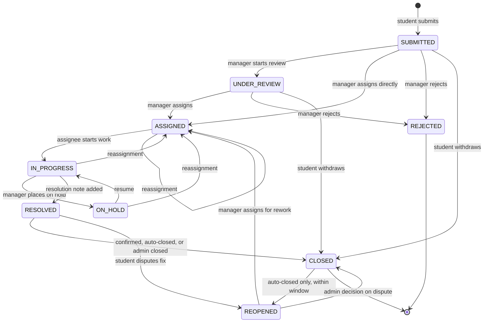
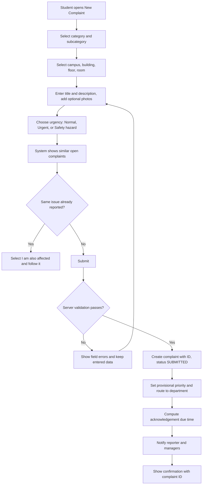
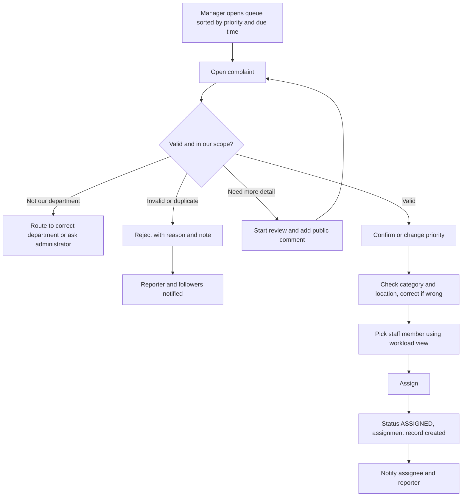
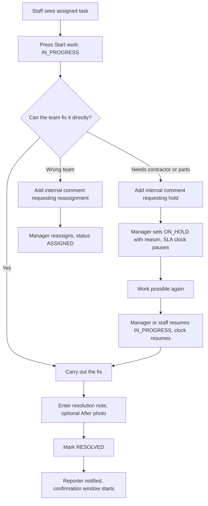
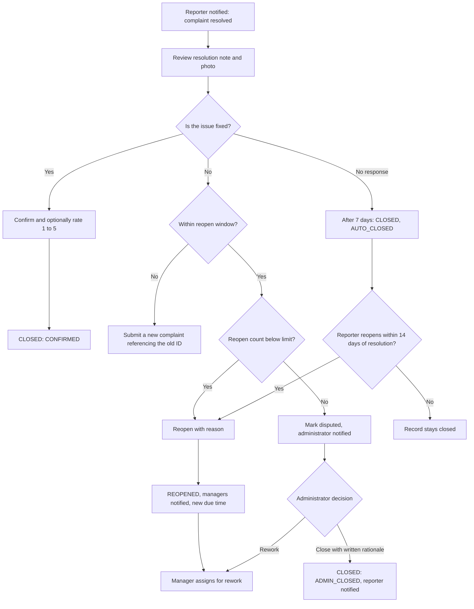
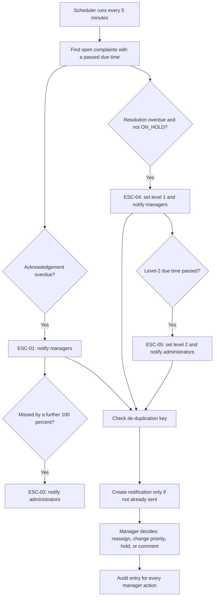
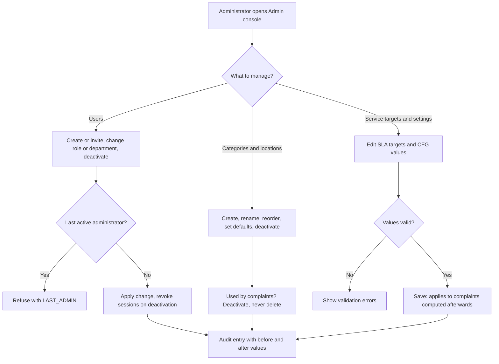
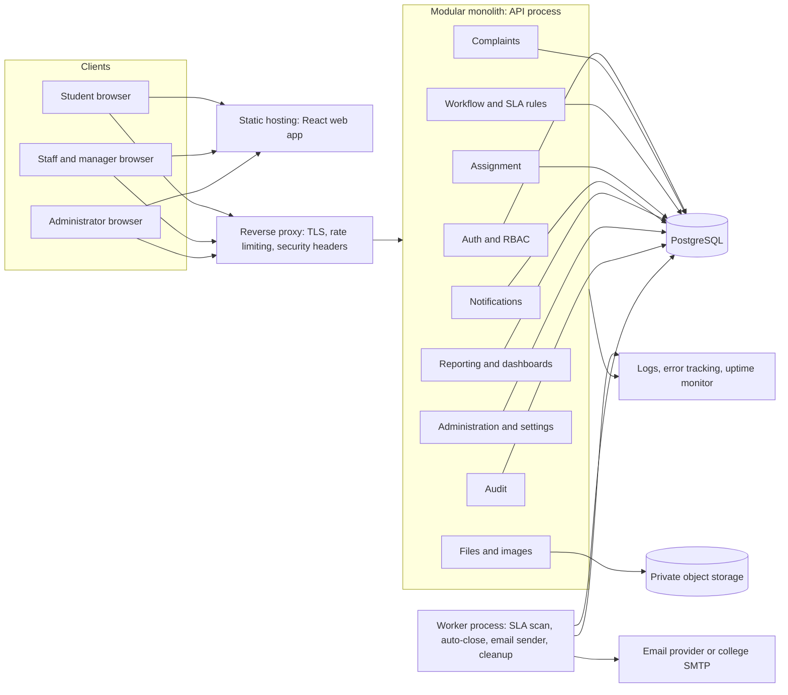
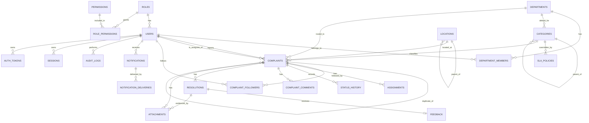

# College Complaint Management System (CCMS)

**Product Requirements Document (PRD) and Technical Planning Document**

| Field | Value |
| --- | --- |
| Document version | 1.0-draft |
| Status | Draft for stakeholder review. No requirement is approved until signed off by college stakeholders. |
| Date | 10 October 2026 |
| Prepared by | Product, architecture and business-analysis working group |
| Audience | Developers, designers, testers, college administrators, facility managers |

### Document conventions

| Tag | Meaning |
| --- | --- |
| \[B\] | Stated in the project brief (the problem statement and requested capabilities). This is NOT the same as stakeholder approval. |
| \[R\] | Recommendation made by the authors, with rationale. Can be changed. |
| \[A\] | Assumption or proposed numeric target. Must be validated with the college or measured in a pilot. |
| \[Q\] | Open question. Needs a decision from college stakeholders (listed in Section 16.5). |

**Priority labels (MoSCoW for MVP):** Must, Should, Could, Won't (for MVP).

**ID prefixes:** G = goal, FR = functional requirement, US = user story, WF = workflow, NFR = non-functional requirement, BR = business rule, SEC = security control, EC = edge case, TC = test case, R = risk, OQ = open question, CFG = configuration parameter.

**Terminology:** *Complaint* = a reported issue. *Reporter* = the student who submitted it. *Resolver team* (stored as Department) = a group such as Housekeeping, Electrical, IT/Network, Carpentry. *Assignee* = the maintenance staff member responsible. *SLA target* = a configurable time target for acknowledging or resolving a complaint (not a legal commitment).

**Consistency note:** Status names, priorities, role names, and configuration parameters defined in Sections 2 and 3 are used unchanged in the workflows, database schema, APIs, and test cases.

### Table of contents

1. Product Overview
2. User Personas and Roles
3. Functional Requirements
4. User Stories and Acceptance Criteria
5. End-to-End User Workflows
6. Non-Functional Requirements
7. Recommended System Architecture
8. Database Design
9. API Specification
10. Security and Abuse Prevention
11. Edge Cases and Business Rules
12. MVP and Future Roadmap
13. Testing Strategy
14. Deployment and Operations
15. Risks, Dependencies, and Success Metrics
16. Final Implementation Plan, Backlog, and Open Questions
17. Appendix A: Architect Review Log (contradictions found and corrected)
18. Appendix B: Final Summary of Recommended Scope

---

## 1. Product Overview

### 1.1 Product name

**College Complaint Management System (CCMS)**. Working short name: *CampusFix*. \[R\]

### 1.2 Product vision

Every cleanliness, infrastructure, and maintenance problem on campus is reported once, routed to a named owner, tracked against a visible target, verified by the person who reported it, and analysed so recurring problems are fixed at the root.

### 1.3 Executive summary

Colleges handle complaints about washrooms, classrooms, fans, lights, furniture, water, and Wi-Fi mostly through verbal reports. There is no record, no owner, no deadline, and no feedback loop. CCMS replaces this with a web application that manages the **full complaint lifecycle**: structured submission with location and photo, review and priority confirmation by a manager, assignment to a resolver team and staff member, status tracking, SLA-based escalation, resolution evidence, student confirmation or reopening, and dashboards for management. The first release is a **modular monolith** with a rules-based workflow. It is deliberately small enough for a student team to build while still demonstrating the entire lifecycle.

### 1.4 Problem statement (from the brief) \[B\]

Complaints are reported verbally, so there is no tracking, accountability, or follow-up. Complaints are delayed, forgotten, or left unresolved. Students cannot see status or expected timelines. Management cannot see recurring issues, cannot prioritise urgent items, cannot measure resolution time, and cannot verify that work was completed. These failures reduce campus cleanliness, infrastructure quality, student satisfaction, and the learning environment.

**Root causes the product must address**

| # | Root cause | Product response |
| --- | --- | --- |
| 1 | No single record of a complaint | Unique complaint ID, structured data, immutable history |
| 2 | No owner | Department and assignee required before work starts; assignment history |
| 3 | No deadline | Configurable SLA targets by category and priority |
| 4 | No visibility for students | Status timeline, notifications, resolution notes |
| 5 | No verification of completion | Student confirmation, reopening, rating |
| 6 | No insight for management | Dashboards, overdue lists, recurring-problem detection |
| 7 | All issues treated equally | Priority model, safety flag, escalation |

### 1.5 Proposed product overview

CCMS is a responsive web application (usable on phones, since most students will report from a phone) with four roles: Student, Maintenance Staff, Facility Manager, and Administrator.

**Lifecycle in one line:** Submit, Review, Assign, Work, Resolve, Student verifies (Confirm or Reopen), Close. Overdue items escalate automatically. Every step is audited.

**Design principles** \[R\]

1. *One complaint, one owner.* No complaint can be in progress without a named assignee.
2. *Rules, not magic.* Routing, priority defaults, and escalation are configurable rules. No AI is required.
3. *Students see what staff see* (except internal notes and other users' private data).
4. *Backend enforces everything.* The UI hides buttons for convenience only; authorization is always checked on the server.
5. *History is never deleted.* Complaints, status changes, and audit entries are retained; configuration items are deactivated, not deleted.
6. *Start small.* Features that do not help demonstrate or improve the core lifecycle are deferred.

### 1.6 Product goals and measurable objectives

All numeric targets are proposals \[A\]. **Baseline values must be collected before any improvement is claimed** (see Section 15.3).

| ID | Goal | Measurable objective (proposed) | Measured by |
| --- | --- | --- | --- |
| G-1 | Prompt acknowledgement | At least 90% of complaints acknowledged within their acknowledgement target | Section 3.11.1 metric M-03 |
| G-2 | Timely resolution | At least 80% of complaints resolved within their resolution target | Metric M-05 |
| G-3 | Transparency | 100% of complaints show current status, owner, and history to the reporter | Functional test, audit |
| G-4 | Accountability | 100% of open complaints past review have a named assignee; 100% of status changes are audited | Database constraint, audit report |
| G-5 | Student satisfaction | Average rating of at least 4.0 out of 5; at least 30% of resolved complaints rated | Metric M-09 |
| G-6 | Quality of fixes | Reopen rate of 10% or less | Metric M-07 |
| G-7 | Backlog reduction | Overdue complaints reduced by a target agreed after baseline measurement (suggested 30% over one term) | Metric M-04 vs baseline |
| G-8 | Adoption | At least 70% of complaints in the pilot area are logged in CCMS rather than verbally (estimate by survey) | Pilot survey \[Q\] |

### 1.7 Target users and stakeholders

| Stakeholder | Interest | System role |
| --- | --- | --- |
| Students | Report problems, see progress, confirm fixes | Student |
| Maintenance, housekeeping, IT/network staff | Receive clear tasks, record work done | Maintenance Staff |
| Department or Facility Managers | Review, prioritise, assign, monitor their teams | Facility Manager |
| College administration (principal, registrar, estate officer) | Oversight, policy, configuration, escalations | Administrator |
| College IT department | Hosting, email domain, single sign-on, security | Dependency, system owner \[Q\] |
| Student council or grievance cell | Possible read-only aggregate reports | Not a role in MVP (Version 2 option) |
| External contractors | Perform specialist repairs | Not system users in MVP; handled via On Hold (BR-14) |

### 1.8 Value proposition

- **Students:** one place to report, a visible status, and a way to say whether the fix actually worked.
- **Staff:** a clear task list with location, photo, and priority instead of verbal instructions.
- **Managers:** a prioritised queue, overdue alerts, and workload visibility.
- **Administration:** evidence-based decisions on recurring faults, staffing, and budget; accountability without manual chasing.

### 1.9 Assumptions and constraints

| ID | Type | Statement |
| --- | --- | --- |
| AS-01 | Assumption \[A\] | The college has an email domain that can be used to verify student and staff identity. |
| AS-02 | Assumption \[A\] | Most students report from a smartphone browser; no native mobile app is needed in MVP. |
| AS-03 | Assumption \[A\] | MVP is piloted on one campus. The data model supports multiple campuses. |
| AS-04 | Assumption \[A\] | All SLA targets, working hours, and windows in this document are defaults to be replaced by the college's own values. |
| AS-05 | Assumption \[A\] | Maintenance staff can access the system from a phone or shared desktop. |
| AS-06 | Assumption \[A\] | The development team is 3 to 5 students with roughly one academic term (4 to 6 months). |
| AS-07 | Assumption \[A\] | MVP user interface language is English. |
| CN-01 | Constraint \[B\] | The solution must be feasible for a student development team and avoid unnecessary complexity. |
| CN-02 | Constraint \[B\] | AI is not a mandatory component. |
| CN-03 | Constraint \[R\] | Hosting cost for MVP should be near zero to low (free tiers or a single small server). |
| CN-04 | Constraint \[R\] | Personal data handling must respect applicable data protection law and college policy (for example, India's Digital Personal Data Protection Act, 2023, to be confirmed with the college's legal advisor). |
| CN-05 | Constraint \[B\] | This document contains no application code. |

### 1.10 Out of scope for MVP

Native mobile apps, anonymous complaints, contractor portal, payment or procurement, inventory/spare-parts management, IoT sensor integration, AI classification, multilingual UI, and integration with the college ERP or student information system (see Section 12).

---

## 2. User Personas and Roles

### 2.1 Role-based access control (RBAC) model \[R\]

- Access is controlled by **permissions** (for example, complaint.assign). Permissions are grouped into **roles**. The four roles below are shipped as system roles.
- Each user has exactly one role in MVP (simplifies authorization and auditing). A person who needs two functions (for example, a small college where the manager is also the administrator) is given the Administrator role, which includes all manager permissions.
- **Scope** limits where a permission applies. Managers and staff are linked to one or more **departments** (resolver teams). Managers can act only on complaints routed to their departments (and, optionally, limited to specific campuses or buildings). Administrators have global scope.
- Every API request is authorised on the server using (role permission) AND (scope) AND (ownership, where relevant) AND (current complaint status).

### 2.2 Role definitions

#### 2.2.1 Student (Persona: Aisha, second-year student, reports from her phone between classes)

**Goals:** report a problem in under two minutes, know who is handling it and when it will be fixed, confirm the fix or reopen if it was not done.

| Aspect | Details |
| --- | --- |
| Can view | Own complaints (all fields except internal notes); public status timeline; assignee's display name and department (not contact details); resolution notes and photos on own complaints; a limited, anonymised list of similar open complaints (title, location, status, no reporter identity) to avoid duplicates; own notifications and profile. |
| Can create or modify | Create complaints; edit own complaint title, description, and attachments only while status is Submitted; add public comments on own complaints; withdraw own complaint while Submitted or Under Review; submit feedback; reopen; mark 'I am also affected' on someone else's open complaint; edit own profile and notification preference. |
| Can perform | Log in/out, submit, track, comment, confirm resolution, rate, reopen (within rules). |
| Restricted | Other students' identities and complaint details; internal notes; staff phone numbers or emails; all dashboards except own summary; assignment, priority confirmation, status changes other than withdraw, confirm, reopen. |

#### 2.2.2 Maintenance Staff (Persona: Ravi, electrician in the Electrical team)

**Goals:** know what to fix, where, and how urgently; record what was done without paperwork.

| Aspect | Details |
| --- | --- |
| Can view | Complaints currently assigned to them; unassigned complaints in their department's queue (read-only, so they can see workload); complaint description, location, photos, confirmed priority, due time; internal and public comments on assigned complaints; own workload and performance summary. |
| Can create or modify | Start work (Assigned to In Progress) on own assignments; add public and internal comments; mark Resolved with mandatory resolution note and optional photo; upload resolution photo; request hold or reassignment through an internal comment (manager decides). |
| Can perform | Log in/out; update own assigned complaints. |
| Restricted | Reporter's name, email, and student ID (hidden by default; configurable, see CFG-14); complaints of other departments; changing priority, category, or assignee; rejecting, closing, or reopening; user and system settings; other staff's performance; audit logs. |

#### 2.2.3 Department or Facility Manager (Persona: Mrs. Rao, estate supervisor)

**Goals:** a prioritised queue, balanced workload, early warning of overdue items, proof of completion.

| Aspect | Details |
| --- | --- |
| Can view | All complaints routed to their departments (scope); reporter identity for those complaints; staff list and workload for their departments; department dashboard and analytics; assignment history and status history of in-scope complaints; internal notes. |
| Can create or modify | Start review; confirm or change priority; change category or location if the reporter's choice was wrong (logged); assign, reassign, and unassign staff within their departments; route a complaint to another department (hand-off, logged); place On Hold and resume; reject with reason; mark duplicates; resolve on behalf of staff (logged); close resolved complaints; review disputes (see BR-12); comment publicly and internally. |
| Can perform | Receive escalation alerts; export in-scope complaint lists (CSV) in Version 2. |
| Restricted | Complaints outside their departments; creating or deactivating users; editing categories, SLA policies, or system settings; audit log viewing beyond complaints in scope (full audit log is Administrator-only); closing a disputed complaint after the maximum reopen count (Administrator decision, BR-12). |

#### 2.2.4 College Administrator (Persona: Dr. Menon, registrar or estate officer)

**Goals:** college-wide visibility, policy configuration, final decisions on disputes and escalations.

| Aspect | Details |
| --- | --- |
| Can view | Everything in the system, including all complaints, all dashboards, and the audit log. |
| Can create or modify | Users (create, invite, deactivate, change role and department); departments; categories and subcategories; locations; SLA policies and escalation settings; system settings (working hours, windows); any complaint action a manager can perform in any department; final decision on disputed complaints and level-2 escalations. |
| Can perform | Configure the system; review audit logs; run reports and exports. |
| Restricted | **Cannot edit or delete audit log entries or status history** (no API or UI exists for this). Cannot view password hashes or reset a password to a chosen value (can only trigger a password-reset email). Cannot delete complaints (only the retention process, under policy, can remove data). |

### 2.3 Permission matrix

Legend: Y = allowed, Own = only own records, Scope = only records in own departments, Asg = only complaints assigned to the user, - = not allowed.

| Permission key | Student | Maintenance Staff | Facility Manager | Administrator |
| --- | --- | --- | --- | --- |
| complaint.create | Y | - | - | - |
| complaint.read | Own | Asg + dept queue (read-only) | Scope | Y |
| complaint.edit\_own\_submitted | Own | - | - | - |
| complaint.withdraw | Own | - | - | - |
| complaint.review (start review) | - | - | Scope | Y |
| complaint.confirm\_priority | - | - | Scope | Y |
| complaint.edit\_classification (category, location) | - | - | Scope | Y |
| complaint.assign / reassign | - | - | Scope | Y |
| complaint.route\_department | - | - | Scope | Y |
| complaint.start\_work | - | Asg | Scope (on behalf) | Y |
| complaint.resolve | - | Asg | Scope | Y |
| complaint.hold / resume | - | - | Scope | Y |
| complaint.reject / mark\_duplicate | - | - | Scope | Y |
| complaint.close | - | - | Scope | Y |
| complaint.reopen | Own (within rules) | - | Scope (any time) | Y |
| complaint.decide\_dispute | - | - | - | Y |
| comment.public | Own complaints | Asg | Scope | Y |
| comment.internal (create and read) | - | Asg | Scope | Y |
| feedback.create | Own | - | - | - |
| followers.add (I am also affected) | Y | - | - | - |
| dashboard.student | Own | - | - | - |
| dashboard.staff | - | Own | - | Y |
| dashboard.manager | - | - | Scope | Y |
| dashboard.admin | - | - | - | Y |
| user.manage | - | - | - | Y |
| department.manage | - | - | - | Y |
| category.manage | - | - | - | Y |
| location.manage | - | - | - | Y |
| sla.manage / settings.manage | - | - | - | Y |
| audit.read | - | - | - | Y |
| profile.edit\_own, notification.read\_own | Y | Y | Y | Y |

### 2.4 Configurability across different college structures \[R\]

Colleges differ: a small college may have one maintenance supervisor, while a university may have separate estates, IT, and hostel offices across several campuses. CCMS therefore avoids hard-coding an organization chart.

| Need | How it is configured (by Administrator) |
| --- | --- |
| Different teams | Create, rename, or deactivate **Departments** (for example Housekeeping, Electrical, Plumbing, Carpentry, IT/Network, Hostel Office). |
| Who handles which issue | Each **Category** has an optional *default department* used for automatic routing at submission. Complaints with no default department go to an **Unrouted queue** visible to Administrators (and to managers designated as triage managers, CFG-13). |
| Manager scope | A manager is linked to one or more departments. Optional narrowing by campus/building is a Version 2 feature \[R\]. |
| Several campuses or buildings | **Locations** are a hierarchy (Campus, Building, Floor, Room/Facility). Administrators add as many levels as needed. |
| Small college with one person doing everything | That person has the Administrator role and, optionally, department membership so they also appear as an assignable staff member. |
| Different resolution targets | SLA policies per category and priority; fallback to global defaults. |
| Different working days and hours | Working calendar setting (CFG-01, CFG-02). |
| Different titles | Role display names can be relabelled (for example, 'Estate Supervisor' shown for Facility Manager) without changing permission keys \[Could\]. |

Changing the permission set of a role (custom roles) is **not** in MVP \[R\]. The four system roles cover the brief; custom roles add risk and test effort. The schema already stores roles and permissions in tables so custom roles can be added later.

---

## 3. Functional Requirements

### 3.1 Configuration parameters (referenced throughout)

All defaults are proposals \[A\] to be replaced by college decisions. All are editable by the Administrator (FR-043, FR-078) and stored in the database, never hard-coded.

| ID | Parameter | Proposed default |
| --- | --- | --- |
| CFG-01 | Working days | Monday to Friday \[Q: some colleges work Saturdays\] |
| CFG-02 | Working hours (local college time) | 09:00 to 17:00 (8 working hours = 480 minutes per working day) |
| CFG-03 | Acknowledgement and resolution targets per priority | See table 3.8.2 |
| CFG-04 | SLA clock type per priority | Critical: continuous (24x7). Others: working hours only |
| CFG-05 | Escalation level 1 trigger (notify manager) | Resolution target reached (100% elapsed) or acknowledgement target missed |
| CFG-06 | Escalation level 2 trigger (notify administrator) | 150% of resolution target elapsed, or acknowledgement missed by a further 100% of the acknowledgement target |
| CFG-07 | Pre-breach warning to assignee | 80% of resolution target elapsed \[Should\] |
| CFG-08 | Student confirmation window (auto-close) | 7 calendar days after Resolved |
| CFG-09 | Reopen window | 14 calendar days after resolved\_at |
| CFG-10 | Maximum student-initiated reopenings per complaint | 2 |
| CFG-11 | Reopen SLA factor (resolution target for a reopened complaint = factor x normal target) | 0.5 |
| CFG-12 | Submission rate limit per student | 10 complaints per rolling 24 hours; 3 per hour |
| CFG-13 | Triage managers for the Unrouted queue | One or more managers designated by the Administrator; default: Administrators only |
| CFG-14 | Staff can see reporter identity | Off (staff see only a reporter reference, not name or contact) |
| CFG-15 | Attachment limits | Up to 3 photos per complaint and 3 per resolution; 5 MB each; JPEG, PNG, WebP |
| CFG-16 | Emergency contact text shown on safety flag | Set by college (for example, security desk number) \[Q\] |
| CFG-17 | Notification de-duplication window | 10 minutes for identical event type and complaint |
| CFG-18 | Similar-complaint match rule | Same location (room or facility) AND same category, status not Closed or Rejected, last 30 days |
| CFG-19 | Recurring-problem threshold | 3 or more distinct complaints, same location and category, in a rolling 30 days |
| CFG-20 | Data retention for complaint records | 5 years then anonymise or archive per college policy \[Q\] |
| CFG-21 | Session limits | Idle timeout 8 hours; absolute lifetime 7 days |
| CFG-22 | Holiday dates excluded from working time (BR-21) \[Should\] | Empty list; the college supplies dates each term |

### 3.2 Requirement conventions

Tables list: **ID**, **Requirement** (testable), **Pri** (MoSCoW for MVP), **Tag** (\[B\] from the brief, \[R\] recommendation). User stories in Section 4 map to these IDs.

### 3.3 A. Authentication and user management

| ID | Requirement | Pri | Tag |
| --- | --- | --- | --- |
| FR-001 | Users log in with a verified college email address and password. Passwords are stored only as salted hashes (Argon2id or bcrypt). | Must | B |
| FR-002 | Student self-registration is allowed only for email addresses on an Administrator-maintained domain allow-list. The account stays inactive until the email is verified through a single-use link valid for 24 hours. Staff, manager, and administrator accounts are created or invited by an Administrator; self-registration never grants a role above Student. | Must | B, R |
| FR-003 | Logout invalidates the server-side session immediately. | Must | B |
| FR-004 | Password reset by emailed single-use link valid for 30 minutes. The response is identical whether or not the email exists. | Must | R |
| FR-005 | After 5 consecutive failed logins for an account, the account is locked for 15 minutes and the login attempt is rate limited by IP. A lockout notice is emailed to the account owner. | Must | R |
| FR-006 | The server enforces role permissions (Section 2.3) and scope on every request. | Must | B |
| FR-007 | Administrators can create or invite users, assign or change role and department membership, deactivate and reactivate users. Deactivation revokes all sessions. Users are never hard-deleted while they own history. | Must | B |
| FR-008 | Users can edit own display name, optional phone number, notification preference, and change password (current password required). Email and role cannot be self-edited. | Must | B |
| FR-009 | Administrators can bulk-import users from CSV with validation report. | Should | R |
| FR-010 | Institution single sign-on (OIDC with the college's Google Workspace or Microsoft tenant). | Won't (MVP, Version 2) | R |

### 3.4 B. Complaint submission

| ID | Requirement | Pri | Tag |
| --- | --- | --- | --- |
| FR-011 | A student can submit a complaint with: title, description, category, subcategory (if the category has any), location, optional photos, and reported urgency. | Must | B |
| FR-012 | Server-side validation: title 5 to 120 characters; description 10 to 2000 characters; category, subcategory, and location must be active and valid; location must be at Room/Facility level or, where no room applies, Building level plus a free-text location detail. Errors list each invalid field. | Must | B |
| FR-013 | Location is chosen from the configured hierarchy (Campus, Building, Floor, Room/Facility) through cascading selectors. An optional free-text location detail (up to 200 characters, for example 'second cubicle, near window') is allowed. | Must | B |
| FR-014 | Photo attachments (0 to 3, per CFG-15) are validated by size, file signature, and type, re-encoded, and stored privately (SEC-07). A complaint can be submitted without a photo. | Must | B |
| FR-015 | On submission the server generates the complaint ID (format CCMS-YYYY-NNNNNN, unique, never reused) and records the submission timestamp in UTC (displayed in college local time). | Must | B |
| FR-016 | Reported urgency has three values: Normal, Urgent, and Safety hazard. Selecting Safety hazard shows the college emergency contact text (CFG-16) and a statement that CCMS is not an emergency service. | Must | R |
| FR-017 | Auto-routing: if the category or subcategory has a default department, the complaint is routed to it on submission; otherwise it enters the Unrouted queue (CFG-13). | Must | R |
| FR-018 | Before final submit, the system shows up to 5 similar open complaints (CFG-18) in anonymised form (title, location, status). The student can select 'I am also affected' to follow that complaint instead of creating a new one, or continue to submit. | Should | R |
| FR-019 | Idempotent submission: the client sends a unique request key; a repeated request with the same key returns the original complaint and never creates a second one. | Must | R |
| FR-020 | On a network failure the web client keeps the form text in the browser until submission succeeds (photos may need re-selecting). | Should | R |
| FR-021 | After submission the student sees a confirmation with the complaint ID and receives an in-app notification. | Must | B |
| FR-022 | While status is Submitted, the reporter can edit title, description, location detail, and attachments; edits are audited. After that, additional information goes through public comments. | Should | R |
| FR-023 | Submission rate limiting per CFG-12; exceeding it returns a clear message with the retry time. | Must | R |

### 3.5 C. Complaint categories and locations

| ID | Requirement | Pri | Tag |
| --- | --- | --- | --- |
| FR-024 | The system is seeded with the categories in table 3.5.1. | Must | B |
| FR-025 | Administrators can create, rename, reorder, and deactivate categories and subcategories. Deactivated categories remain on historical complaints but cannot be selected for new ones. Categories are never deleted once used. | Must | B |
| FR-026 | Each category or subcategory can define: default department, default priority, and a 'safety related' flag. A subcategory with no value inherits from its parent. | Must | R |
| FR-027 | Administrators can create, rename, move, and deactivate locations in the hierarchy. | Must | R |

#### 3.5.1 Seed categories (examples; all editable) \[A\]

| Category | Example subcategories | Default department | Default priority | Safety related |
| --- | --- | --- | --- | --- |
| Cleanliness | Classroom, Corridor or common area, Dustbins and waste, Pest or hygiene | Housekeeping | Medium | No |
| Washrooms | Unclean, Leakage or flush, Door or lock, Missing supplies | Housekeeping (Plumbing for leakage or flush) | Medium | No |
| Water supply | No water, Drinking water, Leakage | Plumbing | High (Medium for leakage) | No |
| Electricity, fans and lights | Fan, Light, Socket or power outage, Exposed wiring or sparking | Electrical | Medium (Critical for exposed wiring) | Yes for exposed wiring |
| Furniture and classroom infrastructure | Desk or bench, Board or projector, Door or window, Ceiling or wall damage | Carpentry and Civil | Low (High for ceiling or wall damage) | Yes for ceiling or wall damage |
| Internet and Wi-Fi | No connectivity, Slow connection, Lab network | IT and Network | Medium | No |
| Other maintenance issues | (none) | None (Unrouted queue) | Low | No |

### 3.6 D. Complaint tracking and lifecycle

| ID | Requirement | Pri | Tag |
| --- | --- | --- | --- |
| FR-028 | Every complaint has exactly one status from: SUBMITTED, UNDER\_REVIEW, ASSIGNED, IN\_PROGRESS, ON\_HOLD, RESOLVED, REOPENED, CLOSED, REJECTED. Display labels: Submitted, Under Review, Assigned, In Progress, On Hold, Resolved, Reopened, Closed, Rejected. | Must | B, R |
| FR-029 | Status changes occur only through the transitions in table 3.6.2, validated on the server for actor role, scope, current status, and required inputs. Any other change is refused with HTTP 409 INVALID\_TRANSITION. | Must | B |
| FR-030 | Each transition writes a status-history row (from, to, actor, timestamp, comment) and an audit entry. | Must | B |
| FR-031 | Reporters see a status timeline with timestamps, public comments, current assignee's display name and department, priority, and the resolution target date. Internal notes are never shown. | Must | B |
| FR-032 | A reporter can withdraw a complaint in SUBMITTED or UNDER\_REVIEW (Closed with close reason WITHDRAWN). | Should | R |
| FR-033 | ON\_HOLD can be set only by a manager or administrator, requires a reason code (AWAITING\_PARTS, EXTERNAL\_CONTRACTOR, AWAITING\_ACCESS, OTHER) and a note, and may carry an expected date. | Must | R |

#### 3.6.1 Lifecycle state diagram



#### 3.6.2 Allowed transitions

| ID | From | To | Who may perform | Conditions and required input | System effects |
| --- | --- | --- | --- | --- | --- |
| TR-01 | (none) | SUBMITTED | Student | Valid form (FR-012); rate limit not exceeded | Create ID; set provisional priority (BR-04); route department; compute acknowledgement due time; notify reporter and in-scope managers (or triage managers) |
| TR-02 | SUBMITTED | UNDER\_REVIEW | Manager (scope), Administrator | None | Set first\_response\_at if empty; notify reporter |
| TR-03 | SUBMITTED or UNDER\_REVIEW | ASSIGNED | Manager (scope), Administrator | Department set; assignee is an active staff member of that department; priority confirmed in the same request or earlier | Set first\_response\_at if empty; confirm priority and compute resolution due time; create assignment record; notify assignee and reporter |
| TR-04 | ASSIGNED, IN\_PROGRESS, or ON\_HOLD | ASSIGNED | Manager (scope), Administrator | New assignee different from current; reason required; if the department changes, the new department must be active and the actor must have scope over it (or be an Administrator) | Close current assignment; open new one; SLA clock continues (not reset); notify old assignee, new assignee, reporter |
| TR-05 | ASSIGNED | IN\_PROGRESS | Assignee; Manager or Administrator on behalf (logged) | Actor is current assignee or has scope | Set started\_at if empty |
| TR-06 | IN\_PROGRESS | ON\_HOLD | Manager (scope), Administrator | Reason code and note (FR-033) | Pause SLA clock (BR-14); notify reporter and assignee |
| TR-07 | ON\_HOLD | IN\_PROGRESS | Assignee, Manager (scope), Administrator | None | Resume SLA clock; extend due time by the paused duration |
| TR-08 | IN\_PROGRESS | RESOLVED | Assignee, Manager (scope), Administrator | Resolution note of at least 20 characters; optional photos | Create resolution record (cycle number); set resolved\_at; start confirmation window (CFG-08); notify reporter |
| TR-09 | RESOLVED | CLOSED | Reporter (confirms); System (auto-close after CFG-08); Manager or Administrator (with note) | Close reason CONFIRMED, AUTO\_CLOSED, or ADMIN\_CLOSED | Set closed\_at and close\_reason; notify reporter (unless reporter acted) |
| TR-10 | RESOLVED or CLOSED | REOPENED | Reporter; Manager (scope) or Administrator at any time with a note | Reporter: reason of at least 10 characters; now within CFG-09 of resolved\_at; for CLOSED only if close reason is AUTO\_CLOSED; reopen count below CFG-10, otherwise the dispute rule (BR-12) applies | Increase reopen count; new resolution due time = now + factor (CFG-11) x target; notify managers |
| TR-11 | REOPENED | ASSIGNED | Manager (scope), Administrator | Same as TR-03 (the same assignee may be chosen) | Create new assignment record |
| TR-12 | SUBMITTED or UNDER\_REVIEW | REJECTED | Manager (scope), Administrator | Reason code (DUPLICATE, NOT\_A\_COLLEGE\_ISSUE, INSUFFICIENT\_INFORMATION, ALREADY\_RESOLVED, OTHER) and a note shown to the reporter; DUPLICATE requires the parent complaint ID | Set first\_response\_at if empty; link followers to the parent when DUPLICATE; notify reporter |
| TR-13 | SUBMITTED or UNDER\_REVIEW | CLOSED | Reporter | Withdrawal (close reason WITHDRAWN) | Notify assigned manager |
| TR-14 | REOPENED (disputed) | CLOSED | Administrator only | Written rationale visible to the reporter (BR-12) | Close reason ADMIN\_CLOSED |

All other combinations are invalid. REJECTED is terminal; CLOSED is terminal except as defined in TR-10.

### 3.7 E. Assignment and accountability

| ID | Requirement | Pri | Tag |
| --- | --- | --- | --- |
| FR-034 | A manager or administrator can assign a complaint to a department and to one active staff member of that department (TR-03). A complaint cannot be ASSIGNED or IN\_PROGRESS without both. | Must | B |
| FR-035 | Every assignment creates an assignment record: complaint, department, assignee, assigned by, assigned at, unassigned at, reason. Exactly one assignment per complaint is current at any time. Records are never edited or deleted. | Must | B |
| FR-036 | Authorised users can reassign (TR-04). A reason is mandatory. The previous assignee is notified and loses edit access immediately. | Must | B |
| FR-037 | A manager can change the department of a complaint that is SUBMITTED, UNDER\_REVIEW, or REOPENED (hand-off before assignment). The new department's managers are notified, any current assignee is cleared, and the change is audited. For a complaint that is already assigned, the department is changed through reassignment (TR-04) by a user with scope over the target department, or by an Administrator. | Should | R |
| FR-038 | The responsible person (assignee) and department are always visible to managers, administrators, and the assigned staff member; reporters see the assignee's display name and department only. | Must | B |
| FR-039 | Complaints without a department appear in an Unrouted queue visible to triage managers and administrators (CFG-13). | Must | R |
| FR-040 | When choosing an assignee, the manager sees each candidate's number of open assigned complaints and overdue count. | Should | R |
| FR-041 | When a staff member is deactivated or marked absent, the system lists their open complaints for the manager and offers bulk reassignment. Nothing is auto-reassigned without a manager action. | Should | R |

### 3.8 F. Priority and escalation

| ID | Requirement | Pri | Tag |
| --- | --- | --- | --- |
| FR-042 | Priorities are Low, Medium, High, and Critical, defined in table 3.8.1. | Must | B |
| FR-043 | Administrators can edit SLA policies (acknowledgement and resolution targets, clock type) per priority, with optional overrides per category. A policy change is audited and applies only to complaints whose due times are computed after the change. | Must | B |
| FR-044 | Provisional priority is set automatically by the rule in BR-04 and shown to managers as 'Provisional'. Reported urgency (Normal, Urgent, Safety hazard) is stored separately and is never overwritten. | Must | B |
| FR-045 | A manager or administrator confirms or changes priority before or at assignment. The confirming user and time are recorded, and a reason is required when the priority is lowered from Critical or High. | Must | B |
| FR-046 | The system stores acknowledgement due time, resolution due time, and level-2 escalation due time on each complaint, computed by the SLA clock (BR-04). The clock pauses in ON\_HOLD (BR-14). | Must | B |
| FR-047 | A background job runs at least every 5 minutes, finds complaints past a due time, and raises escalations idempotently (no duplicate escalation for the same level). | Must | B |
| FR-048 | Escalation levels follow table 3.8.3. Escalation never changes the assignee automatically; it notifies and marks the complaint, and the manager decides. | Must | B, R |
| FR-049 | Safety handling: a complaint with reported urgency Safety hazard (or a safety-related subcategory) becomes provisionally Critical, is pinned at the top of manager queues, and immediately notifies all in-scope managers, triage managers, and administrators by in-app and email notification. A manager who judges it not to be a hazard may lower the priority with a mandatory note. The reporter is not penalised. | Must | R |
| FR-050 | Pre-breach warning to the assignee at CFG-07. | Should | R |

#### 3.8.1 Priority definitions \[A\]

| Priority | Meaning | Examples |
| --- | --- | --- |
| Critical | Risk of injury or serious damage, or loss of an essential service for many people | Exposed or sparking wiring, ceiling or wall at risk of falling, flooding, fire hazard |
| High | Major disruption to classes or essential services | No drinking water, blocked washroom, network down in a lab, ceiling or wall damage with no immediate risk |
| Medium | Single-item defect or partial disruption | Broken fan, unclean washroom, flickering light, slow Wi-Fi in one room |
| Low | Minor, cosmetic, or no disruption | Scratched desk, faded board marker holder, general suggestions |

#### 3.8.2 Default SLA targets \[A: replace with college values\]

| Priority | Clock (CFG-04) | Acknowledgement target | Resolution target |
| --- | --- | --- | --- |
| Critical | Continuous | 30 minutes | 24 hours |
| High | Working hours | 4 working hours | 3 working days |
| Medium | Working hours | 1 working day | 5 working days |
| Low | Working hours | 2 working days | 10 working days |

*Acknowledgement* means the first manager or administrator action on the complaint: start review, assign, reject, or add a public comment (this sets first\_response\_at). *Resolution* means the complaint reaches RESOLVED.

#### 3.8.3 Escalation rules

| ID | Trigger | Recipient | Channel | Repetition |
| --- | --- | --- | --- | --- |
| ESC-01 | Acknowledgement due time passed and first\_response\_at is empty | In-scope managers (or triage managers if Unrouted) | In-app and email | Once |
| ESC-02 | Acknowledgement missed by a further 100% of the acknowledgement target | Administrators | In-app and email | Once |
| ESC-03 | 80% of resolution target elapsed (CFG-07) | Assignee | In-app | Once \[Should\] |
| ESC-04 | Resolution due time passed; status not RESOLVED, CLOSED, REJECTED, or ON\_HOLD. Sets escalation\_level to 1 | Department managers | In-app and email | Once, then a reminder each working day while overdue |
| ESC-05 | Level-2 due time passed (150% of target, CFG-06). Sets escalation\_level to 2 | Administrators | In-app and email | Once |
| ESC-06 | ON\_HOLD expected date passed (if set) | Department managers | In-app | Once per day |

### 3.9 G. Notifications

| ID | Requirement | Pri | Tag |
| --- | --- | --- | --- |
| FR-051 | An in-app notification centre shows a bell with unread count, a list, and mark-as-read. In-app notifications are always created first. The web client refreshes the unread count at most every 30 seconds (polling in MVP). | Must | B |
| FR-052 | Notification events and recipients follow table 3.9.1; the email channel applies only where email is enabled (FR-053). | Must | B |
| FR-053 | Email notifications are optional per user (default on for Student and Maintenance Staff, on for managers). A user's switch never disables escalation and safety alerts for managers and administrators. | Should | B |
| FR-054 | De-duplication: an identical event type for the same complaint and user within CFG-17 produces one notification (enforced by a unique de-duplication key). Public-comment notifications are batched to at most one per complaint per recipient per 10 minutes. | Must | B |
| FR-055 | Email delivery runs in the background with 3 retries (after 1, 5, and 30 minutes). After the final failure the delivery is marked FAILED; the in-app notification is unaffected, and failures are visible on the administrator dashboard. | Should | R |
| FR-056 | Emails contain only the complaint ID, title, new status, and a login link. They never contain the description, photos, reporter details, or internal notes. | Must | R |
| FR-057 | Followers ('I am also affected') are notified only when the complaint is Resolved, Closed, or Rejected. | Should | R |

#### 3.9.1 Notification events

| ID | Event | Recipients | Channels |
| --- | --- | --- | --- |
| N-01 | Complaint submitted | Reporter; in-scope managers (triage managers if Unrouted) | In-app (email for managers only if Critical) |
| N-02 | Moved to Under Review | Reporter | In-app |
| N-03 | Assigned | Assignee; reporter | In-app and email (assignee); in-app (reporter) |
| N-04 | Reassigned | Previous assignee; new assignee; reporter | In-app; email for the new assignee |
| N-05 | Work started | Reporter | In-app |
| N-06 | Put on hold | Reporter; assignee | In-app and email (reporter) |
| N-07 | Resolved (confirmation requested) | Reporter | In-app and email |
| N-08 | Reminder: awaiting confirmation (day 5 of window) | Reporter | In-app and email, once |
| N-09 | Closed by auto-close or administrator | Reporter | In-app |
| N-10 | Reopened | In-scope managers; assignee | In-app and email (managers) |
| N-11 | Rejected (with reason) | Reporter | In-app and email |
| N-12 | Public comment added | Other party (reporter or assignee or manager) | In-app (batched) |
| N-13 | Escalations ESC-01 to ESC-06 | As in table 3.8.3 | As in table 3.8.3 |
| N-14 | Dispute raised (BR-12) | Administrators | In-app and email |
| N-15 | Safety complaint submitted | In-scope managers, triage managers, administrators | In-app and email |

### 3.10 H. Resolution and feedback

| ID | Requirement | Pri | Tag |
| --- | --- | --- | --- |
| FR-058 | To resolve, the assignee (or a manager) enters a resolution note of at least 20 characters describing the action taken (TR-08). | Must | B |
| FR-059 | Optional resolution photos (up to 3, same validation as FR-014), labelled 'After' to the reporter. | Should | B |
| FR-060 | The reporter can confirm the fix (TR-09, close reason CONFIRMED) and may rate satisfaction from 1 to 5 with an optional comment of up to 500 characters. Confirmation does not require a rating. | Must | B |
| FR-061 | The reporter can say the issue is not fixed and reopen (TR-10) with a reason, within CFG-09 and subject to BR-10. | Must | B |
| FR-062 | If the reporter does not respond within CFG-08, the system auto-closes with close reason AUTO\_CLOSED (TR-09). The reporter can still reopen within CFG-09. | Must | R |
| FR-063 | Disputes: when the reporter's reopen count has reached CFG-10, a further reopen request marks the complaint as disputed and routes the decision to an Administrator (BR-12). | Must | B |
| FR-064 | Public comments (visible to the reporter) and internal comments (staff, managers, administrators only) are supported on every complaint. Comments cannot be edited after 5 minutes and are never deleted; moderation hides content and records an audit entry. | Should | R |
| FR-065 | Feedback ratings are visible to managers (scope) and administrators, never to other students. Staff see only their own aggregate rating and individual ratings without reporter identity. | Should | R |

### 3.11 I. Dashboards and analytics

| ID | Requirement | Pri | Tag |
| --- | --- | --- | --- |
| FR-066 | **Student dashboard:** counts of own complaints by status; list with status and due date; an 'Action needed' section for complaints awaiting confirmation. | Must | B |
| FR-067 | **Maintenance staff dashboard:** assigned complaints sorted by due time and priority; due today; overdue; recently resolved; own average resolution time (M-06) and own satisfaction rating. | Must | B |
| FR-068 | **Manager dashboard:** queue by status; unacknowledged complaints; overdue complaints with escalation level; staff workload (M-10); metrics M-01 to M-12 limited to the manager's departments; breakdown by category and location; recurring problems (M-11); complaints flagged 'Assignee inactive' (BR-13). | Must | B |
| FR-069 | **Administrator dashboard:** the same metrics college-wide with a department comparison; Unrouted queue; level-2 escalations; disputes; reported-versus-confirmed priority mismatch (M-13); long holds over 14 days (BR-14); complaints whose assignee is inactive (BR-13); notification failures. | Must | B |
| FR-070 | Every metric uses the definitions in table 3.11.1, has a date-range selector (default last 30 days), and shows its definition on hover or in a help text. | Must | B |
| FR-071 | Recurring problems are detected by rule (CFG-19), with no AI. | Should | B |
| FR-072 | Export of the filtered complaint list and metrics as CSV for managers and administrators. | Won't (MVP, Version 2) | R |

#### 3.11.1 Metric definitions

'Period' = the selected date range. 'SLA time' = elapsed time on the complaint's SLA clock (CFG-04) excluding ON\_HOLD periods. Rejected and withdrawn complaints are excluded from time-based metrics unless stated.

| ID | Metric | Calculation | Access |
| --- | --- | --- | --- |
| M-01 | Total complaints | Count of complaints with submitted\_at in the period | Manager (scope), Administrator |
| M-02 | Pending complaints | Count of complaints currently in SUBMITTED, UNDER\_REVIEW, ASSIGNED, IN\_PROGRESS, ON\_HOLD, or REOPENED | Student (own), Staff (assigned), Manager (scope), Administrator |
| M-03 | First-response time and acknowledgement compliance | Time = first\_response\_at minus submitted\_at (SLA time; mean, median, 90th percentile). Compliance = percentage of complaints submitted in the period with first\_response\_at on or before ack\_due\_at | Manager (scope), Administrator |
| M-04 | Overdue complaints | Open complaints (not RESOLVED, CLOSED, REJECTED, ON\_HOLD) where now is later than resolve\_due\_at; also 'acknowledgement overdue' where first\_response\_at is empty and now is later than ack\_due\_at | Staff (own), Manager (scope), Administrator |
| M-05 | Resolution compliance | Of complaints first resolved in the period, the percentage with first resolved\_at on or before resolve\_due\_at as it stood at confirmation | Staff (own), Manager (scope), Administrator |
| M-06 | Average resolution time | Mean, median, and 90th percentile of (first resolved\_at minus submitted\_at) in SLA time for complaints first resolved in the period | Staff (own), Manager (scope), Administrator |
| M-07 | Reopened complaint rate | Number of reopen events in the period divided by number of resolution events in the period | Manager (scope), Administrator |
| M-08 | Resolution rate | Of complaints submitted in the period (excluding rejected and withdrawn), the percentage in RESOLVED or CLOSED at the time of the report | Manager (scope), Administrator |
| M-09 | Satisfaction | Mean rating of feedback created in the period; response rate = feedback count divided by resolution events | Staff (own, anonymised), Manager (scope), Administrator |
| M-10 | Staff workload | Per staff member: open assigned complaints by status, overdue count, mean age of open complaints, and resolved count in the period | Staff (own), Manager (scope), Administrator |
| M-11 | Recurring problems | Location (room, facility, or building when no room) and category pairs with at least CFG-19 distinct complaints in a rolling 30 days; duplicates rejected as DUPLICATE count once | Manager (scope), Administrator |
| M-12 | Escalations | Number of complaints with escalation\_level 1 or 2 in the period, by department | Manager (scope), Administrator |
| M-13 | Priority mismatch | Percentage of complaints where confirmed priority differs from the priority implied by reported urgency (reporting only; no penalty in MVP) | Administrator |

### 3.12 J. Search and filtering

| ID | Requirement | Pri | Tag |
| --- | --- | --- | --- |
| FR-073 | Search by complaint ID (exact, case-insensitive; the numeric part alone is accepted) and by keywords in title, description, and public comments using database full-text search. Results are always limited to what the user is authorised to see. | Must | B |
| FR-074 | Filters: status (multiple), category and subcategory, priority, location (a parent location includes its descendants), department, assignee, submitted date range, resolved date range, overdue only, escalation level, reported urgency, disputed only. Students can filter their own list by status and date only. | Must | B |
| FR-075 | Sorting by submitted date, last update, resolution due time, and priority (Critical first). Default sort: students by last update; staff and managers by priority then due time. Pagination with a default page size of 20 and maximum 100, using a stable tie-break on complaint ID; responses include total count. | Must | B |

### 3.13 K. Audit trail

| ID | Requirement | Pri | Tag |
| --- | --- | --- | --- |
| FR-076 | The system records an audit entry (actor ID and role, action, entity type and ID, before and after values, timestamp in UTC, IP address, request ID) for: all complaint status changes; assignments, reassignments, priority confirmations, classification edits, and hand-offs; reporter edits and withdrawals; comment moderation; user creation, role, department, and activation changes; category, location, SLA, and setting changes; failed and successful logins; and data exports. | Must | B |
| FR-077 | Audit and status-history tables are append-only: the application's database account has no UPDATE or DELETE privilege on them, and no API or UI exists to alter them. Administrators have a read-only audit viewer with filters (actor, action, entity, date). Managers see only the status and assignment history of complaints in scope. | Must | B |

### 3.14 System administration settings

| ID | Requirement | Pri | Tag |
| --- | --- | --- | --- |
| FR-078 | Administrators can view and edit the parameters in section 3.1 with validation (for example, non-negative numbers, valid time ranges). Each change is audited with before and after values. | Must | R |

---

## 4. User Stories and Acceptance Criteria

Format: *As a \[role\], I want \[action\], so that \[benefit\].* Acceptance criteria (AC) use Given-When-Then. Error cases are expected API outcomes (see Section 9 for codes). Each story lists the functional requirements it covers.

### 4.1 Authentication and accounts

**US-01 Register and verify an account** (FR-002)

- *Story:* As a student, I want to register with my college email, so that I can submit complaints under my own identity.
- *Preconditions:* The email domain is on the allow-list; the email is not already registered.
- *Expected behaviour:* The system creates an inactive Student account and sends a verification link valid for 24 hours; opening the link activates the account.
- *AC1:* Given a valid college email and a strong password, When I register, Then I see 'check your email' and cannot log in until verified.
- *AC2:* Given a verification link older than 24 hours, When I open it, Then it is refused and I can request a new one.
- *AC3:* Given any registration, Then the created role is always Student.
- *Errors:* Email domain not allowed (422 VALIDATION\_ERROR); email already registered (409 CONFLICT, response does not reveal whether the account is verified); weak password (422).

**US-02 Log in, log out, and lockout** (FR-001, FR-003, FR-005)

- *Story:* As any user, I want to log in and out securely, so that only I can act as me.
- *Preconditions:* Account is active and verified.
- *Expected behaviour:* Successful login creates a server-side session in an HttpOnly cookie; logout revokes it.
- *AC1:* Given correct credentials, When I log in, Then I land on the dashboard for my role.
- *AC2:* Given 5 consecutive wrong passwords, When I try a sixth time within 15 minutes, Then I am refused with 429 ACCOUNT\_LOCKED and an email is sent to the owner.
- *AC3:* Given I log out, When I reuse the old session cookie, Then I receive 401.
- *Errors:* Wrong credentials (401, generic message that does not say which field was wrong); deactivated account (403 ACCOUNT\_DISABLED).

**US-03 Reset a forgotten password** (FR-004)

- *Story:* As a user, I want to reset my password by email, so that I can regain access.
- *AC1:* Given any email address entered, Then the response is the same message whether or not an account exists.
- *AC2:* Given a valid reset link, When I set a new password, Then the link cannot be reused and all my sessions are revoked.
- *Errors:* Expired or used token (410 TOKEN\_EXPIRED).

### 4.2 Complaint submission and tracking (student)

**US-04 Submit a complaint** (FR-011 to FR-017, FR-019, FR-021)

- *Story:* As a student, I want to report a campus problem with its location, so that the right team can find and fix it.
- *Preconditions:* Logged in as Student; active categories and locations exist.
- *Expected behaviour:* The system validates, creates the complaint with status SUBMITTED, generates the ID, sets provisional priority, routes it, and notifies.
- *AC1:* Given all required fields valid, When I submit, Then I see the complaint ID in the format CCMS-YYYY-NNNNNN and the status Submitted.
- *AC2:* Given a category with a default department, When I submit, Then the complaint's department equals that default.
- *AC3:* Given the same request key sent twice (for example, a double tap), Then only one complaint exists and both responses return it.
- *AC4:* Given no photo, Then submission still succeeds.
- *Errors:* Missing or invalid fields (422 with per-field details); inactive category or location (422); rate limit exceeded (429 RATE\_LIMITED with retry time); server error during save (500, nothing created).

**US-05 Attach photos** (FR-014)

- *Story:* As a student, I want to attach photos, so that staff can see the problem.
- *AC1:* Given a JPEG of 3 MB, When I upload, Then it is accepted and shown as a thumbnail.
- *AC2:* Given a file renamed to .jpg whose content is not an image, When I upload, Then it is rejected.
- *AC3:* Given a 4th photo, Then it is rejected (limit 3).
- *Errors:* 413 FILE\_TOO\_LARGE; 415 UNSUPPORTED\_MEDIA\_TYPE; 422 TOO\_MANY\_ATTACHMENTS.

**US-06 Avoid duplicate reports** (FR-018, FR-057)

- *Story:* As a student, I want to see if my issue is already reported, so that I do not create duplicates and can still follow progress.
- *AC1:* Given an open complaint in the same room and category within 30 days, When I reach the submit step, Then it is listed without any reporter identity.
- *AC2:* Given I click 'I am also affected', Then I become a follower and receive Resolved, Closed, or Rejected notifications for it.
- *Errors:* Following a Closed or Rejected complaint (409 INVALID\_STATE).

**US-07 Report a safety hazard** (FR-016, FR-049)

- *Story:* As a student, I want to flag a safety hazard, so that dangerous problems are handled urgently.
- *AC1:* Given I choose Safety hazard, Then I see the emergency contact text and the statement that CCMS is not an emergency service.
- *AC2:* Given a submitted safety complaint, Then its provisional priority is Critical and managers and administrators are notified immediately by in-app and email notifications.
- *AC3:* Given a manager lowers it, Then a note is required and the reporter is not penalised.

**US-08 Track my complaint** (FR-031, FR-066)

- *Story:* As a student, I want to see status, owner, and expected date, so that I know what is happening.
- *AC1:* Given my complaint, When I open it, Then I see a timeline of status changes with timestamps, the assignee display name, the department, the priority, and the resolution due date.
- *AC2:* Given another student's complaint ID, When I request it, Then I receive 404 (existence is not revealed).
- *AC3:* Internal notes are never returned to my account.

**US-09 Edit or withdraw a complaint** (FR-022, FR-032)

- *Story:* As a student, I want to correct or withdraw my complaint, so that the record is accurate.
- *AC1:* Given status SUBMITTED, When I change the description, Then it is saved and audited.
- *AC2:* Given status ASSIGNED, When I try to edit, Then I receive 409 INVALID\_STATE and can add a public comment instead.
- *AC3:* Given status UNDER\_REVIEW, When I withdraw, Then status becomes CLOSED with reason WITHDRAWN and the manager is notified.

### 4.3 Review, assignment, and escalation (manager)

**US-10 Review and confirm priority** (FR-044, FR-045, TR-02)

- *Story:* As a facility manager, I want to review new complaints and confirm priority, so that urgent issues are handled first.
- *Preconditions:* Complaint is in my department scope and SUBMITTED.
- *AC1:* Given a new complaint, When I start review, Then status becomes UNDER\_REVIEW and first\_response\_at is set.
- *AC2:* Given a provisional Medium priority, When I confirm High, Then the resolution due time is recalculated and priority\_confirmed\_by and time are saved.
- *AC3:* Given a Critical complaint, When I lower it without a reason, Then the request is refused with 422.
- *Errors:* Complaint outside my scope (404); invalid transition (409 INVALID\_TRANSITION).

**US-11 Assign a complaint** (FR-034, FR-035, TR-03)

- *Story:* As a facility manager, I want to assign a complaint to a staff member, so that someone is accountable.
- *AC1:* Given priority is confirmed and I choose an active staff member of the department, When I assign, Then status is ASSIGNED, an assignment record exists, and the assignee and reporter are notified.
- *AC2:* Given I choose staff from another department, Then it is refused with 422.
- *AC3:* Given two managers assign at the same moment, Then exactly one succeeds and the other receives 409 CONFLICT.

**US-12 Reject or mark duplicate** (TR-12, BR-11, BR-15)

- *Story:* As a facility manager, I want to reject invalid or duplicate complaints with a reason, so that the reporter understands the outcome.
- *AC1:* Given reason DUPLICATE and a parent complaint ID, When I reject, Then the reporter and any followers are linked to the parent and notified.
- *AC2:* Given no note, Then the request is refused with 422.

**US-13 Reassign and handle staff absence** (FR-036, FR-041, BR-13)

- *Story:* As a facility manager, I want to reassign work, so that complaints are not stuck when a person is absent.
- *AC1:* Given an assigned complaint, When I reassign with a reason, Then the previous assignment is closed, a new one is opened, and the due time is unchanged.
- *AC2:* Given a staff account is deactivated, Then I see their open complaints listed for bulk reassignment.

**US-14 Put a complaint on hold** (FR-033, BR-14)

- *Story:* As a facility manager, I want to place a complaint on hold with a reason, so that waiting for a contractor or parts is visible and fair.
- *AC1:* Given IN\_PROGRESS, When I set ON\_HOLD with reason EXTERNAL\_CONTRACTOR and a note, Then the SLA clock pauses and the reporter sees the reason and expected date.
- *AC2:* Given I resume, Then the due times move later by the paused duration.

**US-15 Receive and act on escalations** (FR-047, FR-048)

- *Story:* As a facility manager, I want to be alerted when complaints are overdue, so that I can intervene.
- *AC1:* Given a High complaint passes its resolution due time while IN\_PROGRESS, Then within 10 minutes I receive one in-app and email alert and the complaint shows escalation level 1.
- *AC2:* Given the scheduler runs repeatedly, Then I do not receive a second alert for the same level on the same day.
- *AC3:* Given a complaint is ON\_HOLD, Then no resolution escalation is raised.

### 4.4 Resolution (staff and student)

**US-16 See my tasks and start work** (FR-067, TR-05)

- *Story:* As maintenance staff, I want a clear list of assigned tasks, so that I know what to do first.
- *AC1:* Given assigned complaints, When I open my dashboard, Then they are sorted by priority then due time with location and photos visible and reporter identity hidden (CFG-14).
- *AC2:* Given a complaint assigned to someone else, When I request it, Then I receive 403 or 404 per BR-20.
- *AC3:* Given ASSIGNED, When I press Start work, Then status becomes IN\_PROGRESS.

**US-17 Resolve with notes and photo** (FR-058, FR-059, TR-08)

- *Story:* As maintenance staff, I want to record what I did, so that the student and manager can verify.
- *AC1:* Given IN\_PROGRESS and a note of at least 20 characters, When I mark Resolved, Then a resolution record is created and the reporter is notified.
- *AC2:* Given a note shorter than 20 characters, Then the request is refused with 422.
- *AC3:* Given the complaint was reassigned, When the former assignee tries to resolve, Then 403.

**US-18 Confirm and rate** (FR-060)

- *Story:* As a student, I want to confirm the fix and rate it, so that management knows if service was good.
- *AC1:* Given RESOLVED, When I confirm with a rating of 4, Then status becomes CLOSED (CONFIRMED) and the rating is stored once.
- *AC2:* Given a second submission of feedback for the same resolution, Then 409 CONFLICT.

**US-19 Reopen an unresolved complaint** (FR-061, TR-10, BR-10)

- *Story:* As a student, I want to reopen a complaint that was not truly fixed, so that the issue is addressed.
- *AC1:* Given RESOLVED within 14 days and reopen count 0, When I reopen with a reason of at least 10 characters, Then status becomes REOPENED, reopen count is 1, and managers are notified.
- *AC2:* Given AUTO\_CLOSED within 14 days of resolution, Then I can reopen; given CONFIRMED, Then I cannot (409) and may file a new complaint.
- *AC3:* Given the window has passed, Then 409 REOPEN\_WINDOW\_EXPIRED.

**US-20 Decide a disputed complaint** (FR-063, BR-12, TR-14)

- *Story:* As an administrator, I want to decide disputes, so that repeated disagreements end in a documented outcome.
- *AC1:* Given reopen count has reached 2 and the student requests again, Then the complaint is flagged disputed and I am notified.
- *AC2:* Given I choose rework, Then the complaint is assigned for rework; given I choose to close, Then a written rationale is required and shown to the student.
- *AC3:* Managers cannot close a disputed complaint (403).

### 4.5 Administration, reporting, and audit

**US-21 Manage users** (FR-007)

- *Story:* As an administrator, I want to create, change, and deactivate accounts, so that access matches responsibilities.
- *AC1:* Given I deactivate a user, Then their sessions are revoked immediately and their history is retained.
- *AC2:* Given I change a user's role, Then the change takes effect on their next request and is audited.
- *Errors:* Deactivating the last active Administrator (409 LAST\_ADMIN).

**US-22 Configure categories and locations** (FR-025 to FR-027)

- *Story:* As an administrator, I want to configure categories and locations, so that the system fits our campus.
- *AC1:* Given a category used by complaints, When I delete it, Then it is deactivated instead and old complaints still display it.
- *AC2:* Given a deactivated category, Then it no longer appears in the submission form.

**US-23 Configure service targets** (FR-043, FR-078)

- *Story:* As an administrator, I want to set acknowledgement and resolution targets, so that escalation reflects college policy.
- *AC1:* Given I change the High resolution target, Then complaints confirmed afterwards use it and existing due times are unchanged.
- *AC2:* Given invalid values (zero or negative), Then 422.

**US-24 View dashboards** (FR-066 to FR-070)

- *Story:* As a manager or administrator, I want dashboards with defined metrics, so that I can manage performance.
- *AC1:* Given a manager, Then metrics include only complaints in their departments.
- *AC2:* Given known test data, Then each metric equals its definition in table 3.11.1 (see TC-D01).
- *AC3:* Given a student requests manager dashboard data, Then 403.

**US-25 Search and filter** (FR-073 to FR-075)

- *Story:* As a manager, I want to search and filter complaints, so that I can find items quickly.
- *AC1:* Given I enter CCMS-2026-000123 or 123, Then that complaint appears if in my scope.
- *AC2:* Given filters status=IN\_PROGRESS and priority=High, Then only matching complaints are returned, 20 per page by default, with a total count.
- *AC3:* Given a page size above 100, Then 422.

**US-26 Receive useful notifications** (FR-051 to FR-057)

- *Story:* As a user, I want timely notifications without duplicates, so that I stay informed without noise.
- *AC1:* Given a complaint is assigned, Then the assignee receives exactly one in-app and one email notification.
- *AC2:* Given three identical events within 10 minutes, Then one notification is stored.
- *AC3:* Given an email provider failure, Then the in-app notification still exists and the email is retried 3 times then marked FAILED.

**US-27 Review the audit trail** (FR-076, FR-077)

- *Story:* As an administrator, I want a tamper-resistant record of actions, so that I can establish who did what and when.
- *AC1:* Given any status change, Then an audit entry with actor, time, and before and after values exists.
- *AC2:* Given any attempt through the API to update or delete an audit entry, Then no such endpoint exists (404 or 405), and a direct database update using the application account is denied.

---

## 5. End-to-End User Workflows

Each workflow has a flowchart (Mermaid) and a step table naming the actor, rules, and requirement references.

### WF-01 Student submits a complaint



| Step | Actor | Rule or requirement |
| --- | --- | --- |
| Select category and location | Student | FR-013, FR-024 |
| Similar complaint check | System | FR-018, CFG-18 |
| Validation | System | FR-012; photos FR-014 |
| Creation | System | FR-015, TR-01; idempotency key FR-019 |
| Provisional priority and routing | System | BR-04, FR-017 |
| Safety flag | System | FR-049 immediate alert |
| Network failure before response | Client | FR-019, FR-020: retry with the same key; no duplicate |

### WF-02 Manager reviews and assigns



| Step | Actor | Rule or requirement |
| --- | --- | --- |
| Queue ordering | System | Critical first, then due time; safety pinned (FR-049, FR-075) |
| Start review | Manager | TR-02 sets first\_response\_at |
| Confirm priority | Manager | FR-045, BR-04; reason when lowering Critical or High |
| Reject | Manager | TR-12, BR-15 |
| Assign | Manager | TR-03, BR-05 (assignee must be an active member of the department) |

### WF-03 Maintenance staff resolves a complaint



| Step | Actor | Rule or requirement |
| --- | --- | --- |
| Start work | Assignee | TR-05 |
| Hold request | Assignee, then manager | FR-033, BR-14: only managers set ON\_HOLD |
| Resolve | Assignee | TR-08, FR-058: note of at least 20 characters |
| Notification and window | System | N-07, CFG-08 |

### WF-04 Student reviews the resolution and may reopen



| Step | Actor | Rule or requirement |
| --- | --- | --- |
| Confirm and rate | Reporter | FR-060, TR-09 |
| Reopen | Reporter | FR-061, TR-10, BR-10 |
| Dispute | System and Administrator | FR-063, BR-12, TR-14 |
| Auto-close | System | FR-062, CFG-08 |

### WF-05 Overdue complaint escalation



| Step | Actor | Rule or requirement |
| --- | --- | --- |
| Detection | Background job | FR-047; compares stored due timestamps, so it is cheap and idempotent |
| Alert | System | Table 3.8.3 |
| Resolution of the alert | Manager | FR-048: no automatic reassignment |
| Job failure | Operations | NFR-AV-04: failed runs are logged and alerted; the next run catches up |

### WF-06 Administrator manages users, categories, and service targets



| Step | Actor | Rule or requirement |
| --- | --- | --- |
| User changes | Administrator | FR-007, BR-17 (deactivate, never delete) |
| Category and location changes | Administrator | FR-025 to FR-027 |
| Target and setting changes | Administrator | FR-043, FR-078; not retroactive |
| Auditing | System | FR-076 |

---

## 6. Non-Functional Requirements

**Important:** every numeric target below is a **proposed assumption \[A\] to be validated** in load tests, a pilot, or by the college. None is a performance guarantee. Sizing assumption for targets: up to 5,000 students and 200 staff, up to 500 new complaints per day at the busiest period, up to 100 concurrent users, and about 50,000 complaints over five years.

### 6.1 Performance and response times

| ID | Requirement (measured at the server, normal load of 100 concurrent users) | Target \[A\] |
| --- | --- | --- |
| NFR-PERF-01 | Read API requests (complaint detail, lists of 20) | p95 under 500 ms |
| NFR-PERF-02 | Complaint submission without photos | p95 under 1 s |
| NFR-PERF-03 | Photo upload of 3 MB including processing | p95 under 6 s on a 4G connection |
| NFR-PERF-04 | Search by keyword or ID over 50,000 complaints | p95 under 1 s |
| NFR-PERF-05 | Manager or administrator dashboard load over a 30-day period | p95 under 2 s |
| NFR-PERF-06 | Initial page load on a mid-range phone over 4G | Interactive within 3 s; initial compressed JavaScript under 300 KB |
| NFR-PERF-07 | In-app notification appears for the recipient | Within 60 s of the event |
| NFR-PERF-08 | Email notification handed to the provider | Within 5 minutes of the event |
| NFR-PERF-09 | SLA scan job run time | Under 60 s per run at 50,000 complaints |

### 6.2 Scalability

| ID | Requirement | Target \[A\] |
| --- | --- | --- |
| NFR-SC-01 | The API is stateless (sessions in the database), so additional instances can be added behind a load balancer. | Verified by running 2 instances in staging |
| NFR-SC-02 | All list endpoints are paginated; no unbounded queries. | 100% of list endpoints |
| NFR-SC-03 | Database indexes support the filters in FR-074 (Section 8.4). | Query plans reviewed; no sequential scan on complaints for standard filters at 50,000 rows |
| NFR-SC-04 | Capacity headroom | Tested at 3x expected peak (300 concurrent users) without error rate above 1% |
| NFR-SC-05 | Image storage grows with usage, using object storage with lifecycle rules. | Photos re-encoded to at most 1600 px and about 300 KB on average |

### 6.3 Availability and reliability

| ID | Requirement | Target \[A\] |
| --- | --- | --- |
| NFR-AV-01 | Monthly availability during campus hours (07:00 to 21:00 local time, Monday to Saturday) | 99.0% (about 4 hours of downtime allowed per month in that window) |
| NFR-AV-02 | Planned maintenance | Outside 08:00 to 20:00 on working days, announced 24 hours ahead |
| NFR-AV-03 | Graceful degradation: if email delivery or file storage fails, complaint submission and status changes still work (photos can be retried). | Verified by fault-injection test |
| NFR-AV-04 | Background job failures are logged and alert the operator; the next run processes everything missed. | Alert within 15 minutes of two consecutive failures |
| NFR-AV-05 | Data integrity: status change, history row, audit entry, and outbox notification are committed in one database transaction (all or nothing). | Verified by integration test |
| NFR-AV-06 | Concurrency: simultaneous conflicting updates are detected through a version check and returned as 409. | Verified by concurrent test |

### 6.4 Security (summary; controls in Section 10)

| ID | Requirement | Target \[A\] |
| --- | --- | --- |
| NFR-SEC-01 | All traffic uses TLS 1.2 or higher; HSTS enabled. | Grade A on an SSL test |
| NFR-SEC-02 | Security baseline | OWASP ASVS Level 1 for all features and Level 2 for authentication, session, and access control |
| NFR-SEC-03 | No known critical or high severity vulnerabilities in dependencies at release | 0 open; scan on every build |
| NFR-SEC-04 | Authorization tests cover every endpoint for every role | 100% of endpoints in the permission test matrix |
| NFR-SEC-05 | Password policy | Minimum 10 characters, checked against a common-password list, no forced composition rules |

### 6.5 Privacy and data protection

| ID | Requirement | Target \[A\] |
| --- | --- | --- |
| NFR-PRV-01 | Data minimisation: collect only name, college email, role, optional phone, and optional enrolment number. | Reviewed in design sign-off |
| NFR-PRV-02 | Photo metadata (EXIF, including GPS) is stripped on upload. | 100% of stored images |
| NFR-PRV-03 | Reporter identity is hidden from maintenance staff by default (CFG-14) and from other students. | Verified by role tests |
| NFR-PRV-04 | A privacy notice is shown at registration, stating what is collected, why, who can see it, and how long it is kept. | Content approved by the college \[Q\] |
| NFR-PRV-05 | Retention per CFG-20; a documented procedure exists for correcting or exporting a user's data on request and for anonymising users who leave. | Procedure documented before launch |
| NFR-PRV-06 | No third-party analytics or trackers that receive personal data. | Verified by network inspection |
| NFR-PRV-07 | Data hosting location follows college and legal requirements. | \[Q\] decided before launch |

### 6.6 Accessibility

| ID | Requirement | Target \[A\] |
| --- | --- | --- |
| NFR-ACC-01 | Conformance to WCAG 2.2 Level AA for core flows (login, submit, track, assign, resolve, confirm) | Automated scan with no serious issues, plus manual check |
| NFR-ACC-02 | Full keyboard operation; visible focus; logical tab order | Manual test |
| NFR-ACC-03 | Text contrast at least 4.5:1; status is never conveyed by colour alone (text label or icon as well) | Design review |
| NFR-ACC-04 | Form fields have labels and error messages linked to fields; error summary on submit failure | Manual and screen reader test (NVDA, TalkBack) |
| NFR-ACC-05 | Touch targets at least 44 by 44 px on mobile | Design review |

### 6.7 Usability and responsive design

| ID | Requirement | Target \[A\] |
| --- | --- | --- |
| NFR-USE-01 | Mobile-first responsive layout from 360 px width upward | Tested on 3 phone sizes and 1 tablet |
| NFR-USE-02 | A first-time student can submit a complaint within 2 minutes | At least 90% of 10 test participants in the usability test |
| NFR-USE-03 | Supported browsers: latest two versions of Chrome, Edge, Firefox, and Safari (including Android Chrome and iOS Safari) | Cross-browser test |
| NFR-USE-04 | Clear empty, loading, and error states on every screen | Design checklist |
| NFR-USE-05 | Photos are resized in the browser before upload to reduce data use. | Should |
| NFR-USE-06 | Time shown in the college's local time zone; stored in UTC | Verified |

### 6.8 Maintainability

| ID | Requirement | Target \[A\] |
| --- | --- | --- |
| NFR-MNT-01 | Modular code with enforced module boundaries (Section 7.4) | Lint rule or dependency check in CI |
| NFR-MNT-02 | Automated tests for domain logic | At least 70% line coverage on workflow, SLA, and permission logic; 100% of transitions in table 3.6.2 covered |
| NFR-MNT-03 | API documented with an OpenAPI specification generated from code | Published for every release |
| NFR-MNT-04 | Database changes only through versioned migrations | No manual schema changes in production |
| NFR-MNT-05 | Developer documentation: README, setup in under 30 minutes, architecture decision records for major choices | Reviewed by a new team member |
| NFR-MNT-06 | Configuration only through environment variables and the settings table | No secrets or college values in code |

### 6.9 Backup and recovery

| ID | Requirement | Target \[A\] |
| --- | --- | --- |
| NFR-BKP-01 | Automated encrypted database backup every day; retain 14 daily and 8 weekly copies | Verified weekly |
| NFR-BKP-02 | Recovery point objective (maximum data loss) | 24 hours for MVP; 15 minutes in Version 2 with point-in-time recovery |
| NFR-BKP-03 | Recovery time objective | 4 hours |
| NFR-BKP-04 | Photos protected by object-storage versioning or a daily copy | Verified |
| NFR-BKP-05 | A restore drill into a clean environment | At least once before launch and then once per term |

### 6.10 Logging and monitoring

| ID | Requirement | Target \[A\] |
| --- | --- | --- |
| NFR-LOG-01 | Structured JSON application logs with a request ID on every line; no passwords, tokens, session IDs, or complaint text in logs | Verified by log review |
| NFR-LOG-02 | Error tracking with alerting for unhandled exceptions | Alert within 5 minutes |
| NFR-LOG-03 | Uptime check every 1 to 5 minutes on a health endpoint that tests the database | Alert after 3 failures |
| NFR-LOG-04 | Operational alerts: error rate above 2% for 5 minutes, job failures, disk or database storage above 80%, email failure rate above 20% | Configured before launch |
| NFR-LOG-05 | Application log retention 90 days; audit log retention per CFG-20 | Configured |

---

## 7. Recommended System Architecture

### 7.1 Architecture drivers

The system must be secure and auditable, affordable to host, buildable by a small student team in about one term, and easy to extend. Traffic is low (hundreds of users, not millions), data is strongly relational with strict workflow rules, and consistency matters more than raw throughput. These drivers favour a **simple, well-structured, single deployable application on a relational database**.

### 7.2 Recommended technology stack \[R\]

The stack is a recommendation. If the team's strongest skill is a different mainstream stack (for example Django and PostgreSQL), choosing the stack the team knows best outweighs any item below, provided the architecture rules in this section are kept.

| Component | Recommendation | Why | Trade-offs and alternatives |
| --- | --- | --- | --- |
| Frontend | React with TypeScript (Vite build), responsive and mobile-first, accessible component library | Rich forms, reusable components, large ecosystem, mobile-friendly | A single-page app needs a clean API and careful accessibility work. Server-rendered pages (Django templates) are simpler for teams with little JavaScript experience. SEO and server-side rendering are not needed because all pages need login. |
| Backend | Node.js with NestJS (TypeScript), modular monolith | One language across frontend and backend; enforces modules, validation, and guards | Learning curve for dependency injection. Django with Django REST Framework is an equally valid choice with built-in admin, ORM, and migrations. |
| API | REST over HTTPS with JSON, versioned at /api/v1, OpenAPI documentation | Simple, well understood, easy to test | GraphQL adds complexity without a clear need. WebSockets or server-sent events are deferred to Version 2; polling every 30 s is enough. |
| Database | PostgreSQL | Transactions, constraints, partial unique indexes, full-text search, JSONB for audit values, mature tooling | A single database is a single point of failure; mitigated by managed hosting and backups. |
| Authentication | Server-side sessions stored in PostgreSQL, HttpOnly Secure cookie, CSRF token on state-changing requests, Argon2id password hashing | Immediate revocation (logout, deactivation); no token storage in browser JavaScript | Requires a session lookup per request (cheap). JWT is better for third-party or mobile clients and is not needed in MVP. OIDC single sign-on is added in Version 2. |
| Authorization | Permission guard on every route plus scope and ownership checks in the service layer | Defence in depth: both route-level and data-level | Slightly more code than route-only checks; this is required for security. |
| File storage | S3-compatible private object storage; local disk behind the same interface in development | Cheap, durable, scalable | Adds an external service. Storing images in the database is simpler but bloats backups. |
| Image handling | Server-side re-encoding (for example the libvips-based sharp library): validate, strip metadata, resize, create 320 px thumbnails | Re-encoding removes most malicious payloads and EXIF data | CPU use during upload; acceptable at this scale. |
| Notification service | Internal module using the outbox pattern: notification rows plus delivery rows written in the same transaction as the event; worker sends email through a provider interface (college SMTP or a transactional email provider) | No lost or duplicate notifications; provider can be swapped | Emails are slightly delayed (seconds to minutes). |
| Background jobs | Postgres-backed queue (for example pg-boss) in a separate worker process from the same codebase | No Redis to run; transactional with the database | Lower throughput than Redis-based queues; ample for this scale. BullMQ with Redis is the alternative. |
| Logging and monitoring | Structured logs to stdout, collected by the hosting platform; error tracking service; uptime monitor | Low cost, quick to set up | Free tiers have limits; verify retention. |
| Audit | Append-only audit\_logs table written in the same transaction as the change | Atomic and queryable | Database privileges must be configured correctly (Section 10). A hash chain for tamper evidence is a Version 2 option. |

### 7.3 System architecture diagram



### 7.4 Modular monolith versus microservices

| Criterion | Modular monolith | Microservices |
| --- | --- | --- |
| Team size and skills | Suits 3 to 5 developers | Needs several teams and DevOps skills |
| Deployment and cost | One API process, one worker, one database; low cost | Many services, networking, orchestration; high cost |
| Transactions | Status change, history, audit, and notification outbox are one database transaction | Needs distributed transactions or sagas; high risk of inconsistency |
| Testing and debugging | Simple end-to-end tests; one log stream | Complex integration and tracing |
| Scaling | Scale the whole app horizontally; sufficient for hundreds of users | Independent scaling, not needed here |
| Evolution | Modules can later be extracted if justified | Already split; costly to merge |

**Recommendation:** start with a **modular monolith** with two processes (API and worker) sharing one codebase. There is no justification for microservices in Version 1: no independent scaling need, no multiple teams, and strong transactional consistency needs.

**Module rules \[R\]:** each module owns its tables; other modules call its public service interface and never read its tables directly; modules communicate through in-process interfaces and domain events (for example ComplaintStatusChanged triggers notifications and audit); dependencies between modules are checked in CI. **Revisit this decision if** the notification or reporting load needs independent scaling, or the organisation adopts several development teams.

### 7.5 Component responsibilities

| Component | Responsibility |
| --- | --- |
| Web app | Role-based screens, form validation for usability (never for security), session handling through cookies, in-app notification polling |
| Reverse proxy | TLS termination, request size limits, rate limiting, security headers |
| Auth and RBAC module | Registration, login, sessions, password reset, lockout, permission guard, scope resolution |
| Complaints module | Complaint CRUD rules, comments, followers, duplicate links, search |
| Workflow and SLA module | Transition table, transition validation, priority rules, SLA clock and due-time calculation, escalation decisions |
| Assignment module | Assignment records, department membership, workload counts |
| Files module | Upload validation, re-encoding, storage, signed access links, quarantine on failure |
| Notification module | Event-to-notification rules, de-duplication, in-app feed, email outbox and retries |
| Reporting module | Metric queries per table 3.11.1, scope filtering |
| Administration module | Users, departments, categories, locations, SLA policies, settings |
| Audit module | Append-only audit writes and read-only viewer |
| Worker | Scheduled jobs: SLA scan every 5 minutes, auto-close, awaiting-confirmation reminder, email sender, token and session cleanup |
| PostgreSQL | System of record |
| Object storage | Photo storage, private, accessed only through authorised links |

### 7.6 Main data flows

1. **Submit complaint.** Browser sends form and request key to the API. The API validates, checks permission and rate limit, inserts the complaint, status history (null to SUBMITTED), audit entry, notification outbox rows, and due times in one transaction, and returns the ID. Photos are then uploaded one by one to a separate endpoint (the complaint exists first, so a failed upload never loses the complaint); the Files module validates, re-encodes, stores to object storage, and links the attachment.
2. **Status change or assignment.** The API loads the complaint with its version, validates the transition (table 3.6.2: actor, scope, status, inputs), applies changes, and writes history, assignment, audit, and outbox rows in one transaction. A version conflict returns 409.
3. **Escalation.** The worker queries open complaints whose due timestamps have passed, writes escalation level and notifications with de-duplication keys, and records audit entries.
4. **Email.** The worker reads pending delivery rows, sends through the provider, and updates each row (SENT, retry, FAILED).
5. **Photo download.** The API checks the user's permission on the complaint, then returns a short-lived signed URL (5 minutes) or streams the file. Object storage is never public.
6. **Dashboards.** The Reporting module runs scope-filtered aggregate queries; results for periods over 30 days may be cached for up to 5 minutes.

### 7.7 Cross-cutting design decisions \[R\]

- **Time:** all timestamps stored in UTC; SLA calculation uses the configured working calendar and the college time zone.
- **Concurrency:** each complaint has a version number; updates must supply the expected version.
- **Idempotency:** complaint creation uses a client request key unique per reporter.
- **Error format:** one JSON error structure across the API (Section 9.2).
- **Soft deletion:** configuration records are deactivated; complaints are never deleted through the application (Section 8.6).

---

## 8. Database Design

### 8.1 Conventions \[R\]

- PostgreSQL. Names in snake\_case, tables in plural. Primary keys are UUIDs (gen\_random\_uuid) unless noted; audit and history tables use identity bigint for ordering.
- All timestamps are timestamptz stored in UTC. Text enumerations are stored as text with a CHECK constraint (easier to migrate than native enum types). Email uses a case-insensitive type (citext).
- Every foreign key is ON DELETE RESTRICT unless stated in section 8.6. Column notes: **NN** = NOT NULL; **U** = unique; **FK** = foreign key.
- Enumerations: status = SUBMITTED, UNDER\_REVIEW, ASSIGNED, IN\_PROGRESS, ON\_HOLD, RESOLVED, REOPENED, CLOSED, REJECTED. priority = LOW, MEDIUM, HIGH, CRITICAL. reported\_urgency = NORMAL, URGENT, SAFETY. These are identical to Sections 2 and 3.

### 8.2 Entity-relationship diagram



### 8.3 Table definitions

#### roles, permissions, role\_permissions (reference data, seeded by migration)

| Table | Columns | Constraints |
| --- | --- | --- |
| roles | id smallint PK; key text NN U (STUDENT, MAINTENANCE\_STAFF, FACILITY\_MANAGER, ADMINISTRATOR); display\_name text NN | Four system rows |
| permissions | id smallint PK; key text NN U (for example complaint.assign); description text | Keys as in section 2.3 |
| role\_permissions | role\_id smallint FK roles NN; permission\_id smallint FK permissions NN | PK (role\_id, permission\_id) |

#### users

| Column | Type | Null | Notes |
| --- | --- | --- | --- |
| id | uuid | NN | PK |
| email | citext | NN | U; must match an active allowed domain |
| password\_hash | text | NN | Argon2id hash only |
| full\_name | varchar(100) | NN | Display name |
| role\_id | smallint | NN | FK roles |
| status | text | NN | CHECK in (PENDING\_VERIFICATION, ACTIVE, DEACTIVATED); default PENDING\_VERIFICATION |
| student\_ref | varchar(50) |  | Optional enrolment number; unique where not null |
| phone | varchar(20) |  | Optional |
| email\_notifications\_enabled | boolean | NN | Default true |
| email\_verified\_at | timestamptz |  |  |
| failed\_login\_count | smallint | NN | Default 0; reset on success |
| locked\_until | timestamptz |  | Lockout end |
| last\_login\_at | timestamptz |  |  |
| created\_at, updated\_at | timestamptz | NN |  |
| deactivated\_at | timestamptz |  |  |
| deactivated\_by | uuid |  | FK users |

#### departments, department\_members, allowed\_email\_domains

| Table | Columns | Constraints |
| --- | --- | --- |
| departments | id uuid PK; name varchar(100) NN U; description text; is\_active boolean NN default true; created\_at, updated\_at timestamptz NN | Deactivate, never delete |
| department\_members | user\_id uuid FK users NN; department\_id uuid FK departments NN; added\_at timestamptz NN; added\_by uuid FK users | PK (user\_id, department\_id). Application rule: members have role MAINTENANCE\_STAFF, FACILITY\_MANAGER, or ADMINISTRATOR |
| allowed\_email\_domains | domain text PK; is\_active boolean NN default true | Domain stored lowercase |

#### locations

| Column | Type | Null | Notes |
| --- | --- | --- | --- |
| id | uuid | NN | PK |
| parent\_id | uuid |  | FK locations; null for Campus |
| type | text | NN | CHECK in (CAMPUS, BUILDING, FLOOR, ROOM, FACILITY) |
| name | varchar(100) | NN | Unique within the same parent (unique index on parent\_id coalesced, name) |
| code | varchar(30) |  | Optional short code |
| is\_active | boolean | NN | Default true |
| created\_at, updated\_at | timestamptz | NN |  |

#### categories and sla\_policies

| Table | Columns | Constraints |
| --- | --- | --- |
| categories | id uuid PK; parent\_id uuid FK categories (null for top level); name varchar(100) NN; default\_department\_id uuid FK departments; default\_priority text (LOW to CRITICAL); is\_safety\_related boolean NN default false; sort\_order int NN default 0; is\_active boolean NN default true; created\_at, updated\_at | Depth at most 2 (checked in application and by trigger); unique (parent\_id coalesced, name). A null default on a subcategory inherits from its parent at read time |
| sla\_policies | id uuid PK; category\_id uuid FK categories (null means global default); priority text NN; ack\_minutes int NN; resolve\_minutes int NN; use\_business\_hours boolean NN; is\_active boolean NN default true; updated\_by uuid FK users; created\_at, updated\_at | CHECK ack\_minutes > 0 and resolve\_minutes >= ack\_minutes; unique (coalesce(category\_id, zero uuid), priority) among active rows |
| system\_settings | key text PK; value jsonb NN; description text; updated\_by uuid FK users; updated\_at timestamptz NN | Holds the CFG-nn values, validated by the application |

#### complaints (current state of each complaint)

| Column | Type | Null | Notes |
| --- | --- | --- | --- |
| id | uuid | NN | PK |
| public\_ref | varchar(20) | NN | U; format CCMS-YYYY-NNNNNN from a database sequence; never reused |
| reporter\_id | uuid | NN | FK users; immutable |
| title | varchar(120) | NN | CHECK length 5 or more |
| description | text | NN | CHECK length between 10 and 2000 |
| category\_id | uuid | NN | FK categories (the most specific category selected) |
| location\_id | uuid | NN | FK locations |
| location\_detail | varchar(200) |  | Free text |
| reported\_urgency | text | NN | NORMAL, URGENT, SAFETY; default NORMAL; never overwritten |
| priority | text | NN | LOW to CRITICAL; provisional until priority\_confirmed\_at is set |
| priority\_confirmed\_by | uuid |  | FK users |
| priority\_confirmed\_at | timestamptz |  | Null means provisional |
| status | text | NN | The nine statuses |
| department\_id | uuid |  | FK departments; null means Unrouted |
| assignee\_id | uuid |  | FK users |
| parent\_complaint\_id | uuid |  | FK complaints; set when rejected as DUPLICATE; CHECK parent\_complaint\_id <> id |
| close\_reason | text |  | CONFIRMED, AUTO\_CLOSED, ADMIN\_CLOSED, WITHDRAWN |
| rejection\_reason | text |  | DUPLICATE, NOT\_A\_COLLEGE\_ISSUE, INSUFFICIENT\_INFORMATION, ALREADY\_RESOLVED, OTHER |
| hold\_reason | text |  | AWAITING\_PARTS, EXTERNAL\_CONTRACTOR, AWAITING\_ACCESS, OTHER; set only when ON\_HOLD |
| hold\_expected\_date | date |  | Optional |
| is\_disputed | boolean | NN | Default false (BR-12) |
| reopen\_count | smallint | NN | Default 0; student and manager reopenings both counted |
| escalation\_level | smallint | NN | 0, 1, or 2 |
| submitted\_at | timestamptz | NN | Server time |
| first\_response\_at | timestamptz |  | Set once (BR-04) |
| started\_at | timestamptz |  | First IN\_PROGRESS |
| first\_resolved\_at | timestamptz |  | Set once; used by M-05 and M-06 |
| resolved\_at | timestamptz |  | Latest resolution time |
| closed\_at | timestamptz |  |  |
| ack\_due\_at | timestamptz | NN | Fixed at submission |
| resolve\_due\_at | timestamptz | NN | Recomputed at priority confirmation, hold resume, and reopening |
| level2\_due\_at | timestamptz | NN | Moves with resolve\_due\_at |
| sla\_paused\_at | timestamptz |  | Set while ON\_HOLD |
| client\_request\_id | uuid | NN | Idempotency key; unique per reporter |
| version | int | NN | Optimistic lock; default 1 |
| created\_at, updated\_at | timestamptz | NN |  |

**Table constraints:** UNIQUE (reporter\_id, client\_request\_id). CHECK that status in (ASSIGNED, IN\_PROGRESS, ON\_HOLD) implies department\_id and assignee\_id are not null. CHECK that status = CLOSED implies close\_reason is not null, status = REJECTED implies rejection\_reason is not null, and status = ON\_HOLD implies hold\_reason and sla\_paused\_at are not null. CHECK that escalation\_level is between 0 and 2. These constraints give the database a second line of defence against invalid states.

#### complaint\_followers, assignments, status\_history

| Table | Columns | Constraints |
| --- | --- | --- |
| complaint\_followers | complaint\_id uuid FK NN; user\_id uuid FK NN; created\_at timestamptz NN | PK (complaint\_id, user\_id) |
| assignments | id uuid PK; complaint\_id uuid FK NN; department\_id uuid FK NN; assignee\_id uuid FK users NN; assigned\_by uuid FK users NN; assigned\_at timestamptz NN; unassigned\_at timestamptz; reason text (mandatory for reassignment) | Partial unique index on (complaint\_id) where unassigned\_at is null: only one current assignment. Rows never updated except to set unassigned\_at |
| status\_history | id bigint identity PK; complaint\_id uuid FK NN; from\_status text (null for creation); to\_status text NN; actor\_type text NN (USER or SYSTEM); changed\_by uuid FK users (null when SYSTEM); changed\_at timestamptz NN; comment text; metadata jsonb (reason codes, hold reason, rejection reason, parent ID) | Append-only: no UPDATE or DELETE privilege for the application account |

#### complaint\_comments, resolutions, feedback

| Table | Columns | Constraints |
| --- | --- | --- |
| complaint\_comments | id uuid PK; complaint\_id uuid FK NN; author\_id uuid FK users NN; visibility text NN (PUBLIC or INTERNAL); body varchar(2000) NN; is\_hidden boolean NN default false; hidden\_by uuid FK users; hidden\_at timestamptz; created\_at timestamptz NN; edited\_at timestamptz | Edits only within 5 minutes by the author; moderation hides and never deletes |
| resolutions | id uuid PK; complaint\_id uuid FK NN; cycle\_no smallint NN; resolved\_by uuid FK users NN; notes text NN; resolved\_at timestamptz NN | UNIQUE (complaint\_id, cycle\_no); CHECK length(notes) >= 20 |
| feedback | id uuid PK; complaint\_id uuid FK NN; resolution\_id uuid FK resolutions NN; student\_id uuid FK users NN; outcome text NN (CONFIRMED or NOT\_RESOLVED); rating smallint (1 to 5); comment varchar(500); created\_at timestamptz NN | UNIQUE (resolution\_id): one feedback per resolution; CHECK rating between 1 and 5 |

#### attachments

| Column | Type | Null | Notes |
| --- | --- | --- | --- |
| id | uuid | NN | PK |
| complaint\_id | uuid | NN | FK complaints |
| resolution\_id | uuid |  | FK resolutions; set only for After photos |
| uploaded\_by | uuid | NN | FK users |
| kind | text | NN | COMPLAINT\_PHOTO or RESOLUTION\_PHOTO; resolution\_id may be set only for RESOLUTION\_PHOTO (it stays null until the photo is linked when the complaint is resolved) |
| storage\_key | varchar(255) | NN | U; random name generated by the server, never the user's filename |
| thumbnail\_key | varchar(255) |  |  |
| original\_filename | varchar(255) |  | Sanitised, display only |
| mime\_type | text | NN | image/jpeg, image/png, or image/webp (after re-encoding) |
| size\_bytes | int | NN | CHECK at most 5242880 |
| sha256 | char(64) | NN | For integrity and duplicate detection |
| width, height | int | NN |  |
| status | text | NN | PENDING, ACTIVE, REJECTED, HIDDEN |
| created\_at | timestamptz | NN |  |

#### notifications, notification\_deliveries

| Table | Columns | Constraints |
| --- | --- | --- |
| notifications | id uuid PK; user\_id uuid FK NN; complaint\_id uuid FK; type text NN (for example COMPLAINT\_ASSIGNED); title varchar(150) NN; body varchar(300) NN; dedupe\_key varchar(200) NN; is\_read boolean NN default false; read\_at timestamptz; created\_at timestamptz NN | UNIQUE (user\_id, dedupe\_key); body contains no description text or reporter data |
| notification\_deliveries | id uuid PK; notification\_id uuid FK NN; channel text NN (EMAIL); status text NN (PENDING, SENT, FAILED); attempts smallint NN default 0; next\_attempt\_at timestamptz; last\_error text (sanitised); sent\_at timestamptz; created\_at timestamptz NN | CHECK attempts <= 3 |

#### audit\_logs, sessions, auth\_tokens

| Table | Columns | Constraints |
| --- | --- | --- |
| audit\_logs | id bigint identity PK; occurred\_at timestamptz NN; actor\_id uuid FK users (null for system or unknown user); actor\_role text; action text NN (for example COMPLAINT\_STATUS\_CHANGED); entity\_type text NN; entity\_id text NN; before\_value jsonb; after\_value jsonb; ip\_address inet; user\_agent varchar(300); request\_id uuid | Append-only: the application account has INSERT and SELECT only. Passwords, tokens, and hashes are never stored in values |
| sessions | id char(64) PK (SHA-256 of the session token; the token itself exists only in the cookie); user\_id uuid FK NN; created\_at, last\_seen\_at, expires\_at timestamptz NN; revoked\_at timestamptz; ip\_address inet; user\_agent varchar(300); csrf\_secret\_hash char(64) NN | Purged 7 days after expiry |
| auth\_tokens | id uuid PK; user\_id uuid FK NN; purpose text NN (EMAIL\_VERIFY or PASSWORD\_RESET); token\_hash char(64) NN U; expires\_at timestamptz NN; used\_at timestamptz; created\_at timestamptz NN | Single use |

### 8.4 Indexes

| Table | Index | Supports |
| --- | --- | --- |
| users | UNIQUE (email); (role\_id, status) | Login; user lists |
| department\_members | (department\_id) | Manager scope; staff pick-list |
| locations, categories | (parent\_id) | Tree navigation |
| complaints | UNIQUE (public\_ref); UNIQUE (reporter\_id, client\_request\_id) | ID lookup; idempotency |
| complaints | (reporter\_id, submitted\_at DESC) | Student list |
| complaints | (department\_id, status, priority, resolve\_due\_at) | Manager queue |
| complaints | (assignee\_id, status, resolve\_due\_at) | Staff task list |
| complaints | (category\_id, location\_id, submitted\_at) | Duplicate suggestion, recurring problems |
| complaints | Partial (ack\_due\_at) where first\_response\_at is null and status = SUBMITTED | Acknowledgement escalation scan |
| complaints | Partial (resolve\_due\_at) where status in (ASSIGNED, IN\_PROGRESS, REOPENED) | Resolution escalation scan |
| complaints | Partial (resolved\_at) where status = RESOLVED | Auto-close scan |
| complaints | GIN full-text index on title and description (simple configuration, no stemming, so mixed languages work) | Keyword search |
| assignments | Partial UNIQUE (complaint\_id) where unassigned\_at is null; (assignee\_id, assigned\_at) | One current assignment; workload |
| status\_history | (complaint\_id, changed\_at); (changed\_at, to\_status) | Timeline; metrics |
| complaint\_comments | (complaint\_id, created\_at) | Thread |
| attachments | (complaint\_id) | Gallery |
| notifications | UNIQUE (user\_id, dedupe\_key); (user\_id, is\_read, created\_at DESC) | De-duplication; bell |
| notification\_deliveries | Partial (next\_attempt\_at) where status = PENDING | Email worker |
| audit\_logs | (entity\_type, entity\_id, occurred\_at); (actor\_id, occurred\_at); (occurred\_at) | Viewer filters |
| sessions | (user\_id); (expires\_at) | Revoke all; cleanup |

Indexes must be validated with real query plans at 50,000 complaints (NFR-SC-03).

### 8.5 Relationships and normalization decisions

- **Third normal form** for reference and history data. Names of users, departments, categories, and locations are never copied into complaints; they are joined when needed, so a rename appears everywhere and history stays correct.
- **Deliberate denormalization (justified):** complaints keeps current status, priority, department, assignee, due times, and counters. These make queues, dashboards, and escalation scans fast and are the single source for current state. The history tables (status\_history, assignments, audit\_logs) hold the past. Both are updated in one transaction, and a nightly consistency check compares complaints.status with the latest status\_history row and reports mismatches.
- **Computed metrics are not stored.** Metrics M-01 to M-13 are calculated by queries from complaints and history, so definitions can change without data migration.
- **Due times are stored, not recalculated,** so a later change to SLA policy does not silently change existing commitments (BR-04).
- **Resolution cycles:** resolutions are separate rows (cycle\_no), so a complaint reopened and resolved again keeps every cycle with its own notes, photos, and feedback.
- **Categories** use a two-level self-reference; inherited defaults are resolved at read time, avoiding duplicated values.
- **Locations** use an adjacency list with recursive queries for descendants. The tree is small (hundreds to a few thousand rows) and rarely changes, so a path column would only add redundancy.
- **One role per user** (role\_id on users) in MVP; roles and permissions are tables so custom roles can be added later without redesign.
- **Reporter identity** is a foreign key to users; hiding it from staff is an authorization and serialization rule (BR-20), not a different table.

### 8.6 Deletion policies and preservation of history

| Data | Policy |
| --- | --- |
| Complaints and all child records | Never deleted through the application. The API has no delete endpoint. After the retention period (CFG-20), a documented administrative procedure anonymises or archives them. |
| Users | Deactivated, never deleted. On a verified erasure request or after retention, personal fields are replaced (name set to 'Former user', email replaced by a non-routable placeholder, phone cleared) while IDs remain, so complaint history stays intact. |
| Departments, categories, locations, SLA policies | Deactivated, never deleted once referenced. Foreign keys are RESTRICT. |
| status\_history, assignments, resolutions, feedback, audit\_logs | Append-only (assignments only receive unassigned\_at). The application database account lacks UPDATE and DELETE on status\_history and audit\_logs. |
| Attachments | Not deleted while the complaint is retained. A moderator can set status HIDDEN (audited); at end of retention the files are deleted from storage and rows are marked. |
| Sessions, auth\_tokens | Deleted by a cleanup job 7 days after expiry or use (ON DELETE CASCADE from users applies only to these rows if a user is ever purged). |
| Notifications and deliveries | Purged after 180 days. |
| Followers | Retained with the complaint. |

---

## 9. API Specification

### 9.1 Conventions

- **Base path:** /api/v1. JSON request and response bodies (UTF-8), except file upload (multipart/form-data). HTTPS only.
- **Authentication:** session cookie (HttpOnly, Secure, SameSite=Lax). All state-changing requests (POST, PUT, PATCH, DELETE) must send the header X-CSRF-Token with the value returned at login or by GET /me. Public endpoints are marked 'Public'.
- **Authorization is enforced by the backend on every request:** permission (role), then scope (department), then ownership, then current status. Hiding a button in the UI is never relied on. When a user is not allowed to know a resource exists (another student's complaint, a complaint outside a manager's scope), the API returns 404 NOT\_FOUND; when the resource is visible but the action is not allowed for the role, it returns 403 FORBIDDEN.
- **Identifiers:** complaint paths accept either the UUID or the public reference (for example CCMS-2026-000123).
- **Concurrency:** complaint action requests include version (the value last read). A stale version returns 409 VERSION\_CONFLICT.
- **Idempotency:** POST /complaints requires clientRequestId (UUID).
- **Naming:** plural nouns for resources; verbs only for workflow actions (POST /complaints/{id}/assign). JSON fields in camelCase. Timestamps in ISO 8601 UTC.
- **Pagination and sorting:** page (default 1), pageSize (default 20, maximum 100), sort (comma-separated field names, prefix with minus for descending). Lists return data and meta.
- **Success codes:** 200 for reads and actions, 201 for creation, 202 for accepted background work, 204 for no content.

### 9.2 Error format and codes

Every error uses the same structure; the requestId matches the server log.

```json
{
  "error": {
    "code": "VALIDATION_ERROR",
    "message": "One or more fields are invalid.",
    "details": [
      { "field": "description", "issue": "Must be between 10 and 2000 characters" }
    ],
    "requestId": "0b6e5f4a-5c1e-4d86-9d0e-6f4e2a9c1a11"
  }
}
```

| HTTP | Code | Meaning |
| --- | --- | --- |
| 400 | MALFORMED\_REQUEST | Body is not valid JSON or is the wrong shape |
| 401 | UNAUTHENTICATED | No valid session |
| 403 | FORBIDDEN, ACCOUNT\_DISABLED | Authenticated but not permitted |
| 404 | NOT\_FOUND | Missing or not visible to this user |
| 409 | INVALID\_TRANSITION, INVALID\_STATE, VERSION\_CONFLICT, CONFLICT, REOPEN\_WINDOW\_EXPIRED, LAST\_ADMIN | State or concurrency conflicts |
| 410 | TOKEN\_EXPIRED | Verification or reset token no longer valid |
| 413 | FILE\_TOO\_LARGE | Upload over 5 MB |
| 415 | UNSUPPORTED\_MEDIA\_TYPE | Not a valid JPEG, PNG, or WebP |
| 422 | VALIDATION\_ERROR, TOO\_MANY\_ATTACHMENTS | Field-level validation failures, with details |
| 429 | RATE\_LIMITED, ACCOUNT\_LOCKED | Too many requests; includes Retry-After header |
| 500 | INTERNAL\_ERROR | Unexpected failure; message is generic and details are logged only |

### 9.3 Field visibility by role (serialization rules)

| Field | Student (own) | Maintenance Staff | Manager | Administrator |
| --- | --- | --- | --- | --- |
| reporter (name, email, student reference) | Self only | Hidden by default (CFG-14) | Visible (scope) | Visible |
| internal comments | Never returned | Assigned complaints | Scope | All |
| assignee | Display name and department | Full | Full | Full |
| provisional or confirmed priority flag | Priority and 'provisional' label | Priority | Full | Full |
| feedback rating and comment | Own | Own tasks, reporter hidden | Scope | All |
| audit data | Never | Never | History of complaints in scope only | All |

### 9.4 Endpoint catalogue

#### Authentication and profile

| Method and URL | Purpose | Permission | Request body (key fields) | Key errors |
| --- | --- | --- | --- | --- |
| POST /auth/register | Create a Student account | Public | email, password, fullName | 422, 409, 429 |
| POST /auth/verify-email | Activate account | Public | token | 410 |
| POST /auth/login | Create session (200) | Public | email, password | 401, 403 ACCOUNT\_DISABLED, 429 ACCOUNT\_LOCKED |
| POST /auth/logout | Revoke session (204) | Any authenticated | none | 401 |
| POST /auth/forgot-password | Send reset link (202, same answer for any email) | Public | email | 429 |
| POST /auth/reset-password | Set new password (204) | Public | token, newPassword | 410, 422 |
| GET /me | Current user, permissions, CSRF token | Any authenticated | none | 401 |
| PATCH /me | Edit own profile | Any authenticated | fullName, phone, emailNotificationsEnabled | 422 |
| POST /me/change-password | Change password (204) | Any authenticated | currentPassword, newPassword | 401, 422 |

#### Reference data

| Method and URL | Purpose | Permission | Request | Key errors |
| --- | --- | --- | --- | --- |
| GET /categories | Active categories with subcategories | Any authenticated | none | 401 |
| GET /locations?parentId= | Children of a location (cascading selector) | Any authenticated | none | 401 |
| GET /departments | Departments | Manager (scope), Administrator | none | 403 |
| GET /departments/{id}/members | Staff with open and overdue counts | Manager (scope), Administrator | none | 403, 404 |

#### Complaints

| Method and URL | Purpose | Permission | Request body (key fields) | Key errors |
| --- | --- | --- | --- | --- |
| POST /complaints | Submit (201) | complaint.create (Student) | clientRequestId, title, description, categoryId, locationId, locationDetail, reportedUrgency (photos are uploaded afterwards through the attachments endpoint) | 422, 429 RATE\_LIMITED |
| GET /complaints | List with search, filters, pagination | complaint.read (scoped by role) | query: q, status, categoryId, priority, locationId, departmentId, assigneeId, from, to, overdue, escalationLevel, disputed, page, pageSize, sort | 422 |
| GET /complaints/similar?categoryId=&locationId= | Anonymised similar open complaints | Student | none | 422 |
| GET /complaints/{id} | Complaint detail | complaint.read | none | 404 |
| PATCH /complaints/{id} | Reporter edit while SUBMITTED | complaint.edit\_own\_submitted | title, description, locationDetail, version | 409 INVALID\_STATE, 404 |
| PATCH /complaints/{id}/classification | Correct category or location (audited) | complaint.edit\_classification | categoryId, locationId, reason, version | 403, 409 |
| GET /complaints/{id}/timeline | Status and assignment timeline (filtered by role) | complaint.read | none | 404 |
| POST /complaints/{id}/followers | I am also affected (201) | followers.add | none | 409 INVALID\_STATE |
| DELETE /complaints/{id}/followers/me | Stop following (204) | Student | none | 404 |

#### Workflow actions (status changes; each maps to a transition in table 3.6.2)

| Method and URL | Transition | Permission | Request body (key fields) | Key errors |
| --- | --- | --- | --- | --- |
| POST /complaints/{id}/review | TR-02 | complaint.review | version | 409 INVALID\_TRANSITION |
| POST /complaints/{id}/priority | Confirm or change priority | complaint.confirm\_priority | priority, reason (required when lowering Critical or High), version | 422, 403 |
| POST /complaints/{id}/department | Route to another department (before assignment) | complaint.route\_department | departmentId, reason, version | 409, 422 |
| POST /complaints/{id}/assign | TR-03, TR-04, TR-11 | complaint.assign | departmentId, assigneeId, priority (if not yet confirmed), reason (required for reassignment), version | 422 (assignee not in department), 409 |
| POST /complaints/{id}/start | TR-05 | complaint.start\_work | version | 403, 409 |
| POST /complaints/{id}/hold | TR-06 | complaint.hold | reasonCode, note, expectedDate, version | 422, 409 |
| POST /complaints/{id}/resume | TR-07 | complaint.hold | version | 409 |
| POST /complaints/{id}/resolve | TR-08 | complaint.resolve | notes (at least 20 characters), attachmentIds, version | 422, 403, 409 |
| POST /complaints/{id}/reject | TR-12 | complaint.reject | reasonCode, note, parentComplaintId (for DUPLICATE), version | 422, 409 |
| POST /complaints/{id}/withdraw | TR-13 | complaint.withdraw | version | 409 |
| POST /complaints/{id}/confirm | TR-09 (reporter) | feedback.create | rating (optional), comment, version | 409 |
| POST /complaints/{id}/reopen | TR-10 | complaint.reopen | reason, version | 409 REOPEN\_WINDOW\_EXPIRED, 409 INVALID\_STATE |
| POST /complaints/{id}/close | TR-09 (manager) and TR-14 (administrator, disputes) | complaint.close; complaint.decide\_dispute for disputed | note (required), version | 403, 409 |

#### Comments, attachments, feedback

| Method and URL | Purpose | Permission | Request | Key errors |
| --- | --- | --- | --- | --- |
| GET /complaints/{id}/comments | List comments (internal hidden from students) | complaint.read | query: page | 404 |
| POST /complaints/{id}/comments | Add comment (201) | comment.public or comment.internal | body, visibility | 422, 403 |
| POST /comments/{id}/hide | Moderate a comment | Manager (scope), Administrator | reason | 404 |
| POST /complaints/{id}/attachments | Upload a photo (201, multipart file and kind) | Reporter while SUBMITTED; assignee or manager for RESOLUTION\_PHOTO | file, kind | 413, 415, 422 TOO\_MANY\_ATTACHMENTS |
| GET /attachments/{id} | Short-lived signed URL (5 minutes) | complaint.read | none | 404 |
| DELETE /attachments/{id} | Hide a photo (reporter while SUBMITTED; audited) | Reporter | none | 409 |
| POST /complaints/{id}/feedback | Rate after auto-close or after reopening decision | feedback.create | rating, comment | 409 CONFLICT |
| GET /complaints/{id}/feedback | View feedback | Manager (scope), Administrator | none | 404 |

#### Dashboards and notifications

| Method and URL | Purpose | Permission | Request | Key errors |
| --- | --- | --- | --- | --- |
| GET /dashboards/student | Own summary | dashboard.student | none | 403 |
| GET /dashboards/staff | Own tasks and metrics | dashboard.staff | none | 403 |
| GET /dashboards/manager?from=&to=&departmentId= | Metrics M-01 to M-12 within scope | dashboard.manager | query | 403, 422 |
| GET /dashboards/admin?from=&to= | College-wide metrics including M-13 | dashboard.admin | query | 403 |
| GET /notifications | List own notifications | Any authenticated | query: unreadOnly, page | 401 |
| GET /notifications/unread-count | Bell count | Any authenticated | none | 401 |
| POST /notifications/{id}/read, POST /notifications/read-all | Mark read (204) | Any authenticated | none | 404 |

#### Administration (all require the Administrator role unless stated)

| Method and URL | Purpose | Request (key fields) | Key errors |
| --- | --- | --- | --- |
| GET and POST /admin/users | List and create or invite users | email, fullName, roleKey, departmentIds | 409, 422 |
| GET and PATCH /admin/users/{id} | View and change role, name, departments | roleKey, fullName, departmentIds | 409 LAST\_ADMIN |
| POST /admin/users/{id}/deactivate, /reactivate | Change account status; deactivation revokes sessions | reason | 409 LAST\_ADMIN |
| POST /admin/users/import | CSV import with validation report \[Should\] | file | 422 |
| GET, POST, PATCH /admin/departments; PUT and DELETE /admin/departments/{id}/members/{userId} | Departments and membership | name, isActive | 409 |
| GET, POST, PATCH /admin/categories; POST /admin/categories/{id}/deactivate | Categories and subcategories | name, parentId, defaultDepartmentId, defaultPriority, isSafetyRelated | 409, 422 |
| GET, POST, PATCH /admin/locations; POST /admin/locations/{id}/deactivate | Location hierarchy | name, type, parentId | 409, 422 |
| GET, POST, PATCH /admin/sla-policies | Service targets | categoryId, priority, ackMinutes, resolveMinutes, useBusinessHours | 422 |
| GET and PUT /admin/settings | System parameters CFG-nn | key and value pairs | 422 |
| GET and PUT /admin/allowed-domains | Registration domain allow-list | domains | 422 |
| GET /admin/audit-logs | Read-only audit viewer | query: actorId, action, entityType, entityId, from, to, page | 403 |
| GET /health | Liveness and database check (no data) | none | 503 |

There is intentionally **no** PUT, PATCH, or DELETE endpoint for audit logs, status history, or complaints.

### 9.5 Example requests and responses

**Example 1: POST /auth/login**

```json
Request
{ "email": "aisha.khan@college.example.edu", "password": "correct horse battery staple" }

Response 200 (also sets the session cookie)
{
  "data": {
    "user": { "id": "7c1f2d1a-4e3b-4f0a-9b7e-3a1d2c4b5e6f", "fullName": "Aisha Khan", "role": "STUDENT" },
    "permissions": ["complaint.create", "complaint.read", "feedback.create"],
    "csrfToken": "d41d8cd98f00b204e9800998ecf8427e"
  }
}
```

**Example 2: POST /complaints (Student)**

```json
Request
{
  "clientRequestId": "b3b8e6f2-6b58-4a52-8d3a-1c3f2a7d9e10",
  "title": "Ceiling fan not working",
  "description": "The fan above the third bench in the right row does not start.",
  "categoryId": "5e0c6a77-2c8f-4a39-9c11-0f7c1d2a3b4c",
  "locationId": "9a8b7c6d-1e2f-4a3b-8c4d-5e6f7a8b9c0d",
  "locationDetail": "Third bench, right row",
  "reportedUrgency": "NORMAL"
}

Response 201
{
  "data": {
    "id": "2f6d1a90-3b7c-4e55-a1d2-8c9e0f1a2b3c",
    "publicRef": "CCMS-2026-000123",
    "status": "SUBMITTED",
    "priority": "MEDIUM",
    "priorityConfirmed": false,
    "department": { "id": "c1d2e3f4-0a1b-4c2d-8e3f-4a5b6c7d8e9f", "name": "Electrical" },
    "submittedAt": "2026-10-12T04:31:10Z",
    "ackDueAt": "2026-10-13T04:31:10Z",
    "resolveDueAt": "2026-10-19T04:31:10Z",
    "version": 1
  }
}
```

The due times above follow the default Medium targets (1 working day, 5 working days), Monday to Friday 09:00 to 17:00 college time, and are examples only; dates and numbers in the other examples are illustrative and not calculated.

**Example 3: POST /complaints/{id}/assign (Manager)**

```json
Request
{
  "departmentId": "c1d2e3f4-0a1b-4c2d-8e3f-4a5b6c7d8e9f",
  "assigneeId": "e7f8a9b0-1c2d-4e3f-9a4b-5c6d7e8f9a0b",
  "priority": "HIGH",
  "version": 2
}

Response 200
{
  "data": {
    "id": "2f6d1a90-3b7c-4e55-a1d2-8c9e0f1a2b3c",
    "status": "ASSIGNED",
    "priority": "HIGH",
    "priorityConfirmed": true,
    "assignee": { "id": "e7f8a9b0-1c2d-4e3f-9a4b-5c6d7e8f9a0b", "fullName": "Ravi Kumar" },
    "resolveDueAt": "2026-10-15T04:31:10Z",
    "version": 3
  }
}
```

**Example 4: POST /complaints/{id}/resolve (Maintenance Staff)**

```json
Request
{
  "notes": "Replaced the faulty capacitor and tested the fan at all speeds.",
  "attachmentIds": ["f0e1d2c3-b4a5-4968-8776-655443322110"],
  "version": 4
}

Response 200
{
  "data": {
    "status": "RESOLVED",
    "resolvedAt": "2026-10-14T08:12:44Z",
    "confirmationDeadline": "2026-10-21T08:12:44Z",
    "version": 5
  }
}
```

**Example 5: POST /complaints/{id}/reopen (Student)**

```json
Request
{ "reason": "The fan works for a few minutes and then stops again.", "version": 5 }

Response 200
{ "data": { "status": "REOPENED", "reopenCount": 1, "resolveDueAt": "2026-10-16T04:12:44Z", "version": 6 } }

Error 409 when the window has passed
{ "error": { "code": "REOPEN_WINDOW_EXPIRED", "message": "This complaint can no longer be reopened. Please submit a new complaint.", "details": [], "requestId": "5d1c..." } }
```

**Example 6: GET /complaints?status=IN\_PROGRESS&priority=HIGH&page=1&pageSize=20&sort=-priority,resolveDueAt (Manager)**

```json
Response 200
{
  "data": [
    {
      "id": "2f6d1a90-3b7c-4e55-a1d2-8c9e0f1a2b3c",
      "publicRef": "CCMS-2026-000123",
      "title": "Ceiling fan not working",
      "status": "IN_PROGRESS",
      "priority": "HIGH",
      "location": "Main Block > Floor 2 > Room 204",
      "assignee": { "id": "e7f8a9b0-1c2d-4e3f-9a4b-5c6d7e8f9a0b", "fullName": "Ravi Kumar" },
      "resolveDueAt": "2026-10-15T04:31:10Z",
      "escalationLevel": 0,
      "overdue": false
    }
  ],
  "meta": { "page": 1, "pageSize": 20, "totalItems": 1, "totalPages": 1 }
}
```

**Example 7: invalid transition (409)**

```json
POST /complaints/{id}/resolve  while the status is CLOSED
{
  "error": {
    "code": "INVALID_TRANSITION",
    "message": "A complaint in status CLOSED cannot be resolved.",
    "details": [ { "field": "status", "issue": "current=CLOSED, requested=RESOLVED" } ],
    "requestId": "8a77a3d2-9c1b-4e0f-b1a2-3c4d5e6f7a8b"
  }
}
```

**Example 8: GET /dashboards/manager?from=2026-09-12&to=2026-10-11 (Manager)**

```json
Response 200
{
  "data": {
    "period": { "from": "2026-09-12", "to": "2026-10-11" },
    "scope": [ { "id": "c1d2e3f4-0a1b-4c2d-8e3f-4a5b6c7d8e9f", "name": "Electrical" } ],
    "metrics": {
      "M01_totalComplaints": 64,
      "M02_pending": 11,
      "M03_ackCompliancePercent": 92.2,
      "M03_firstResponseMedianMinutes": 95,
      "M04_overdue": 3,
      "M05_resolutionCompliancePercent": 81.0,
      "M06_avgResolutionHours": 38.5,
      "M07_reopenRatePercent": 6.4,
      "M09_avgRating": 4.2
    },
    "byCategory": [ { "category": "Electricity, fans and lights", "count": 41 } ],
    "recurring": [ { "location": "Main Block > Room 204", "category": "Fan", "count": 3 } ]
  }
}
```

The numbers in example 8 are illustrative placeholders, not targets or measurements.

---

## 10. Security and Abuse Prevention

Security is designed in layers: the network and proxy, the application (authentication, authorization, validation), the data layer (constraints and database privileges), and operations (secrets, monitoring, audit). Each control has an ID, and each is verified by a test (Section 13.7).

| ID | Threat | Controls |
| --- | --- | --- |
| SEC-01 | Weak or stolen passwords | Passwords stored only as Argon2id hashes (OWASP-recommended parameters), unique salt per hash, never logged or returned. Minimum 10 characters, checked against a common and breached password list. Password changes require the current password and revoke other sessions. Reset tokens are 256-bit random values, stored hashed, single use, valid 30 minutes. |
| SEC-02 | Session theft or fixation | Session token is a 256-bit random value; only its SHA-256 hash is stored. Cookie flags: HttpOnly, Secure, SameSite=Lax, \_\_Host- prefix. A new session is issued at login and after password change. Idle timeout and absolute lifetime per CFG-21. Sessions are revoked on logout, password change, and deactivation. |
| SEC-03 | Brute-force login | Account lockout after 5 consecutive failures for 15 minutes (FR-005); per-IP rate limit at the proxy (proposed 20 login attempts per 15 minutes) \[A\]; generic error messages and similar response time for unknown email and wrong password; lockout emailed to the owner; optional CAPTCHA after repeated failures \[Could\]. Password reset and verification emails are rate limited (3 per hour per address). |
| SEC-04 | Unauthorized access to complaints; students seeing others' private information | Deny-by-default authorization in a shared service layer on every operation: permission, then scope, then ownership, then status. Data access goes through repository helpers that always apply the scope filter, so a developer cannot forget it on a new query. Role-specific response objects (section 9.3) so fields such as reporter identity are not serialized for roles that must not see them. Non-visible resources return 404. The similar-complaints endpoint returns anonymised data only. No endpoint lets students search users. Complaint references are guessable, so authorization never depends on secrecy of an ID. |
| SEC-05 | Privilege escalation | Role is never accepted from a client except through the Administrator user endpoints. Registration always creates a Student. Request bodies are validated against explicit allow-lists of fields (no mass assignment). Permissions are read from the database per request, never from client-supplied data. A user cannot change their own role. The last active Administrator cannot be deactivated or demoted. There is no impersonation feature. |
| SEC-06 | Unauthorized or invalid status changes | One central workflow service implements table 3.6.2 and is the only code that changes status. The database CHECK constraints (section 8.3) catch invalid combinations. Version checks prevent lost updates. Every transition has a test, and every invalid transition has a negative test. |
| SEC-07 | Malicious file uploads | Allow-list of JPEG, PNG, and WebP only. The file type is determined from the file's content (magic bytes) and by successfully decoding it with an image library, never from the extension or the client's Content-Type. Size limit 5 MB at the proxy and the application, and a pixel limit (proposed 40 megapixels) against decompression bombs. Images are re-encoded and resized (maximum 1600 px), which removes embedded scripts and EXIF metadata including GPS. The storage key is a random server-generated name; the user's filename is sanitised and used only for display. No SVG, PDF, or archives. Files are stored in a private bucket outside any web root and served through short-lived signed URLs with X-Content-Type-Options: nosniff and a fixed image content type. Attachments are PENDING until processing succeeds; orphaned PENDING files are deleted after 24 hours. Upload count and rate limits per user. Antivirus scanning (for example ClamAV) is a Version 2 option \[Could\]. |
| SEC-08 | Injection (SQL, command, search) | Parameterised queries through the ORM or query builder only; no string-built SQL. All input validated against schemas (types, lengths, enumerations). Sort and filter field names come from allow-lists. Full-text queries use the database's safe query parsing. No shell commands or file paths are built from user input. |
| SEC-09 | Cross-site scripting | User text (titles, descriptions, comments) is stored as plain text and rendered as text by the framework's default escaping; raw HTML rendering is forbidden in code review and by lint rule. Email templates escape all values. Content Security Policy: default-src 'self'; script-src 'self' (no inline scripts); img-src 'self' plus the storage domain; frame-ancestors 'none'; object-src 'none'. |
| SEC-10 | Cross-site request forgery | SameSite=Lax cookies, plus a per-session CSRF token required in the X-CSRF-Token header on all state-changing requests, plus Origin header validation. CORS allows only the application's own origin. GET requests never change state. |
| SEC-11 | Audit-log tampering | Audit and status-history tables are append-only: the application's database role has INSERT and SELECT but no UPDATE, DELETE, or TRUNCATE; migrations run under a separate owner role whose credentials are not available to the running app. No API alters them. Audit rows are written in the same transaction as the change. Database administrator access is restricted to named people and logged by the host. Version 2 option: hash chain across audit rows and periodic export to a separate store. |
| SEC-12 | Spam and duplicate submissions | Verified college email required; per-student rate limits (CFG-12); idempotency key; warning on identical title and description from the same reporter at the same location within 24 hours; similar-complaint suggestions; manager tools to mark duplicates; Administrators can deactivate abusive accounts under college policy \[Q\]. |
| SEC-13 | Secret exposure | Secrets only in environment variables or the hosting platform's secret store, never in the repository, build logs, or client code. Separate secrets per environment. Secret scanning in CI (for example gitleaks). Least-privilege database users (app, migration, read-only reporting). Rotation when a team member leaves and at least once a year. |
| SEC-14 | Transport and browser hardening | TLS 1.2 or higher, HSTS, secure cookies; headers: X-Content-Type-Options nosniff, Referrer-Policy strict-origin-when-cross-origin, Permissions-Policy restricting unused features, Cache-Control no-store on authenticated API responses. |
| SEC-15 | Denial of service and abuse of expensive endpoints | Request size limits (JSON 100 KB; uploads 6 MB), timeouts, per-IP and per-user rate limits (proposed 120 requests per minute per user) \[A\], mandatory pagination (maximum 100), limits on dashboard date ranges (maximum 12 months), caching of heavy aggregates. |
| SEC-16 | Vulnerable dependencies and supply chain | Lock files committed; automated dependency alerts and updates; vulnerability scan on every build (NFR-SEC-03); static analysis (for example CodeQL or Semgrep); only maintained libraries; minimal container image. |
| SEC-17 | Account enumeration and information leakage | Registration, reset, and login responses do not reveal whether an email exists. Errors never include stack traces, SQL, or internal paths. Logs exclude complaint text and tokens. Emails contain no complaint details (FR-056). |
| SEC-18 | Misuse by privileged users | All administrative and manager actions are audited with before and after values. Administrators cannot edit audit or history. Having at least two Administrators is recommended. Administrators can reset a password only by triggering the reset email. Periodic review of the Administrator list. |

**Authorization decision order (applied on every request):** authenticate session; load user and role permissions; check permission for the action; resolve scope (departments, ownership, assignment); load the resource through a scope-filtered query (not found means 404); check state rules and version; execute in a transaction with audit and outbox writes.

---

## 11. Edge Cases and Business Rules

### 11.1 Business rules (the single source of truth for rules referenced elsewhere)

| ID | Rule |
| --- | --- |
| BR-01 | Status changes only through the transitions in table 3.6.2. Any other request is refused with 409 INVALID\_TRANSITION and changes nothing. |
| BR-02 | Every complaint has exactly one reporter, who never changes. Complaints are created only by Students. |
| BR-03 | The complaint ID has the format CCMS-YYYY-NNNNNN, comes from a database sequence, is unique, and is never reused. |
| BR-04 | **Priority and SLA clock.** (1) Provisional priority at submission = the subcategory default priority, else the category default, else Medium. (2) If reported urgency is SAFETY, provisional priority is Critical. (3) If reported urgency is URGENT, provisional priority is raised one level, to a maximum of High. (4) A manager or administrator confirms or changes the priority at or before assignment; confirmation is recorded with user and time; lowering from Critical or High needs a reason. (5) ack\_due\_at is calculated at submission from the provisional priority and is never recalculated. (6) resolve\_due\_at = submission time + the resolution target for the current priority on that priority's clock (continuous or working hours, CFG-04), recalculated when priority is confirmed or changed. level2\_due\_at = resolve\_due\_at + 50% of the target. (7) first\_response\_at is set once, at the first review, assignment, rejection, or public manager comment. (8) SLA policy edits are not retroactive. (9) If a recalculated resolve\_due\_at is already in the past, the complaint is immediately overdue and is escalated at the next scan; the reason for the priority change is kept in the audit trail. |
| BR-05 | A complaint is assigned only to an active user with the Maintenance Staff role who is a member of the chosen department, and only after its priority is confirmed. Managers and administrators may act on behalf of the assignee, and the action is logged as such. |
| BR-06 | The reporter may edit a complaint only while it is SUBMITTED. After that, extra information goes in public comments. |
| BR-07 | **Safety complaints.** A complaint with reported urgency SAFETY or a safety-related category is provisionally Critical, pinned, and alerts managers and administrators immediately (FR-049, N-15). The reporter sees the college's emergency contact text. CCMS never replaces emergency services. A manager may lower the priority only with a note. |
| BR-08 | Resolution requires a note of at least 20 characters, entered by the current assignee, a manager in scope, or an administrator. |
| BR-09 | A RESOLVED complaint auto-closes (AUTO\_CLOSED) after CFG-08 days without a reporter response. A reminder (N-08) is sent on day 5 of the window. |
| BR-10 | **Reopening.** A reporter may reopen a complaint that is RESOLVED, or CLOSED with reason AUTO\_CLOSED, within CFG-09 days of resolved\_at, if reopen\_count is below CFG-10 and a reason of at least 10 characters is given. A complaint closed as CONFIRMED, WITHDRAWN, or ADMIN\_CLOSED, or REJECTED, cannot be reopened by the reporter; the reporter can file a new complaint. A manager or administrator may reopen at any time with a note. Each reopening increments reopen\_count and creates a new resolution cycle with a new due time (CFG-11 factor). |
| BR-11 | **Duplicates.** A manager may reject a complaint as DUPLICATE only by naming a parent complaint. The reporter and followers are linked to the parent and notified when the parent is resolved. Duplicates count once in recurring-problem detection. A duplicate's parent must itself not be REJECTED. |
| BR-12 | **Disputes.** If a reporter requests reopening when reopen\_count has already reached CFG-10, the complaint is set to REOPENED with is\_disputed = true and is routed to Administrators (N-14). Only an Administrator can decide: assign for rework (TR-11), or close with a written rationale shown to the reporter (TR-14). A manager cannot close a disputed complaint. The decision and rationale are audited. |
| BR-13 | **Staff absence and reassignment.** Nothing is reassigned automatically. When an assignee is deactivated or absent, the manager sees their open complaints, flagged 'Assignee inactive', and reassigns them with a reason. Reassignment does not reset the SLA clock. Escalations continue as normal. If a department has no active manager, escalation notifications go to Administrators. |
| BR-14 | **On hold and external contractors.** Only a manager or administrator sets ON\_HOLD, with a reason code (AWAITING\_PARTS, EXTERNAL\_CONTRACTOR, AWAITING\_ACCESS, OTHER), a note, and an optional expected date. While ON\_HOLD, the SLA clock is paused and no resolution escalation is raised. On resume, due times move later by the paused time on the complaint's clock. The reporter sees the hold reason and the expected date. Contractor details are recorded in internal comments in MVP (contractors have no accounts). Holds longer than 14 days appear on the Administrator dashboard as 'long holds' \[A\]. |
| BR-15 | Rejection needs a reason code and a note, which the reporter can see. Rejected complaints are terminal. |
| BR-16 | **Notifications.** One notification per user per event per CFG-17 window (de-duplication key); comment notifications are batched; email never contains complaint details; a failed email never blocks a workflow step. |
| BR-17 | Users, departments, categories, locations, and SLA policies are deactivated, never deleted, once referenced. |
| BR-18 | Submission rate limits per CFG-12; the idempotency key prevents double submission. |
| BR-19 | Anonymous complaints are not supported in MVP (a verified identity gives accountability and enables follow-up). A Version 2 'confidential' option may hide the reporter's identity from everyone except Administrators \[optional feature\]. |
| BR-20 | **Visibility.** Students see only their own complaints (plus anonymised similar complaints). Maintenance Staff see their assigned complaints and, read-only, their department's unassigned queue, without reporter identity (CFG-14). Managers see complaints in their departments. Administrators see all. Resources a user may not see return 404; visible resources with a forbidden action return 403. Internal comments are never shown to students. |
| BR-21 | All times are stored in UTC and shown in the college time zone. Working time follows CFG-01 and CFG-02. A holiday date list (setting 'holidays', proposed CFG-22) excluded from working time is a Should for MVP and defaults to empty \[Q\]. |

### 11.2 Edge cases and expected behaviour

'Mandatory' means required for MVP. 'Optional' means a Should, Could, or later feature.

| ID | Scenario | Expected system behaviour | Status |
| --- | --- | --- | --- |
| EC-01 | Duplicate complaints about the same issue | At submission, similar open complaints are shown (CFG-18) and 'I am also affected' is offered. If a duplicate is still created, a manager rejects it as DUPLICATE with a parent (BR-11); reporter and followers get the parent's updates. | Manager action: Mandatory. Suggestions and followers: Optional (Should) |
| EC-02 | Anonymous complaints | Not supported (BR-19). The form states that identity is visible to managers and administrators only, and hidden from staff and other students. | Mandatory (not supported); confidential mode Optional (Version 2) |
| EC-03 | Complaint without a photo | Accepted. The description must still meet the length rule. A manager may ask for a photo in a public comment. | Mandatory |
| EC-04 | Incorrect or incomplete location | Location must reach Room or Facility level, or Building level plus a free-text detail when no room applies. A manager can correct category or location with a reason (audited), and the reporter is notified. Wrong location never blocks routing, which depends on category. | Mandatory |
| EC-05 | Staff absence or reassignment | BR-13: manager-driven reassignment with reason; clock not reset; former assignee loses access immediately; bulk list for deactivated staff (Should). | Reassignment: Mandatory. Bulk list: Optional |
| EC-06 | Complaint not acknowledged within target | ESC-01 to managers, ESC-02 to administrators; shown in the 'acknowledgement overdue' list (M-04). No automatic assignment. | Mandatory |
| EC-07 | Student disputes the resolution | Reporter reopens with a reason; manager reassigns for rework; the earlier resolution and its photos remain in the history. | Mandatory |
| EC-08 | Repeated reopening | After CFG-10 reopenings the next request becomes a dispute decided by an Administrator (BR-12). Managers' own reopenings are also counted and are visible in the audit trail. | Mandatory |
| EC-09 | Network failure during submission | The client keeps the typed text and retries with the same clientRequestId, so at most one complaint exists. Photos upload as separate requests: if a photo fails, the complaint stays and the student is told to retry that photo. Pending attachments older than 24 hours are removed. | Idempotency: Mandatory. Text retention: Optional (Should) |
| EC-10 | Failed notification delivery | In-app notification exists regardless. Email is retried 3 times (1, 5, and 30 minutes), then marked FAILED and counted on the Administrator dashboard. The workflow is never blocked. | In-app: Mandatory. Email retry: Optional (Should) |
| EC-11 | Unauthorized or invalid status transition | No change is made; the API returns 403, 404, or 409 as appropriate. Repeated permission-denied attempts by one user are written to the security log and flagged to Administrators. | Mandatory |
| EC-12 | Complaint requires an external contractor | Manager sets ON\_HOLD with reason EXTERNAL\_CONTRACTOR, a note, and an expected date; the SLA clock pauses; the reporter is notified; ESC-06 reminds the manager when the expected date passes; the manager resumes when work is possible. | Mandatory |
| EC-13 | Two managers act at the same moment | The second request fails with 409 VERSION\_CONFLICT; the interface reloads the current state. | Mandatory |
| EC-14 | Assignee deactivated while a complaint is in progress | The complaint stays assigned but is flagged 'Assignee inactive' in the manager queue; escalation continues; the manager must reassign. | Mandatory |
| EC-15 | Category with no default department, or a department with no manager | Unrouted queue to triage managers or Administrators; escalation to Administrators. | Mandatory |
| EC-16 | Category, location, or department deactivated while complaints are open | Open complaints are unaffected; the item is no longer offered for new complaints. | Mandatory |
| EC-17 | Priority raised after the new target is already passed | The complaint is immediately overdue and escalates at the next scan (BR-04 item 9). | Mandatory |
| EC-18 | Reporter account deactivated or graduated | The complaint continues and can be resolved and closed by staff and managers; notifications to the reporter are suppressed; auto-close applies. | Mandatory |
| EC-19 | Public holidays and different working days | MVP uses working days and hours (CFG-01, CFG-02). A holiday list (BR-21) is a Should. Without it, targets are calculated as if holidays were working days, which the college must accept or avoid by configuring the list \[Q\]. | Holiday list: Optional (Should) |
| EC-20 | Uploaded file is not a valid image or fails processing | The file is rejected with a clear message; the complaint is unaffected. | Mandatory |
| EC-21 | One complaint covers many places (for example, all washrooms in a block) | Choose Building level with a free-text detail; multi-location complaints are not supported in MVP. A manager may create separate complaints if work must be split. | Mandatory (not supported); Optional later |
| EC-22 | Misuse of the Urgent or Safety flag | Managers can lower priority with a note; the mismatch rate (M-13) is reported to Administrators; no automatic penalty; repeated misuse is handled by college policy \[Q\]. | Mandatory (reporting) |
| EC-23 | Reporter wants to add information after submission | Public comments are available at any time before closure; edits to the original description only while SUBMITTED. | Mandatory (comments are Should) |

---

## 12. MVP and Future Roadmap

### 12.1 MVP: Version 1

**Goal:** demonstrate the full complaint lifecycle end to end (submit, review, assign, work, resolve, verify, close, escalate, and report) with secure role-based access and a complete audit trail, within about one academic term.

| Area | Included in MVP | Requirement references |
| --- | --- | --- |
| Accounts and access | Email and password with college domain check and verification; four roles; profile; admin user management; lockout; password reset | FR-001 to FR-008 |
| Submission | Form with category, subcategory, location, photos (up to 3), urgency; automatic ID; validation; idempotency; rate limit; auto-routing | FR-011 to FR-017, FR-019, FR-021, FR-023 |
| Configuration | Seeded categories; admin editing of categories, locations, departments, SLA targets, settings | FR-024 to FR-027, FR-043, FR-078 |
| Lifecycle | Nine statuses and the transition table; timeline; hold; withdraw | FR-028 to FR-033 |
| Assignment | Assign, reassign, history, Unrouted queue | FR-034 to FR-036, FR-038, FR-039 |
| Priority and escalation | Four priorities; provisional vs confirmed; SLA due times; background escalation; safety handling | FR-042, FR-044 to FR-049 |
| Notifications | In-app notification centre (Must); email for key events: assignment, resolution, rejection, reopening, escalations, and safety alerts (Should, kept in MVP because staff and managers need prompt alerts) | FR-051, FR-052, FR-054, FR-056 and FR-053, FR-055 (Should) |
| Resolution | Resolution note, student confirmation and rating, reopen, auto-close, dispute path | FR-058, FR-060 to FR-063 |
| Dashboards | Four role dashboards with metrics M-01 to M-12 (M-13 for administrators) | FR-066 to FR-070 |
| Search | ID and keyword search, filters, sort, pagination | FR-073 to FR-075 |
| Audit | Audit log, append-only history, administrator viewer | FR-076, FR-077 |

**Should-have items in MVP if time allows:** similar-complaint suggestions and 'I am also affected' (FR-018, FR-057), reporter edit (FR-022), withdraw (FR-032), pre-breach warning (FR-050), comments (FR-064), resolution photos (FR-059), department hand-off (FR-037), workload view and bulk reassignment (FR-040, FR-041), recurring-problem list (FR-071), CSV user import (FR-009), holiday list.

### 12.2 Version 2: improvements after the core works

- Single sign-on with the college's identity provider (FR-010).
- CSV export of lists and metrics (FR-072); scheduled weekly summary email to managers.
- Live notification updates (server-sent events) and optional browser push.
- Manager scope limited by campus or building; holiday calendar per campus.
- Offline-tolerant progressive web app with draft saving.
- Confidential complaints mode; antivirus scanning of uploads; audit hash chain.
- Point-in-time database recovery; audit table partitioning.
- Saved filters; attachments on comments; custom roles and relabelled role names.
- Contractor tracking fields (vendor, work order number) inside complaints.

### 12.3 Future scope

- QR code on every room or facility that opens the complaint form with the location pre-filled.
- Recurring-issue detection beyond simple thresholds, and preventive maintenance schedules based on proven patterns.
- Integration with college systems (student information system, ERP, asset register, helpdesk).
- Multilingual interface.
- Predictive maintenance analytics, only after enough clean historical data exists.
- Contractor portal, spare-parts and cost tracking, SMS or WhatsApp notifications, native mobile apps.

### 12.4 Position on AI

AI is **not** part of the MVP or Version 2 commitments. The first goal is a reliable rules-based system with trustworthy data. AI should be considered only if a measured need appears. For example, if baseline data shows that many complaints are miscategorised or that duplicates are frequent, a suggestion feature (category suggestion or semantic duplicate detection, always confirmed by a human) could be evaluated against the rules-based approach. Any such feature requires a privacy review, a measurable benefit, and a non-AI fallback.

### 12.5 Explicit Won't-have for MVP

Single sign-on, anonymous complaints, native apps, contractor accounts, SMS or WhatsApp, multilingual UI, CSV export, custom roles, integrations, AI features, real-time push.

---

## 13. Testing Strategy

### 13.1 Approach

- **Test pyramid:** many fast unit tests of business rules, a smaller set of integration and API tests against a real PostgreSQL, and a focused set of end-to-end and security tests.
- **Traceability:** every acceptance criterion in Section 4 maps to at least one automated test ID (or a named manual UAT script) in a traceability sheet kept in the repository. A story is 'done' only when its criteria pass.
- **CI gates:** lint, type check, unit, integration, API contract, dependency and secret scans must pass before merge; end-to-end smoke tests run on staging before production release.
- **Suggested tools** (examples, not mandates): Vitest or Jest, Supertest, Testing Library, Playwright, k6, OWASP ZAP, axe-core, Testcontainers for PostgreSQL.

### 13.2 Unit testing

Pure business logic with no database:

- Transition validator: every valid transition in table 3.6.2 succeeds for the permitted actor and fails for every other actor; every status pair not in the table is refused.
- Priority rules (BR-04): category default, SAFETY to Critical, URGENT raised one level capped at High, manager confirmation, lowering needs a reason.
- SLA calculator: working hours, weekends, start outside working hours, continuous clock for Critical, pause and resume, priority change, reopen factor, holiday list, college time zone including a daylight-saving zone for portability.
- Permission and scope resolver; input validators; de-duplication key builder; metric calculators on small hand-made datasets.
- Target: at least 70% line coverage on workflow, SLA, and permission code (NFR-MNT-02).

### 13.3 Integration testing

With a real PostgreSQL (containerised), fake object storage, and a fake email provider:

- Atomicity: a status change, its history row, audit row, and notification outbox rows commit together or not at all (NFR-AV-05), including a forced failure midway.
- Database constraints: the CHECK rules in section 8.3, the single current assignment per complaint, one feedback per resolution, unique idempotency key.
- Append-only enforcement: an UPDATE or DELETE on audit\_logs and status\_history under the application account is denied.
- Worker jobs: SLA scan finds only overdue complaints, never double-escalates, ignores ON\_HOLD; auto-close at CFG-08; reminders; token and session cleanup; email retry and FAILED handling.
- File pipeline: valid image accepted and re-encoded; invalid files rejected; metadata stripped.

### 13.4 API testing

- For every endpoint: success response matches the OpenAPI schema; each documented error code is produced by a test; the error format is uniform.
- Pagination, sorting, filtering, and search return correct, authorised results; page size above 100 is rejected.
- Idempotent create; version conflicts; CSRF token required for state-changing requests; rate limit responses include Retry-After.

### 13.5 Frontend testing

- Component tests of forms (validation messages, required fields, cascading location selector, photo limits), status timeline, notification bell, and dashboards with fixture data.
- Loading, empty, and error states render on every list and detail screen.
- Role-based navigation is tested as a convenience only; security does not depend on it.
- Automated accessibility scan (axe-core) on core screens; manual keyboard and screen-reader pass (NFR-ACC-01 to 04).
- Responsive checks at 360 px, 768 px, and 1280 px.

### 13.6 Role and permission testing

A generated test matrix covers every endpoint for every role in these situations: own resource, another user's resource, in-scope, out-of-scope, and unauthenticated, and for each relevant status. Expected results are 200 or 201 where allowed, 403 where visible but not allowed, and 404 where not visible. Specific checks include:

- A student cannot read, edit, or act on another student's complaint (404), and cannot call any manager, staff, or admin endpoint (403).
- Staff cannot see complaints assigned to others except the read-only department queue, cannot see reporter identity (CFG-14), and cannot change priority, category, or assignee.
- A manager cannot see or act outside their departments, cannot close a disputed complaint, and cannot edit settings or users.
- Only an Administrator can change roles; no one can edit audit entries.
- API calls made directly (not through the UI) are refused exactly as the matrix states.

### 13.7 Security testing

One or more tests for every control SEC-01 to SEC-18:

- **Authentication and sessions:** lockout after 5 failures; generic error messages; logout, password change, and deactivation revoke sessions; reset and verification tokens are single use and expire; session cookie flags checked.
- **Access control:** insecure direct object reference tests using other users' IDs and public references on every resource; mass-assignment attempts (for example sending role or status in a body); privilege-escalation attempts.
- **Injection and XSS:** SQL injection and script payloads in every text field, search query, sort, and filter parameter; confirm escaped output in web pages and emails.
- **CSRF:** state-changing requests without the token or with a foreign Origin are refused.
- **File upload:** renamed executables, polyglot files, oversized files, decompression-bomb images, SVG, and files with GPS metadata (verify stripped).
- **Audit integrity:** attempt to modify or delete audit rows through the API (no endpoint) and through the application database account (denied).
- **Configuration:** security headers, CSP, TLS grade, no secrets in the repository (secret scan), dependency scan with zero critical or high findings, OWASP ZAP baseline scan of staging.
- **Pre-launch review:** a checklist walk-through against OWASP ASVS Level 1 (and Level 2 for authentication, session, and access control), ideally reviewed by the college IT department or an independent person.

### 13.8 Performance testing

- Seed staging with at least 50,000 complaints and realistic history.
- Load scenarios with k6: 100 concurrent users with a realistic mix (60% reading, 25% searching or listing, 10% submitting, 5% status actions); a spike to 300 users; a one-hour soak to check memory and connection leaks.
- Compare results with NFR-PERF-01 to 09 and report p50, p95, and error rates. The targets are assumptions; failures lead to tuning (indexes, caching) or revising the target with the college.
- Review query plans of the top queries (queues, search, dashboards) and the SLA scan.
- Upload tests with 3 MB images over a throttled 4G profile.

### 13.9 End-to-end testing

Automated browser tests for each workflow in Section 5, using three seeded users per role and a clock that can be advanced in test environments (so escalation and auto-close can be tested without waiting): WF-01 to WF-06, including the reopen and dispute branch, escalation, and the hold branch. Tests run on desktop Chrome and a mobile viewport, with a weekly run on Firefox and WebKit.

### 13.10 User acceptance testing (UAT)

- **Participants:** at least 10 students, 3 maintenance staff, 2 managers, and 1 administrator from the college, using a staging environment with sample data.
- **Method:** scripted tasks per workflow, then free exploration; observe and time the student submission task (NFR-USE-02); collect satisfaction comments.
- **Pilot:** a four-week pilot in one building or department before college-wide launch, with baseline measurements started first (Section 15.3).
- **Exit criteria:** all Must acceptance criteria pass; no open defect of severity 1 (data loss, security, cannot complete a lifecycle step) or severity 2 (major function broken without workaround); stakeholders sign off on the thresholds and wording \[Q\].

### 13.11 Key test scenarios

| ID | Scenario | Expected result | Covers |
| --- | --- | --- | --- |
| TC-S01 | Submit a valid complaint | 201, ID format correct, SUBMITTED, department routed, due times set | US-04, FR-011 to FR-017 |
| TC-S02 | Submit twice with the same clientRequestId | One complaint; both responses return it | FR-019 |
| TC-S03 | Submit with a 4-character title, empty description, inactive category | 422 with a detail per field | FR-012 |
| TC-S04 | Submit more than the rate limit | 429 RATE\_LIMITED with Retry-After | FR-023 |
| TC-S05 | Upload a text file renamed to .jpg | Rejected 415; complaint unaffected | US-05, SEC-07 |
| TC-S06 | Submit with Safety hazard | Provisional Critical; managers and administrators notified at once; emergency text shown | US-07, FR-049 |
| TC-W01 | Attempt every status pair for every role | Only table 3.6.2 transitions succeed | BR-01, FR-029 |
| TC-W02 | Assign to a staff member of another department, or an inactive staff member | 422; no change | BR-05 |
| TC-W03 | Two managers assign at once | One succeeds; the other gets 409 VERSION\_CONFLICT | US-11, EC-13 |
| TC-W04 | Hold for 2 working days then resume | Due times shift by the paused time; no escalation during the hold | BR-14, US-14 |
| TC-W05 | Raise priority so the new due time is in the past | Immediately overdue; escalates at next scan | EC-17 |
| TC-W06 | Reopen twice, then a third time | Third becomes disputed and goes to the Administrator; manager cannot close it | BR-12, US-20 |
| TC-W07 | Auto-close at day 7; reopen on day 10; reopen on day 15 | Closed AUTO\_CLOSED; reopen allowed; refused with REOPEN\_WINDOW\_EXPIRED | BR-09, BR-10 |
| TC-W08 | Reassign a High complaint | New assignment record; old one closed; due time unchanged | US-13 |
| TC-E01 | Run the scheduler repeatedly across the due time and the level-2 time | One ESC-04 and one ESC-05 alert each; levels set 1 then 2 | US-15, FR-047 |
| TC-N01 | Trigger three identical events within 10 minutes | One notification stored | FR-054 |
| TC-N02 | Email provider fails | In-app exists; 3 retries; FAILED; workflow unaffected | EC-10 |
| TC-R01 | Student requests another student's complaint | 404 | BR-20, SEC-04 |
| TC-R02 | Manager requests a complaint from another department | 404 | BR-20 |
| TC-R03 | Staff opens an assigned complaint | Reporter identity absent from the response | CFG-14 |
| TC-R04 | Student calls a manager endpoint with a valid session | 403 | FR-006 |
| TC-R05 | A manager tries to change a user's role | 403; no change | SEC-05 |
| TC-D01 | Run dashboards on a golden dataset with hand-calculated values | Every metric M-01 to M-13 equals its definition | FR-070 |
| TC-A01 | Attempt UPDATE on audit\_logs with the application database account | Permission denied | SEC-11 |
| TC-A02 | Perform each audited action | One audit row with actor, time, and before and after values | FR-076 |
| TC-AU01 | Five wrong passwords, then the correct one | ACCOUNT\_LOCKED until the lock expires; email sent | FR-005 |
| TC-AU02 | Use a session after logout or deactivation | 401 | SEC-02 |
| TC-P01 | Run the load scenario | Meets NFR-PERF-01 to 09 or the gaps are reported | NFR-PERF |
| TC-B01 | Restore last night's backup in a clean environment | Application runs; counts match; RTO measured | NFR-BKP-05 |

---

## 14. Deployment and Operations

### 14.1 Environments

| Environment | Purpose | Data | Deployed |
| --- | --- | --- | --- |
| Local development | Each developer's machine using Docker Compose: PostgreSQL, S3-compatible storage emulator, local mail catcher | Synthetic seed data | Manually |
| CI | Automated tests on every pull request | Created and destroyed per run | Automatically |
| Staging | Production-like; UAT and pre-release checks | Synthetic or anonymised data only, never real student data | Automatically after merge to main |
| Production | Live system | Real data | After manual approval of a tested release |

### 14.2 Configuration and environment variables

Infrastructure settings and secrets are environment variables; college business rules (CFG-01 to CFG-22, SLA targets) live in the database and are edited in the Administrator console. Real values are never committed to the repository; a template file lists names only.

| Variable (example name) | Purpose |
| --- | --- |
| APP\_ENV, APP\_BASE\_URL, ALLOWED\_ORIGIN | Environment name, public URL, CORS origin |
| DATABASE\_URL (application role), MIGRATION\_DATABASE\_URL (owner role) | Separate least-privilege database credentials |
| SESSION\_SECRET, CSRF\_SECRET | Server secrets for session and token handling |
| STORAGE\_ENDPOINT, STORAGE\_BUCKET, STORAGE\_ACCESS\_KEY, STORAGE\_SECRET\_KEY, SIGNED\_URL\_TTL\_SECONDS | Object storage |
| EMAIL\_PROVIDER\_URL or SMTP\_HOST, SMTP\_USER, SMTP\_PASSWORD, EMAIL\_FROM | Email delivery |
| DEFAULT\_TIME\_ZONE | College time zone for working-hour calculations |
| ERROR\_TRACKING\_DSN, LOG\_LEVEL | Monitoring |
| RATE\_LIMIT\_\* | Proxy and application rate limits |

### 14.3 Database migrations

- Versioned, ordered migration scripts stored in the repository and reviewed like code. No manual schema changes in staging or production.
- Migrations run in the deployment pipeline before the new application version starts, using the owner credentials.
- Use backward-compatible changes (add first, migrate data, remove later) so a failed release can roll back to the previous image.
- A backup or snapshot is taken before every production migration. Rollback means redeploying the previous image, and restoring the backup only if data was changed incorrectly.
- Idempotent seed scripts create roles, permissions, default categories, and default SLA policies.

### 14.4 CI/CD recommendations

- Source control with protected main branch and at least one reviewer per pull request.
- **On every pull request:** install, lint, type check, unit tests, integration tests with PostgreSQL, API contract tests, dependency scan, secret scan, static analysis, and OpenAPI diff.
- **On merge to main:** build a container image, deploy to staging, run migrations, run end-to-end smoke tests.
- **Production:** manual approval, tagged release, deploy with migration, health check, automatic rollback to the previous image on failed health check.
- Release notes for each release; a rollback procedure is tested at least once before launch.

### 14.5 Deployment options (affordable first)

Costs depend on providers and current free tiers and must be verified at decision time \[A\].

| Option | Description | Strengths | Weaknesses |
| --- | --- | --- | --- |
| A. Managed platform | Container platform (for example Render, Railway, or Fly.io) with managed PostgreSQL and object storage | Lowest operational effort; TLS, deploys, and backups largely handled | Recurring cost after free tiers; data location depends on provider |
| B. Single virtual server | One small VM running Docker Compose with a reverse proxy; managed or self-run PostgreSQL | Cheap and flexible | More operations work (patching, backups, monitoring) |
| C. College-hosted server | A VM in the college's own data centre | Data stays on campus; may be free | Depends on college IT for uptime, backup, and access; possible slow change process |
| D. Public cloud (AWS, Google Cloud, Azure) | Managed container service, managed database, object storage | Scales well; student credits may exist | Highest complexity and risk of surprise costs |

**Recommendation \[R\]:** use option A for the pilot unless the college requires on-premises hosting, in which case use option C. Keep the application containerised and all configuration external so moving between options is a small task. Decide data location with the college before launch \[Q\].

### 14.6 Logging and monitoring in operation

- Collect JSON logs from both processes; keep 90 days. Error tracking with notifications to the team channel.
- Uptime checks on the health endpoint; alerts as in NFR-LOG-04.
- A simple operations view: error rate, response times, job last-run time, email queue length and failure rate, disk and database usage.
- A short runbook per alert: what it means, first checks, who to call.

### 14.7 Backups and recovery

- Daily encrypted database backup (managed snapshot or scheduled dump) kept in a different location from the database; 14 daily and 8 weekly copies.
- Object storage versioning or a daily sync to a second bucket.
- Restore procedure documented and rehearsed (NFR-BKP-05). Recovery steps: provision new database, restore latest backup, run pending migrations, point the application to it, verify counts and a test complaint, then announce.

### 14.8 Operational maintenance

- Monthly: apply security updates and dependency updates; review alerts and errors; check backup restore logs.
- Each term start: confirm the user list, department membership, categories, locations, SLA values, working hours, and holidays with the college; archive inactive accounts.
- Each term end: restore drill, review of metrics with management, review of the Administrator list.
- Certificate renewal automated and monitored. Data retention job per CFG-20 (documented, audited).
- At least two team members hold production access. Maintain a handover guide and architecture decision records so a new student team can take over.
- Incident process: severity levels, a named incident lead, user notice for outages, and a short post-incident review.

### 14.9 Go-live checklist

Security checklist complete; privacy notice approved; roles and departments loaded; categories, locations, and SLA values approved by the college; staff trained for 30 minutes; baseline measurement started; backup and restore drill done; monitoring and alerts live; support contact published; rollback tested.

---

## 15. Risks, Dependencies, and Success Metrics

### 15.1 Risk register

Likelihood (L) and impact (I) are rated H, M, or L by the authors and should be reviewed by the team.

| ID | Category | Risk | L | I | Mitigation |
| --- | --- | --- | --- | --- | --- |
| R-01 | Technical | Scope creep delays the MVP | H | H | MoSCoW discipline, written change control, a weekly scope check against section 12, and Should items cut first |
| R-02 | Technical | Bugs in SLA and working-hours calculation produce wrong due times and false escalations | M | H | Isolated SLA module, exhaustive unit tests on date edge cases, golden datasets (TC-D01), a simple rule set, and a manager-visible due time so errors are noticed |
| R-03 | Technical | An authorization bug exposes complaints or identities | M | H | Central deny-by-default layer, scope-filtered repositories, generated permission matrix tests, code review checklist, independent security review |
| R-04 | Technical | Email is blocked by spam filters or provider limits | M | M | In-app notifications always work; authenticated sender domain (SPF, DKIM) where possible; minimal email content; failure monitoring |
| R-05 | Technical | Photo storage grows faster than expected | L | M | Re-encoding to small images, limits, lifecycle rules, and retention (CFG-20) |
| R-06 | Technical | Student team members leave or graduate | H | M | Simple stack, module boundaries, architecture decision records, setup guide, two people with production access, documented handover |
| R-07 | Operational | Staff do not update statuses, so data becomes stale | H | H | Mobile-friendly three-tap workflow, short training, manager dashboards showing stale and overdue items, pilot with a staff champion, and escalation of unacknowledged work |
| R-08 | Operational | Default SLA targets are unrealistic for real staffing | M | M | Treat all targets as defaults; tune in the pilot using measured data; review monthly; never present targets as promises until approved |
| R-09 | Operational | Escalation noise causes alert fatigue | M | M | De-duplication, once-per-day reminders, escalation only to the responsible level, threshold review after the pilot |
| R-10 | Operational | Real maintenance capacity is insufficient, so overdue items stay high regardless of software | M | H | The system makes the gap visible with evidence for management; success metrics separate process compliance from capacity |
| R-11 | Adoption | Students and teachers keep reporting verbally | H | H | Launch awareness with faculty support, a link in the college portal, staff redirecting verbal reports into the system, quick visible wins, published monthly results |
| R-12 | Adoption | Students fear being identified or blamed | M | M | Identity hidden from staff and other students (BR-20); clear privacy notice; confidential mode considered for Version 2 |
| R-13 | Adoption | Low feedback response | M | L | One-tap rating on the confirmation screen and one reminder (N-08) |
| R-14 | Privacy | Photos show people or personal information | M | M | Guidance text on the form ('photograph the problem, not people'); metadata stripped; managers can hide attachments (audited); retention rules |
| R-15 | Privacy | Legal obligations unknown or breached (consent, retention, hosting location) | M | H | Data minimisation, privacy notice, retention setting, early legal review (OQ-09), decision on hosting location before launch |
| R-16 | Security | An Administrator or Manager account is compromised | L | H | Strong password policy, audit trail, lockout; two-factor authentication for Administrators and Managers is recommended in Version 2 \[R\] |
| R-17 | Data quality | Poor or inconsistent location data | M | M | Structured location hierarchy maintained by Administrators, required location fields, correction by managers, QR codes in future scope |
| R-18 | Abuse | The Urgent or Safety flag is overused, diluting real emergencies | M | M | Separate reported and confirmed priority, manager downgrade with note, mismatch metric M-13, policy for repeated misuse (OQ-12) |

### 15.2 Dependencies

| ID | Dependency | Needed by | Owner (proposed) |
| --- | --- | --- | --- |
| D-01 | College email domain(s) and permission to send verification emails | Phase 4 | College IT |
| D-02 | List of departments, managers, and maintenance staff with roles | Phase 1 and 4 | Administration |
| D-03 | Location master data (campus, buildings, floors, rooms) | Phase 5 | Estate office |
| D-04 | Stakeholder agreement on SLA targets, working hours, and holidays | Phase 7 (draft earlier) | Administration and managers |
| D-05 | Hosting decision, domain name, TLS certificate | Phase 10 (staging earlier) | College IT and team |
| D-06 | Email delivery service or college SMTP credentials | Phase 7 | College IT |
| D-07 | Object storage account | Phase 5 | Team |
| D-08 | Privacy notice approval and legal review | Before pilot | Administration |
| D-09 | Pilot area, pilot participants, and a staff champion | Phase 9 | Administration |
| D-10 | Baseline measurement (section 15.3) started | Before the pilot | Team and managers |

### 15.3 Success metrics and baselines

**Rule: no improvement may be claimed without a baseline.** Before the pilot, collect baseline values for four weeks (or the longest practical period) using a simple shared log kept by the office or maintenance supervisor (issue, location, date reported, date fixed, who fixed it), existing maintenance registers, and a short student survey (how long fixes take, whether students know the status, satisfaction on a 1 to 5 scale). If no baseline can be collected, report the first full term as the benchmark and describe later results as changes from that benchmark, not as proven improvement. Compare like with like (same term type, same scope), report counts with percentages, and show percentages only when at least 30 complaints are in the sample \[A\]. All numeric targets are proposals \[A\].

| ID | Success metric | How it is measured | Baseline method | Proposed target |
| --- | --- | --- | --- | --- |
| SM-01 | Complaints acknowledged within target | M-03 compliance from CCMS | Time from report to first action in the manual log, compared with the same acknowledgement targets | At least 90% |
| SM-02 | Complaints resolved within target | M-05 | Time to fix in the manual log, compared with the same resolution targets | At least 80% |
| SM-03 | Average resolution time | M-06 (mean, median, and 90th percentile) | Same calculation on the manual log | Reduction versus baseline; amount agreed after the baseline is known |
| SM-04 | Student satisfaction | M-09 average rating and response rate; repeat of the baseline survey question at the end of the term | Baseline survey | Average at least 4.0 of 5; response at least 30% |
| SM-05 | Complaint reopening rate | M-07 | Not applicable (new measure); first term is the benchmark | At most 10% |
| SM-06 | Reduction in overdue complaints | M-04 at the end of each month | Overdue count in the manual log using the same targets | 30% reduction over one term versus baseline |
| SM-07 | Adoption in the pilot area | CCMS complaint count compared with complaints from other channels in the log, plus a survey question | Baseline log | At least 70% via CCMS |
| SM-08 | Accountability | Share of open complaints past review with a named assignee; share of status changes with an audit entry | Not applicable | 100% |
| SM-09 | System reliability | Availability in campus hours (NFR-AV-01); notification failure rate | Monitoring | At least 99%; email failures under 5% |

---

## 16. Final Implementation Plan

### 16.1 Phases

Durations assume a team of 3 to 5 students and about 20 weeks in total; phases overlap, and all durations are estimates \[A\] to be re-planned after the first two sprints.

| Phase | Deliverables | Dependencies | Completion criteria | Estimate |
| --- | --- | --- | --- | --- |
| 1. Requirements validation | Reviewed PRD; answers to priority open questions (16.5); agreed MVP scope; SLA draft values; baseline measurement plan started | D-02, D-04, D-10 | Stakeholders have reviewed sections 2, 3.6, 3.8, 11, and 12 and recorded decisions or open items; MVP scope frozen for Version 1 | Weeks 1 to 2 |
| 2. UI/UX design | Wireframes for the four roles (mobile first); navigation; design system basics; accessibility checklist; clickable prototype | Phase 1 | Prototype tested with 5 students and 2 staff; main flows (submit, assign, resolve, confirm) understood without help | Weeks 2 to 4 |
| 3. Database design | Final schema and migrations v1; seed data; ER diagram; indexes; privileges (app role, owner role) | Phase 1 | Migrations run on a clean database; constraints tested; append-only privileges verified | Weeks 2 to 3 |
| 4. Authentication and RBAC | Registration, verification, login, sessions, CSRF, lockout, reset; roles, permissions, scope resolver; admin users and departments; audit write path; CI pipeline | Phase 3, D-01 | TC-AU01, TC-AU02, TC-R01 to TC-R05 pass; every endpoint is in the permission matrix | Weeks 3 to 5 |
| 5. Complaint submission and tracking | Category and location admin; submission form and API; photo pipeline; student list, detail, and timeline; search and filters | Phase 4, D-03, D-07 | TC-S01 to TC-S06 pass; a student can submit from a phone in under 2 minutes in a test | Weeks 5 to 8 |
| 6. Assignment and status management | Workflow engine with the transition table; review, priority confirmation; assignment, reassignment, hold; staff task view and resolve; student confirm, reopen, auto-close, dispute; reject and withdraw | Phase 5 | TC-W01 to TC-W08 pass; WF-01 to WF-04 pass end to end | Weeks 8 to 11 |
| 7. Notifications and escalation | SLA calculator and policy admin; notification module and in-app bell; email outbox; scheduler and escalation; safety alerts; settings console | Phase 6, D-04, D-06 | TC-E01, TC-N01, TC-N02 pass; WF-05 works with an advanceable test clock | Weeks 11 to 13 |
| 8. Dashboards and analytics | Four dashboards; metric queries M-01 to M-13; audit viewer; recurring-problem list | Phase 7 | TC-D01 passes on the golden dataset; dashboard load meets NFR-PERF-05 on 50,000 complaints | Weeks 13 to 15 |
| 9. Testing and security review | Full regression; permission matrix; security tests SEC-01 to SEC-18; performance tests; accessibility audit; UAT scripts; pilot in one area | Phases 4 to 8, D-09 | All Must acceptance criteria pass; no open severity 1 or 2 defects; ASVS Level 1 checklist complete; UAT sign-off | Weeks 15 to 18 (testing runs continuously from Phase 4) |
| 10. Deployment and documentation | Production environment; backups and restore drill; monitoring and alerts; user guides and short training; admin guide; runbooks; handover guide | Phase 9, D-05, D-08 | Go-live checklist (14.9) complete; baseline captured; pilot launched | Weeks 18 to 20 |

### 16.2 Suggested development backlog

Size: S = up to 2 days, M = 3 to 5 days, L = 1 to 2 weeks, for one developer \[A\]. Phase numbers refer to table 16.1.

| ID | Item | Requirements | MoSCoW | Size | Phase |
| --- | --- | --- | --- | --- | --- |
| BL-01 | Repository, CI pipeline, local environment, lint and test scaffolding | NFR-MNT-01 to 06 | Must | M | 4 |
| BL-02 | Schema migrations v1 and seed data | Section 8 | Must | M | 3 |
| BL-03 | Registration, email verification, login, logout, password reset, sessions, CSRF | FR-001 to FR-004, SEC-01, SEC-02, SEC-10 | Must | L | 4 |
| BL-04 | Lockout and rate limiting | FR-005, SEC-03, SEC-15 | Must | S | 4 |
| BL-05 | RBAC guard, scope resolver, role-specific response objects | FR-006, SEC-04, SEC-05 | Must | L | 4 |
| BL-06 | Admin: users and departments | FR-007 | Must | M | 4 |
| BL-07 | Profile management | FR-008 | Must | S | 4 |
| BL-08 | Audit write path (and later viewer, BL-24) | FR-076, FR-077 | Must | M | 4 |
| BL-09 | Admin: categories and locations | FR-024 to FR-027 | Must | M | 5 |
| BL-10 | Complaint submission API and form | FR-011 to FR-017, FR-019, FR-021, FR-023 | Must | L | 5 |
| BL-11 | Photo upload and image pipeline | FR-014, SEC-07 | Must | L | 5 |
| BL-12 | Student list, detail, timeline | FR-028 to FR-031 | Must | M | 5 |
| BL-13 | Search, filters, sorting, pagination | FR-073 to FR-075 | Must | M | 5 |
| BL-14 | Workflow engine: transition table, history, version checks | FR-028 to FR-030, TR-01 to TR-14 | Must | L | 6 |
| BL-15 | Review and priority confirmation | FR-044, FR-045 | Must | M | 6 |
| BL-16 | Assignment, reassignment, history, Unrouted queue | FR-034 to FR-036, FR-038, FR-039 | Must | L | 6 |
| BL-17 | Staff task view, start work, resolve with note | FR-058, FR-067 | Must | M | 6 |
| BL-18 | On hold and resume | FR-033, BR-14 | Must | S | 6 |
| BL-19 | Confirm, rate, reopen, auto-close, dispute | FR-060 to FR-063 | Must | L | 6 |
| BL-20 | Reject and mark duplicate | TR-12, BR-11, BR-15 | Must | S | 6 |
| BL-21 | SLA calculator and policy admin | FR-043, FR-046 | Must | L | 7 |
| BL-22 | Notification module and in-app bell | FR-051, FR-052, FR-054 | Must | L | 7 |
| BL-23 | Scheduler, escalation, safety alerts | FR-047 to FR-049 | Must | L | 7 |
| BL-24 | Settings console and audit viewer | FR-078, FR-077 | Must | M | 7, 8 |
| BL-25 | Dashboards and metrics | FR-066 to FR-070 | Must | L | 8 |
| BL-26 | Security review, performance and accessibility testing, UAT | Sections 10 and 13 | Must | L | 9 |
| BL-27 | Deployment, backups, monitoring, documentation, training | Section 14 | Must | L | 10 |
| BL-28 | Email outbox, sender, retries | FR-053, FR-055, FR-056 | Should | M | 7 |
| BL-29 | Similar-complaint suggestions and 'I am also affected' | FR-018, FR-057 | Should | M | 5, 6 |
| BL-30 | Public and internal comments | FR-064 | Should | M | 6 |
| BL-31 | Resolution photos | FR-059 | Should | S | 6 |
| BL-32 | Reporter edit and withdraw | FR-022, FR-032 | Should | S | 5, 6 |
| BL-33 | Workload view and bulk reassignment for absent staff | FR-040, FR-041 | Should | M | 6 |
| BL-34 | Department hand-off | FR-037 | Should | S | 6 |
| BL-35 | Pre-breach warning | FR-050 | Should | S | 7 |
| BL-36 | Recurring-problem list | FR-071 | Should | S | 8 |
| BL-37 | Form text kept during network failure | FR-020 | Should | S | 5 |
| BL-38 | CSV user import | FR-009 | Could | M | 4 |
| BL-39 | Holiday list in working-time calculation | BR-21 | Could | S | 7 |
| BL-40 | Relabel role names | Section 2.4 | Could | S | 10 |

### 16.3 MVP priorities (MoSCoW)

| Priority | Items |
| --- | --- |
| **Must have** | Authentication, roles, and scope enforcement; complaint submission with location and photo; categories and locations; full lifecycle with transition rules; assignment and history; priority (provisional and confirmed) and SLA due times; background escalation; safety handling; in-app notifications; resolution note; student confirmation, reopen, auto-close, and dispute path; four dashboards; search and filter; audit trail; Administrator configuration; security controls SEC-01 to SEC-18 as scoped; backups and monitoring |
| **Should have** | Email notifications and retries; similar-complaint suggestions; comments; resolution photos; reporter edit and withdraw; workload view; bulk reassignment; department hand-off; pre-breach warning; recurring-problem list; draft retention; CSV user import |
| **Could have** | Holiday list; role relabelling; CAPTCHA after repeated login failures; Admin view of long holds as a dedicated report |
| **Won't have (MVP)** | Single sign-on; anonymous or confidential complaints; native apps; contractor accounts; SMS or WhatsApp; multilingual interface; CSV export; custom roles; integrations; real-time push; AI features |

### 16.4 Definition of done (applies to every backlog item)

Code reviewed by a second developer; unit and integration tests written and passing; acceptance criteria verified and traced; authorization tests added for new endpoints; audit entries added for state changes; no new critical or high scanner findings; accessibility checked for new screens; documentation and API specification updated; deployed to staging and demonstrated.

### 16.5 Open questions requiring college stakeholder input

| ID | Question | Decision owner (proposed) | Affects |
| --- | --- | --- | --- |
| OQ-01 | Which email domains identify students and staff? Does the college use Google Workspace or Microsoft 365 for single sign-on? | College IT | FR-001, FR-002, FR-010 |
| OQ-02 | What are the working days and hours (including Saturdays) and the holiday calendar? Which services need evening, night, or weekend cover (for example, hostels)? | Administration | CFG-01, CFG-02, BR-21 |
| OQ-03 | What are the acceptable acknowledgement and resolution targets for each priority and category, and who approves them? | Administration and managers | Table 3.8.2 |
| OQ-04 | What is the real organization: departments, managers, campuses, and who handles IT and Wi-Fi (college IT or an external vendor)? | Administration | Section 2.4, departments |
| OQ-05 | Which places and issue types are in scope: classrooms, labs, library, hostels, canteen, sports facilities, grounds? | Administration | Categories, locations |
| OQ-06 | Who triages complaints that have no department (the Unrouted queue)? | Administration | CFG-13 |
| OQ-07 | May maintenance staff see the reporter's name, or should it stay hidden? | Administration and student representatives | CFG-14, BR-20 |
| OQ-08 | What counts as a safety hazard; what emergency contact text should appear; who must be alerted? | Administration, security office | FR-016, BR-07, CFG-16 |
| OQ-09 | What are the legal requirements and retention period for personal data and photos, and what consent text is needed? | Legal advisor, Administration | CFG-20, NFR-PRV |
| OQ-10 | Where will the system be hosted (on campus or cloud), what is the budget, and which domain name will be used? | College IT | Section 14.5 |
| OQ-11 | What email sender address and provider can be used, and can SPF and DKIM be configured? | College IT | FR-053, R-04 |
| OQ-12 | Is anonymous reporting needed? What is the policy for false or abusive reports and misuse of the Urgent and Safety flags? | Administration, student affairs | BR-19, R-18 |
| OQ-13 | Are the confirmation window (7 days), reopen window (14 days), and maximum reopenings (2) acceptable? | Managers, student representatives | CFG-08 to CFG-10 |
| OQ-14 | Who decides disputes: an Administrator, or a committee or grievance cell? | Administration | BR-12 |
| OQ-15 | How are external contractors engaged, and is approval needed before work starts? Should vendor details be recorded in the system? | Estate office, finance | BR-14 |
| OQ-16 | Is a reliable list of buildings, floors, and rooms available, and who will maintain it? | Estate office | Locations |
| OQ-17 | What languages and devices do staff use? Do maintenance staff have smartphones, or must they use shared computers? How much training is realistic? | Managers | UI design, NFR-USE |
| OQ-18 | Which building or department will be the pilot, for how long, and who will be the staff champion? Is baseline data already available? | Administration | Phase 9, SM metrics |
| OQ-19 | Should the student council or grievance cell receive read-only aggregate reports? | Administration | Version 2 scope |
| OQ-20 | May managers see per-person staff metrics, and are there HR or union considerations? | Administration, HR | FR-068, M-10 |
| OQ-21 | What branding, accessibility, or university IT policies must the application follow? | College IT | NFR-ACC, UI |

---

## 17. Appendix A: Architect Review Log

The complete draft was reviewed against the questions: Does anything contradict? What is missing? Where are the security gaps? What is unnecessarily complex? What cannot be built with the proposed architecture? The findings below were corrected in this version. The review was done by reading the document against itself and the architecture; **nothing has been prototyped**, so the feasibility conclusions need confirmation in the technical spike recommended below.

### A.1 Contradictions and inconsistencies found and corrected

| # | Finding | Correction applied |
| --- | --- | --- |
| A-01 | A goal (G-1) pointed to the wrong section for its metric definition. | Reference now points to table 3.11.1. |
| A-02 | Department hand-off (FR-037) implied moving an assigned or in-progress complaint back to Submitted or Under Review, which is not an allowed transition in table 3.6.2. | Hand-off by itself is limited to Submitted, Under Review, and Reopened complaints. For assigned complaints the department changes through reassignment (TR-04), with a rule that the actor needs scope over the target department. |
| A-03 | Photos were described as uploadable before the complaint exists, but the schema requires a complaint on every attachment and the API uploads under a complaint. | One flow everywhere: create the complaint first, then upload photos. The create and reopen requests no longer carry attachment IDs; photos on reopen are removed from MVP; resolution photos are uploaded as RESOLUTION\_PHOTO and linked at resolution. |
| A-04 | The notification requirement (a Must) referred to email channels, while email is a Should. | FR-052 now states that the email channel applies only where enabled; section 12.1 states that in-app is the Must and email the Should. |
| A-05 | Business rules BR-13 and BR-14 (inactive assignee, long holds) and edge case EC-14 had no matching dashboard requirement. | Added to FR-068 and FR-069. |
| A-06 | The holiday list was mentioned in BR-21 and EC-19 but missing from the parameter table. | Added as CFG-22. |
| A-07 | The API examples looked like calculated values. | Marked as illustrative; only example 2 and 3 due times were calculated from the default targets (Monday to Friday, 09:00 to 17:00 college time). |

### A.2 Missing requirements checked

- Optimistic concurrency, idempotent submission, and atomic status-change transactions were made explicit as requirements (NFR-AV-05, NFR-AV-06, FR-019) and as schema columns (version, client\_request\_id).
- The dispute path now has a state (is\_disputed), a transition (TR-14), an API action, a notification (N-14), and tests (TC-W06).
- Escalation for 'no manager in the department' and for 'complaint on hold past its expected date' was added (BR-13, ESC-06).
- Requirement ID sequences are continuous: FR-001 to FR-078, TR-01 to TR-14, BR-01 to BR-21, SEC-01 to SEC-18.

### A.3 Security gaps considered

- Authorization depends on every query being scope-filtered. This is now enforced by repository helpers plus a generated permission matrix test, not by developer discipline alone (SEC-04, section 13.6).
- Audit tamper-resistance depends on correct database privileges and a separate migration role (SEC-11, TC-A01). A hash chain is a Version 2 option.
- Privileged accounts rely on passwords only in MVP. Two-factor authentication for Administrators and Managers is recommended for Version 2 (R-16).
- Complaint references are guessable, so authorization never relies on secrecy of an ID (SEC-04).
- Photo handling is the main upload risk; re-encoding, private storage, and signed URLs are mandatory (SEC-07).

### A.4 Unnecessary complexity removed or deferred

Microservices; a separate message broker or Redis (a Postgres-backed queue is enough); real-time push; single sign-on; custom roles; anonymous complaints; multi-location complaints; contractor accounts; a mandatory holiday calendar; mandatory antivirus scanning; audit table partitioning and hash chain; AI features.

### A.5 Known limitations accepted for Version 1

1. A reporter can add photos only while the complaint is Submitted. Clients upload photos immediately after creation. A late photo can be requested through comments; attachments on comments are in Version 2.
2. SLA calculations ignore public holidays unless the college supplies a holiday list (CFG-22).
3. One role per user; people with two functions use the Administrator role.
4. In-app notifications refresh by polling (up to 30 seconds).
5. Reopened complaints get a new resolution target but are not measured against an acknowledgement target.
6. Visibility of per-person staff metrics to managers is pending OQ-20.

### A.6 Feasibility conclusion and recommended spike

Every Must requirement maps to standard capabilities of the recommended stack (relational constraints, transactions, a Postgres-backed job queue, object storage, and server-side image processing). Before building, run a one-week technical spike on the three highest-risk items: (1) the working-hours SLA calculator with pause, resume, and priority change; (2) the image upload and re-encoding pipeline with signed URLs; (3) database role setup that makes the audit tables append-only. Adjust the estimates in section 16.1 using the results.

---

## 18. Appendix B: Final Summary of the Recommended Product Scope

**Product.** A responsive web application that manages the whole life of a campus complaint: submit, review, assign, work, resolve, verify by the student, close, and escalate when overdue, with a complete audit trail.

**Users.** Students, Maintenance Staff, Facility Managers, and Administrators, with permissions, department scope, and ownership enforced by the backend. Departments, categories, locations, service targets, and working hours are configured by the Administrator, so the system fits different college structures.

**Lifecycle.** Nine statuses (Submitted, Under Review, Assigned, In Progress, On Hold, Resolved, Reopened, Closed, Rejected) with 14 defined transitions, each tied to an actor, conditions, and effects. Students confirm or reopen; repeated disagreement goes to an Administrator.

**Priority and escalation.** Four priorities. Reported urgency (Normal, Urgent, Safety hazard) is kept separate from the priority a manager confirms. Configurable acknowledgement and resolution targets drive a background scan that alerts managers, then administrators. Safety complaints are alerted immediately.

**Architecture.** A modular monolith (React front end; NestJS or equivalent API; PostgreSQL; private object storage; a Postgres-backed worker for escalation, auto-close, and email), deployed cheaply in containers. No microservices, no AI dependency.

**Data and security.** A relational schema of 24 tables with constraints that protect the workflow, append-only history and audit tables, deactivate-instead-of-delete policies, and 18 numbered security controls covering access control, sessions, uploads, injection, XSS, CSRF, brute force, and audit integrity.

**MVP (Version 1).** Everything required to demonstrate the full lifecycle: authentication and roles, submission with photo, assignment, status management, priority and SLA, escalation, in-app notifications with key emails, resolution and feedback, four dashboards with defined metrics, search, and audit. Version 2 adds single sign-on, exports, live updates, and further hardening. Future scope includes QR-code location reporting, integrations, and analytics, and AI only where measured evidence shows a need.

**Measuring success.** Acknowledgement and resolution compliance, average resolution time, satisfaction, reopening rate, and overdue reduction, all defined precisely and all compared against baselines collected before launch.

**Next steps.** (1) Walk stakeholders through the open questions in section 16.5, starting with OQ-01 to OQ-04, OQ-07, OQ-08, OQ-09, and OQ-10. (2) Start baseline collection. (3) Run the one-week technical spike. (4) Begin phase 2 (design) and phase 3 (database) in parallel.
