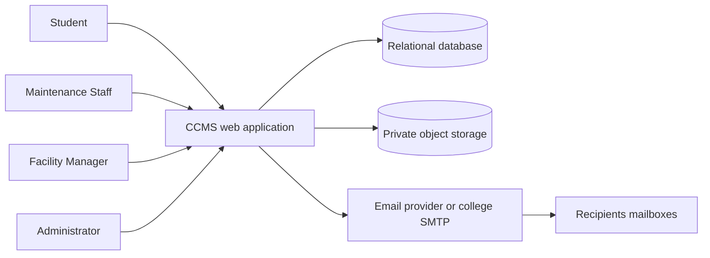
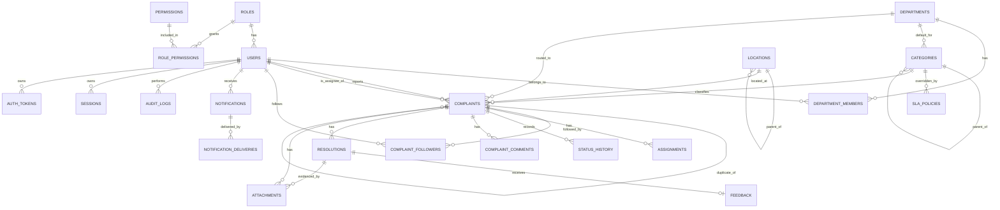
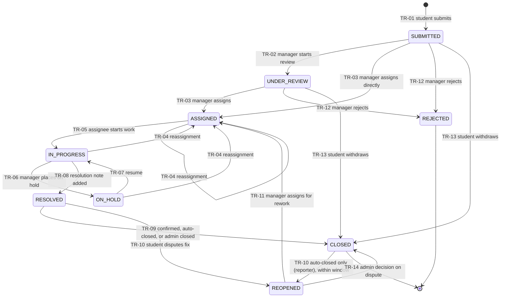

# Software Requirements Specification (SRS)

## College Complaint Management System (CCMS), working name CampusFix

| Field | Value |
| --- | --- |
| Document title | Software Requirements Specification for the College Complaint Management System |
| Document version | 0.2-draft (complete: sections 1 to 17) |
| Status | DRAFT. Not reviewed or approved by stakeholders. |
| Date | 10 October 2026 |
| Source document | College Complaint Management System PRD, version 1.0-draft, dated 10 October 2026 (the PRD) |
| Structure basis | Organised after ISO/IEC/IEEE 29148:2018 and IEEE-style SRS practice. **No claim of formal compliance or certification is made**; compliance has not been verified. |
| Prepared by | Requirements engineering working group (derived from the PRD) |
| Audience | Developers, designers, testers, college stakeholders, project reviewers |

### Document approval (to be completed)

| Role | Name | Decision | Date |
| --- | --- | --- | --- |
| College administration representative | TBD | Pending | TBD |
| Facility management representative | TBD | Pending | TBD |
| Student representative | TBD | Pending | TBD |
| College IT representative | TBD | Pending | TBD |
| Project lead / architect | TBD | Pending | TBD |

### Table of contents

1. Introduction
2. Overall Description
3. System Context and Interfaces
4. Functional Requirements
5. Detailed Business Rules
6. Non-Functional Requirements
7. External Interface Requirements
8. Data Requirements
9. API and Communication Requirements
10. Security Requirements
11. State and Workflow Specifications
12. Error Handling and Edge Cases
13. Verification and Acceptance Criteria
14. Traceability Matrix
15. Constraints, Risks, and Open Issues (including the Requirements Issue Register)
16. Appendices
17. Final Summary (coverage, unresolved decisions, inconsistencies, testability, draft statement)

---

## 1. Introduction

### 1.1 Purpose

This SRS specifies the software requirements of the College Complaint Management System (CCMS) in a form that developers can implement, testers can verify, and stakeholders can review. It transforms the PRD into precise, atomic, testable requirements. The PRD is the primary and authoritative source. This SRS does not change the PRD's scope; where the PRD is ambiguous, incomplete, or inconsistent, the SRS records the matter in the Requirements Issue Register (section 15.2) and does not silently resolve it.

### 1.2 Scope of the software product

CCMS is a responsive web application through which college students submit complaints about cleanliness, washrooms, water supply, electricity, fans and lights, furniture and classroom infrastructure, Wi-Fi, and other maintenance issues. The software shall manage the complete complaint lifecycle: submission, tracking, review, priority confirmation, assignment to a department and staff member, resolution, student confirmation or reopening, escalation of overdue complaints, notifications, dashboards and analytics, search, audit, and administrative configuration.

**In scope (Version 1 / MVP):** the capabilities in section 4 whose priority is Must or Should for MVP. **Out of scope:** the features listed in section 2.9.

### 1.3 Product identification

| Item | Value |
| --- | --- |
| Product name | College Complaint Management System (CCMS) |
| Working name | CampusFix |
| Product type | Responsive web-based complaint management application |
| Release covered | Version 1 (MVP), with Version 2 and future items identified but not specified in detail |
| Recommended architecture (PRD section 7) | Modular monolith with an API process and a worker process, relational database, private object storage |

### 1.4 Intended audience

| Reader | Use of this document |
| --- | --- |
| Developers | Implementation reference: requirements, rules, data, API, states |
| Testers | Verification matrix (section 13), traceability (section 14), acceptance criteria |
| Designers | User interface requirements (section 7.1) and roles |
| College stakeholders | Review of scope, rules, and open decisions (section 15) |
| Project reviewers | Evidence of structured requirements engineering |

### 1.5 Document conventions

**Requirement language.** 'Shall' marks a mandatory requirement. 'Should' marks a recommended requirement whose omission requires justification. 'May' marks a permitted option. Requirements are written to express one principal obligation and to be verifiable.

**Source and status tags.**

| Tag | Meaning |
| --- | --- |
| \[S\] | Source-derived: restated from a PRD requirement, rule, or specification. The PRD ID is cited. |
| \[D\] | Derived clarification: an SRS decomposition or wording of PRD content that adds no new behaviour. |
| \[P\] | Proposed addition: not in the PRD; proposed for stakeholder decision; **not a confirmed requirement**. |
| \[A\] | Assumption or proposed numeric value from the PRD that is not yet validated. Not an approved commitment. |
| TBD | To be determined. Information missing from the PRD. |
| OQ-nn | PRD open question (PRD section 16.5), kept under its original ID. |
| ISS-nn | Issue in the Requirements Issue Register (section 15.2). |

**Priority labels (MVP, MoSCoW):** Must, Should, Could, Won't (for MVP). Priorities are copied from the PRD.

**Identifier conventions.** Existing PRD identifiers are preserved unchanged: FR-001 to FR-078, TR-01 to TR-14, BR-01 to BR-21, CFG-01 to CFG-22, NFR-xxx, SEC-01 to SEC-18, ESC-01 to ESC-06, N-01 to N-15, M-01 to M-13, EC-01 to EC-23, US-01 to US-27, TC-xxx, WF-01 to WF-06, R-01 to R-18, D-01 to D-10, OQ-01 to OQ-21. Identifiers newly assigned by this SRS are: API-001 to API-080 (endpoint identifiers; the PRD has endpoints but no IDs), UIR-nnn (user interface requirements derived from the PRD), IFR-nn (external interface requirements), DR-nn (data requirements), SEC-nn.m (decomposed security requirements under a PRD control), BR-Pnn (provisional business-rule IDs, used only where the PRD has a rule without an ID), PTC-nn (proposed test cases to close verification gaps), and ISS-nn (issues).

### 1.6 Definitions, acronyms, and abbreviations

| Term | Definition |
| --- | --- |
| Complaint | A reported campus issue recorded in CCMS, identified by an ID of the format CCMS-YYYY-NNNNNN. |
| Reporter | The Student who submitted a complaint. |
| Department (resolver team) | A configurable group such as Housekeeping, Electrical, or IT and Network that handles complaints. |
| Assignee | The Maintenance Staff member currently responsible for a complaint. |
| Scope | The set of departments (and, for administrators, the whole college) to which a user's permissions apply. |
| Provisional priority | Priority set automatically at submission, before a manager confirms it. |
| Confirmed priority | Priority confirmed or changed by a Facility Manager or Administrator. |
| Reported urgency | The reporter's choice of NORMAL, URGENT, or SAFETY; stored separately from priority. |
| SLA target | Configurable acknowledgement and resolution time target. Not a legal commitment. |
| Acknowledgement | The first manager or administrator action on a complaint (first\_response\_at). |
| Resolution | A complaint reaching status RESOLVED. |
| SLA clock | Continuous or working-hours time basis used to compute due times (CFG-04). |
| Unrouted queue | Complaints with no department, visible to triage managers and administrators. |
| Dispute | A reopen request made after the reopen limit (CFG-10) is reached; decided by an Administrator. |
| Idempotency key | Client-supplied unique key (clientRequestId) that prevents duplicate creation. |
| Outbox | Database rows written with a state change, from which notifications are delivered. |
| Audit log | Append-only record of significant actions. |

| Acronym | Meaning |
| --- | --- |
| API | Application Programming Interface |
| CSRF | Cross-Site Request Forgery |
| CSV | Comma-Separated Values |
| EXIF | Exchangeable Image File Format metadata |
| JSON | JavaScript Object Notation |
| MoSCoW | Must, Should, Could, Won't |
| MVP | Minimum Viable Product |
| NFR | Non-Functional Requirement |
| OIDC | OpenID Connect |
| RBAC | Role-Based Access Control |
| REST | Representational State Transfer |
| SLA | Service Level Agreement (used here as an internal service target) |
| SMTP | Simple Mail Transfer Protocol |
| SRS | Software Requirements Specification |
| TLS | Transport Layer Security |
| UAT | User Acceptance Testing |
| UTC | Coordinated Universal Time |
| WCAG | Web Content Accessibility Guidelines |

### 1.7 References and source documents

| Ref | Document |
| --- | --- |
| \[PRD\] | College Complaint Management System PRD and Technical Planning Document, version 1.0-draft, 10 October 2026 (primary and authoritative source) |
| \[ISO29148\] | ISO/IEC/IEEE 29148:2018, Systems and software engineering: Life cycle processes: Requirements engineering (used as structural guidance only) |
| \[ASVS\] | OWASP Application Security Verification Standard (referenced by the PRD as the security baseline, Level 1, with Level 2 for authentication, session, and access control) |
| \[WCAG\] | Web Content Accessibility Guidelines 2.2, Level AA (referenced by the PRD, NFR-ACC-01) |

### 1.8 Document status and approval requirements

This SRS is a **draft**. It becomes a baseline only after review and written approval by the stakeholders listed in the approval table above. Until then no requirement in this document is approved, and values tagged \[A\] are proposals. Changes after approval follow the change history process in appendix 16.7.

---

## 2. Overall Description

### 2.1 Product perspective

CCMS is a new, self-contained web application. It replaces verbal, untracked complaint reporting. It has no mandatory integration with other college systems. Its only external dependencies in Version 1 are the college email domain (for identity verification), an email delivery service, private object storage, and a hosting environment (PRD D-01, D-05, D-06, D-07). Optional single sign-on and integrations with college systems are Version 2 or future items and are excluded from this SRS's committed scope.

The recommended internal structure (PRD section 7) is a modular monolith with two processes sharing one codebase: an API process (authentication and authorization, complaints, workflow and SLA, assignment, files, notifications, reporting, administration, audit) and a worker process (SLA scan, auto-close, reminders, email delivery, cleanup), over one PostgreSQL database and one private object store. This is a recommendation \[R\] and is not a requirement unless stated in section 6 or 7.

### 2.2 Product functions (summary)

| Module | Summary (detail in section 4) |
| --- | --- |
| 1. Authentication and user management | Registration with college email, login, logout, password reset, lockout, roles, profile |
| 2. Complaint submission | Structured submission with location, urgency, photos, automatic ID, idempotency |
| 3. Categories and locations | Configurable categories and location hierarchy |
| 4. Lifecycle and status transitions | Nine statuses and fourteen defined transitions |
| 5. Assignment and accountability | Assign, reassign, history, Unrouted queue |
| 6. Priority and SLA tracking | Four priorities, provisional and confirmed priority, due times |
| 7. Escalation | Background detection of overdue complaints; safety handling |
| 8. Notifications | In-app and email notifications with de-duplication |
| 9. Resolution and feedback | Resolution notes, confirmation, rating, reopening, auto-close, disputes |
| 10. Dashboards and analytics | Four role dashboards with defined metrics |
| 11. Search, filtering, sorting, pagination | Keyword and ID search, filters, stable pagination |
| 12. Audit trail | Append-only audit and history |
| 13. System administration and configuration | Settings, SLA policies, users, departments, categories, locations |

### 2.3 User classes and characteristics

| Class | Characteristics | Technical level | Frequency | Source |
| --- | --- | --- | --- | --- |
| Student | Reports and tracks complaints, usually from a smartphone browser; many users; may be first-time users | Low to medium | Occasional | PRD 2.2.1 |
| Maintenance Staff | Receives and resolves assigned tasks; may use a phone or shared computer; limited training time | Low | Daily | PRD 2.2.2 |
| Facility Manager | Reviews, prioritises, assigns, and monitors one or more departments | Medium | Daily | PRD 2.2.3 |
| Administrator | Configures the system, manages users, decides disputes, reviews audit | Medium to high | Weekly or as needed | PRD 2.2.4 |

Each user has exactly one role in the MVP \[S: PRD 2.1\]. Permissions are defined in the matrix in section 5.2 and enforced by the server.

### 2.4 Operating environment

| Element | Requirement | Source |
| --- | --- | --- |
| Client | Latest two versions of Chrome, Edge, Firefox, and Safari, including Android Chrome and iOS Safari, from a viewport width of 360 px | NFR-USE-01, NFR-USE-03 |
| Server | Containerised API and worker processes; recommended stack React with TypeScript, Node.js with NestJS (or Django with Django REST Framework as an equivalent), PostgreSQL | PRD 7.2 \[R\] |
| Database | PostgreSQL (relational, transactional) | PRD 7.2 \[R\] |
| File storage | S3-compatible private object storage | PRD 7.2 \[R\] |
| Network | HTTPS only; TLS 1.2 or higher | NFR-SEC-01 |
| Hosting | Not decided: managed platform, virtual server, college server, or public cloud | PRD 14.5, OQ-10 (TBD) |

### 2.5 Design and implementation constraints

| ID | Constraint | Source |
| --- | --- | --- |
| CN-01 | The solution shall be feasible for a student development team and avoid unnecessary complexity. | PRD 1.9 \[B\] |
| CN-02 | AI shall not be a mandatory component. | PRD 1.9 \[B\] |
| CN-03 | Hosting cost for the MVP should be near zero to low. | PRD 1.9 \[R\] |
| CN-04 | Personal data handling shall respect applicable data protection law and college policy; applicable law is TBD (OQ-09). | PRD 1.9 |
| CN-05 | Authorization shall be enforced by the backend, not only by the user interface. | PRD 3 intro, FR-006 |
| CN-06 | Status, priority, role, and configuration names shall be used exactly as defined in this SRS. | PRD conventions |
| CN-07 | Database changes shall be made only through versioned migrations. | NFR-MNT-04 |

### 2.6 Assumptions and dependencies

| ID | Statement | Source | Status |
| --- | --- | --- | --- |
| AS-01 | The college has an email domain usable for identity verification. | PRD AS-01 | \[A\], needs validation (OQ-01) |
| AS-02 | Most students report from a smartphone browser. | PRD AS-02 | \[A\] |
| AS-03 | The MVP is piloted on one campus; the data model supports several. | PRD AS-03 | \[A\] |
| AS-04 | All SLA targets, working hours, and windows are defaults to be replaced by college values. | PRD AS-04 | \[A\] (OQ-02, OQ-03) |
| AS-05 | Maintenance staff can use a phone or shared desktop. | PRD AS-05 | \[A\] (OQ-17) |
| AS-06 | The development team is 3 to 5 students with roughly one term. | PRD AS-06 | \[A\] |
| AS-07 | The MVP interface language is English. | PRD AS-07 | \[A\] (OQ-17) |

| ID | Dependency | Source |
| --- | --- | --- |
| D-01 | College email domain and permission to send verification email | PRD 15.2 |
| D-02 | List of departments, managers, and staff with roles | PRD 15.2 |
| D-03 | Location master data (campus, buildings, floors, rooms) | PRD 15.2 |
| D-04 | Stakeholder agreement on SLA targets, working hours, holidays | PRD 15.2 |
| D-05 | Hosting decision, domain name, TLS certificate | PRD 15.2 |
| D-06 | Email delivery service or college SMTP credentials | PRD 15.2 |
| D-07 | Object storage account | PRD 15.2 |
| D-08 | Privacy notice approval and legal review | PRD 15.2 |
| D-09 | Pilot area, participants, and staff champion | PRD 15.2 |
| D-10 | Baseline measurement started | PRD 15.2 |

### 2.7 User documentation requirements

The following documentation is required deliverables of the project (PRD phase 10 and go-live checklist). Detailed content is TBD.

| ID | Document | Audience | Source |
| --- | --- | --- | --- |
| DOC-01 | Student quick guide (submit, track, confirm, reopen) | Students | PRD 16.1 phase 10 \[D\] |
| DOC-02 | Staff and manager guide, with a short training session (about 30 minutes) | Staff, managers | PRD 14.9 |
| DOC-03 | Administrator guide (users, departments, categories, locations, SLA, settings) | Administrators | PRD 16.1 phase 10 |
| DOC-04 | Privacy notice shown at registration (content approved by the college) | All users | NFR-PRV-04 |
| DOC-05 | Operations runbooks, backup and restore procedure, handover guide | Operators | PRD 14.6 to 14.8 |
| DOC-06 | API documentation (OpenAPI specification) | Developers | NFR-MNT-03 |

### 2.8 System boundaries

| Inside the boundary | Outside the boundary |
| --- | --- |
| Web application, API, worker, database, private file store, notification module, audit | Users' browsers and devices (client environment) |
| Email composition and hand-off to a provider | The email provider's delivery to recipients |
| Authentication by email and password | College identity providers (single sign-on is a Version 2 item) |
| Complaint, assignment, and resolution records | Physical repair work, contractors, spare parts, procurement |
| Dashboards over CCMS data | College ERP, student information system, asset register |

CCMS is not an emergency service. For safety hazards the interface shall display the college emergency contact text (FR-016, CFG-16, OQ-08).

### 2.9 Explicitly excluded features (Won't have for MVP)

Per PRD sections 1.10 and 12.5: single sign-on (FR-010); anonymous or confidential complaints (BR-19); native mobile apps; contractor accounts or portal; SMS or WhatsApp notifications; multilingual interface; CSV export of lists and metrics (FR-072); custom roles; integrations with college systems; real-time push; AI features; payment, procurement, and inventory management; IoT sensor integration; multi-location complaints (EC-21).

---

## 3. System Context and Interfaces

### 3.1 Context diagram



Future or optional links, shown separately and not committed: college single sign-on provider (FR-010, Version 2), CSV export consumers (FR-072, Version 2), college systems integration (future scope).

### 3.2 User interfaces (overview)

The application shall provide a web user interface for each role. Screens, fields, validation messages, and role-specific visibility are specified in section 7.1. The interface shall be mobile-first and responsive from 360 px width (NFR-USE-01), keyboard operable, and conformant to the accessibility requirements in NFR-ACC-01 to NFR-ACC-05.

### 3.3 External system interfaces

| ID | Interface | Direction | Purpose | Status | Source |
| --- | --- | --- | --- | --- | --- |
| IFR-01 | Email delivery (provider API or SMTP) | Outbound | Send notification and account emails | Committed for MVP (Should for notifications; Must for account verification and password reset) | FR-002, FR-004, FR-053, FR-055 |
| IFR-02 | Private object storage (S3-compatible) | Outbound and inbound | Store and retrieve photos | Committed | FR-014, SEC-07 |
| IFR-03 | Relational database | Internal | System of record | Committed | PRD section 8 |
| IFR-04 | College identity provider (OIDC single sign-on) | Outbound | Alternative authentication | Optional, Version 2 | FR-010 |
| IFR-05 | CSV export | Outbound to user | Export of lists and metrics | Optional, Version 2 | FR-072 |
| IFR-06 | College systems (ERP, student information system, asset register, helpdesk) | TBD | Integration | Future scope; no requirements specified | PRD 12.3 |

### 3.4 Software interfaces

The software shall expose a REST API over HTTPS (section 9) consumed by the web client. Third-party client use of the API is not required in the MVP.

### 3.5 Communication interfaces

- All client-server traffic shall use HTTPS with TLS 1.2 or higher (NFR-SEC-01).
- API payloads shall be JSON, except photo upload, which shall use multipart/form-data.
- Browser sessions shall use an HttpOnly, Secure, SameSite=Lax cookie; state-changing requests shall carry an X-CSRF-Token header (PRD 9.1, SEC-02, SEC-10).
- The web client shall obtain unread notification counts by polling at an interval of at most 30 seconds (FR-051). Server push is a Version 2 item.

### 3.6 Email notification interface

See IFR-01 and requirement group 8 (FR-051 to FR-057). The interface requires: sender address and provider credentials (TBD, OQ-11), at most 3 delivery retries at 1, 5, and 30 minutes (FR-055), and message content limited to complaint ID, title, new status, and a login link (FR-056).

### 3.7 Private image and file storage interface

See IFR-02 and SEC-07. Files shall be stored in a private bucket under server-generated random keys. Access shall be through short-lived signed URLs of 5 minutes (PRD 7.6 and API-040) issued only after an authorization check. Public listing and public read access shall not be enabled.

### 3.8 Browser and responsive-design requirements

The software shall support the latest two versions of Chrome, Edge, Firefox, and Safari (including Android Chrome and iOS Safari) (NFR-USE-03), shall provide a mobile-first layout from 360 px width (NFR-USE-01), and shall render the layouts at 360 px, 768 px, and 1280 px without horizontal scrolling of primary content (PRD 13.5). Initial compressed JavaScript below 300 KB and interactive within 3 seconds on a mid-range phone over 4G is a proposed target (NFR-PERF-06, \[A\]).

---

## 4. Functional Requirements

### 4.0 How to read this section

Requirements are grouped into thirteen modules. To avoid repeating identical text on every row, each module opens with a **module behaviour table** giving the preconditions, inputs, processing, outputs, and exceptions that apply to its requirements; the requirement table then gives the atomic requirement statement, source, priority, and verification method. Where a single requirement needs extra detail, it is described under the table.

**Verification method codes:** T = test (automated or manual execution), I = inspection (review of design, code, configuration, or documents), A = analysis (calculation or reasoning), D = demonstration (observed operation). Source column: 'PRD FR-nnn' means the requirement is restated from the PRD \[S\]. Priorities are the PRD's MVP priorities. All FR IDs are preserved from the PRD; no FR has been removed or renumbered.

### 4.1 Module 1: Authentication and user management

| Aspect | Specification |
| --- | --- |
| Rationale | Verified identity gives accountability and enables role-based access (PRD 2.1, 3.3). |
| Preconditions | Registration: email domain on the allow-list. Login: account ACTIVE and verified. Administration actions: caller has the Administrator role. |
| Inputs | Email, password, full name, verification or reset token, role, department memberships, profile fields. |
| Processing | Domain check, password hashing, token issue and validation, session creation and revocation, lockout counting, role and scope resolution, audit writing. |
| Outputs | Account state, session cookie and CSRF token, emails for verification, reset, and lockout, audit entries. |
| Exceptions | 422 VALIDATION\_ERROR (weak password, disallowed domain); 409 CONFLICT (email already registered, without revealing verification state); 401 UNAUTHENTICATED; 403 ACCOUNT\_DISABLED; 429 ACCOUNT\_LOCKED or RATE\_LIMITED; 410 TOKEN\_EXPIRED; 409 LAST\_ADMIN. |

| ID | Requirement statement | Source | Pri | Ver |
| --- | --- | --- | --- | --- |
| FR-001 | The system shall authenticate a user by a verified college email address and a password, and shall store passwords only as salted Argon2id or bcrypt hashes. | PRD FR-001 | Must | T, I |
| FR-002 | The system shall allow self-registration only for email addresses on the Administrator-maintained domain allow-list, shall keep the account inactive until the owner opens a single-use verification link valid for 24 hours, and shall assign the Student role to every self-registered account. | PRD FR-002 | Must | T |
| FR-002a \[D\] | The system shall allow Maintenance Staff, Facility Manager, and Administrator accounts to be created or invited only by an Administrator. | PRD FR-002 | Must | T |
| FR-003 | The system shall invalidate the server-side session immediately when the user logs out. | PRD FR-003 | Must | T |
| FR-004 | The system shall send a password-reset link that is single-use and valid for 30 minutes, and shall return an identical response whether or not the submitted email address belongs to an account. | PRD FR-004 | Must | T |
| FR-005 | The system shall lock an account for 15 minutes after 5 consecutive failed login attempts, shall rate limit login attempts by IP address, and shall email a lockout notice to the account owner. | PRD FR-005 | Must | T |
| FR-006 | The system shall enforce the permissions and scope defined in section 5.2 on every request on the server. | PRD FR-006 | Must | T |
| FR-007 | The system shall allow an Administrator to create or invite users, assign or change a user's role and department memberships, and deactivate and reactivate users, shall revoke all sessions of a user on deactivation, and shall not hard-delete users who own history. | PRD FR-007 | Must | T |
| FR-008 | The system shall allow a user to edit their own display name, optional phone number, and email-notification preference, and to change their password only by supplying the current password; the system shall not allow a user to edit their own email address or role. | PRD FR-008 | Must | T |
| FR-009 | The system shall allow an Administrator to bulk-import users from a CSV file and shall return a validation report. | PRD FR-009 | Should | T |
| FR-010 | Single sign-on with the college identity provider (OIDC) is excluded from the MVP; no MVP behaviour is specified. | PRD FR-010 | Won't | I |

### 4.2 Module 2: Complaint submission

| Aspect | Specification |
| --- | --- |
| Rationale | Structured, validated input with location and evidence allows routing and accountability (PRD 3.4). |
| Preconditions | Caller is an authenticated Student; active categories and locations exist; rate limit not exceeded. |
| Inputs | clientRequestId, title, description, categoryId, locationId, locationDetail, reportedUrgency; photos are uploaded afterwards through the attachments interface (API-039). |
| Processing | Server-side validation, ID generation, provisional priority and routing (BR-04, FR-017), due-time calculation, outbox and audit writes in one transaction. |
| Outputs | Complaint record with ID, status SUBMITTED, department, provisional priority, ackDueAt, resolveDueAt, version; confirmation view; in-app notification. |
| Exceptions | 422 VALIDATION\_ERROR with per-field details; 429 RATE\_LIMITED with Retry-After; 413, 415, 422 TOO\_MANY\_ATTACHMENTS for photos; 409 INVALID\_STATE for edits after SUBMITTED. |

| ID | Requirement statement | Source | Pri | Ver |
| --- | --- | --- | --- | --- |
| FR-011 | The system shall allow a Student to submit a complaint with title, description, category, subcategory (where the category has any), location, optional photos, and reported urgency. | PRD FR-011 | Must | T |
| FR-012 | The system shall validate on the server that the title has 5 to 120 characters, the description has 10 to 2000 characters, the category, subcategory, and location are active and valid, and the location is at Room or Facility level or at Building level with a free-text location detail, and shall return an error identifying each invalid field. | PRD FR-012 | Must | T |
| FR-013 | The system shall let the Student choose the location from the configured hierarchy (Campus, Building, Floor, Room or Facility) and shall accept an optional free-text location detail of at most 200 characters. | PRD FR-013 | Must | T, D |
| FR-014 | The system shall accept 0 to 3 photo attachments per complaint, shall validate each by size, file signature, and type, shall re-encode it, and shall store it privately; the system shall accept a complaint without photos. | PRD FR-014, CFG-15, SEC-07 | Must | T |
| FR-015 | The system shall generate a unique complaint ID of the format CCMS-YYYY-NNNNNN and shall record the submission timestamp in UTC when a valid complaint is submitted. | PRD FR-015, BR-03 | Must | T |
| FR-016 | The system shall offer the reported urgency values NORMAL, URGENT, and SAFETY, and when SAFETY is selected shall display the college emergency contact text (CFG-16) and a statement that CCMS is not an emergency service. | PRD FR-016 | Must | T, D |
| FR-017 | The system shall route a submitted complaint to the default department of its subcategory or category, and shall place a complaint with no default department in the Unrouted queue. | PRD FR-017 | Must | T |
| FR-018 | The system shall, before final submission, show up to 5 anonymised similar open complaints matching the rule in CFG-18 and shall allow the Student to follow one ('I am also affected') instead of creating a new complaint. | PRD FR-018 | Should | T |
| FR-019 | The system shall treat a repeated creation request with the same clientRequestId from the same reporter as the same request and shall return the original complaint without creating a second one. | PRD FR-019 | Must | T |
| FR-020 | The web client shall retain the typed form text in the browser until submission succeeds. | PRD FR-020 | Should | T, D |
| FR-021 | The system shall show the Student a confirmation containing the complaint ID and shall create an in-app notification after successful submission. | PRD FR-021 | Must | T |
| FR-022 | The system shall allow the reporter to edit title, description, location detail, and attachments only while the complaint status is SUBMITTED, and shall record each edit in the audit log. | PRD FR-022, BR-06 | Should | T |
| FR-023 | The system shall limit complaint submissions per Student according to CFG-12 and shall return the retry time when the limit is exceeded. | PRD FR-023 | Must | T |

### 4.3 Module 3: Complaint categories and locations

| Aspect | Specification |
| --- | --- |
| Rationale | Configurable categories and locations let the system fit different colleges (PRD 2.4, 3.5). |
| Preconditions | Caller is an Administrator (for changes). |
| Inputs | Category name, parent, default department, default priority, safety flag, sort order, active flag; location name, type, parent. |
| Processing | Validation of uniqueness within parent and depth; deactivation instead of deletion for referenced items; audit writing. |
| Outputs | Updated category and location lists available to the submission form; historical complaints unchanged. |
| Exceptions | 409 CONFLICT (duplicate name, invalid parent); 422 VALIDATION\_ERROR. |

| ID | Requirement statement | Source | Pri | Ver |
| --- | --- | --- | --- | --- |
| FR-024 | The system shall be seeded with the categories and example subcategories in PRD table 3.5.1 (Cleanliness; Washrooms; Water supply; Electricity, fans and lights; Furniture and classroom infrastructure; Internet and Wi-Fi; Other maintenance issues). | PRD FR-024 | Must | I, T |
| FR-025 | The system shall allow an Administrator to create, rename, reorder, and deactivate categories and subcategories, shall keep deactivated categories on historical complaints, shall not offer them for new complaints, and shall not delete a category once used. | PRD FR-025, BR-17 | Must | T |
| FR-026 | The system shall allow each category or subcategory to define a default department, a default priority, and a safety-related flag, and shall let a subcategory with no value inherit the parent's value. | PRD FR-026 | Must | T |
| FR-027 | The system shall allow an Administrator to create, rename, move, and deactivate locations in the hierarchy. | PRD FR-027 | Must | T |

### 4.4 Module 4: Complaint lifecycle and status transitions

| Aspect | Specification |
| --- | --- |
| Rationale | A controlled lifecycle provides tracking and accountability (PRD 3.6). |
| Preconditions | Caller authenticated, authorised for the action, and the complaint is visible to the caller. |
| Inputs | Complaint reference, action-specific fields (note, reason code, priority, version), expected version. |
| Processing | Validation against the transition table (section 11.3), version check, state change, history, audit, and outbox writes in one transaction. |
| Outputs | New status and version; timeline entry; notifications. |
| Exceptions | 409 INVALID\_TRANSITION; 409 VERSION\_CONFLICT; 403 FORBIDDEN; 404 NOT\_FOUND; 422 VALIDATION\_ERROR. |

| ID | Requirement statement | Source | Pri | Ver |
| --- | --- | --- | --- | --- |
| FR-028 | The system shall give every complaint exactly one status from SUBMITTED, UNDER\_REVIEW, ASSIGNED, IN\_PROGRESS, ON\_HOLD, RESOLVED, REOPENED, CLOSED, and REJECTED. | PRD FR-028 | Must | T, I |
| FR-029 | The system shall change a complaint's status only through the transitions TR-01 to TR-14, validated on the server for actor role, scope, current status, and required inputs, and shall refuse any other change with HTTP 409 INVALID\_TRANSITION. | PRD FR-029, BR-01 | Must | T |
| FR-030 | The system shall write a status-history row (from-status, to-status, actor, timestamp, comment) and an audit entry for every status transition. | PRD FR-030 | Must | T |
| FR-031 | The system shall show the reporter a status timeline with timestamps, public comments, the assignee's display name and department, the priority, and the resolution target date, and shall not show internal notes. | PRD FR-031 | Must | T |
| FR-032 | The system shall allow the reporter to withdraw a complaint in status SUBMITTED or UNDER\_REVIEW, setting status CLOSED with close reason WITHDRAWN. | PRD FR-032, TR-13 | Should | T |
| FR-033 | The system shall allow only a Facility Manager (within scope) or an Administrator to set ON\_HOLD, and shall require a reason code (AWAITING\_PARTS, EXTERNAL\_CONTRACTOR, AWAITING\_ACCESS, OTHER) and a note, with an optional expected date. | PRD FR-033, BR-14 | Must | T |

### 4.5 Module 5: Assignment and accountability

| Aspect | Specification |
| --- | --- |
| Rationale | Every active complaint needs a named owner (PRD design principle 1, goal G-4). |
| Preconditions | Caller is a Facility Manager within scope or an Administrator; complaint in a status permitting assignment (TR-03, TR-04, TR-11). |
| Inputs | departmentId, assigneeId, priority (if not yet confirmed), reason (mandatory for reassignment), version. |
| Processing | Validation that the assignee is active, a Maintenance Staff member, and a member of the department (BR-05); closing the current assignment record and opening a new one; audit and notifications. |
| Outputs | Assignment record; status ASSIGNED; notifications to assignee and reporter. |
| Exceptions | 422 VALIDATION\_ERROR (assignee not in department, inactive assignee, missing reason); 409 VERSION\_CONFLICT for simultaneous assignment. |

| ID | Requirement statement | Source | Pri | Ver |
| --- | --- | --- | --- | --- |
| FR-034 | The system shall allow a Facility Manager or Administrator to assign a complaint to a department and to one active staff member of that department, and shall not allow a complaint to be ASSIGNED or IN\_PROGRESS without both. | PRD FR-034, BR-05 | Must | T |
| FR-035 | The system shall create an assignment record (complaint, department, assignee, assigned by, assigned at, unassigned at, reason) for every assignment, shall keep exactly one assignment current per complaint, and shall not edit or delete assignment records other than setting the unassigned time. | PRD FR-035 | Must | T |
| FR-036 | The system shall allow an authorised user to reassign a complaint, shall require a reason, shall notify the previous assignee, and shall remove the previous assignee's edit access immediately. | PRD FR-036, TR-04 | Must | T |
| FR-037 | The system shall allow a Facility Manager to change the department of a complaint that is SUBMITTED, UNDER\_REVIEW, or REOPENED, shall notify the new department's managers, shall clear any current assignee, and shall audit the change. For an already assigned complaint, the department shall change only through reassignment (TR-04). | PRD FR-037 (as amended in PRD review A-02) | Should | T |
| FR-038 | The system shall display the assignee and department to managers, administrators, and the assigned staff member, and shall display only the assignee's display name and department to the reporter. | PRD FR-038 | Must | T |
| FR-039 | The system shall list complaints without a department in an Unrouted queue visible to triage managers and Administrators (CFG-13). | PRD FR-039 | Must | T |
| FR-040 | The system shall show, for each candidate assignee, the number of open assigned complaints and the overdue count when a manager chooses an assignee. | PRD FR-040 | Should | T, D |
| FR-041 | The system shall list the open complaints of a deactivated or absent staff member for the manager and shall offer bulk reassignment, and shall not reassign any complaint automatically. | PRD FR-041, BR-13 | Should | T |

Note: the PRD defines no data field for an 'absent' staff member (only deactivation). See ISS-06.

### 4.6 Module 6: Priority management and SLA tracking

| Aspect | Specification |
| --- | --- |
| Rationale | Not every complaint is equally urgent; targets make delays visible (PRD 3.8). |
| Preconditions | Complaint exists; for confirmation, caller is a manager in scope or an Administrator. |
| Inputs | Category defaults, reported urgency, priority, reason, SLA policies, working calendar (CFG-01, CFG-02, CFG-22). |
| Processing | Provisional priority rule (BR-04), confirmation, due-time calculation on the applicable SLA clock, pause and resume on hold, recalculation on priority change and reopening. |
| Outputs | priority, priority\_confirmed\_by and time, ack\_due\_at, resolve\_due\_at, level2\_due\_at. |
| Exceptions | 422 VALIDATION\_ERROR (missing reason when lowering Critical or High; invalid values). |

| ID | Requirement statement | Source | Pri | Ver |
| --- | --- | --- | --- | --- |
| FR-042 | The system shall use the priorities LOW, MEDIUM, HIGH, and CRITICAL as defined in PRD table 3.8.1. | PRD FR-042 | Must | I, T |
| FR-043 | The system shall allow an Administrator to edit SLA policies (acknowledgement target, resolution target, clock type) per priority with optional per-category overrides, shall audit each change, and shall apply a change only to complaints whose due times are computed after the change. | PRD FR-043, BR-04(8) | Must | T |
| FR-044 | The system shall set a provisional priority automatically by the rule in BR-04, shall show it to managers as provisional, and shall store reported urgency separately without overwriting it. | PRD FR-044 | Must | T |
| FR-045 | The system shall allow a Facility Manager (within scope) or an Administrator to confirm or change the priority before or at assignment, shall record the confirming user and time, and shall require a reason when the priority is lowered from CRITICAL or HIGH. | PRD FR-045 | Must | T |
| FR-046 | The system shall store ack\_due\_at, resolve\_due\_at, and level2\_due\_at on each complaint, calculated on the SLA clock of the priority, and shall pause the clock while the status is ON\_HOLD. | PRD FR-046, BR-04, BR-14 | Must | T, A |

### 4.7 Module 7: Escalation

| Aspect | Specification |
| --- | --- |
| Rationale | Overdue complaints must reach a responsible person without manual chasing (PRD 3.8). |
| Preconditions | The scheduled job is running; complaints have stored due times. |
| Inputs | Stored due times, status, escalation\_level, first\_response\_at, CFG-05 to CFG-07. |
| Processing | Scheduled scan at least every 5 minutes; escalation per rules ESC-01 to ESC-06; de-duplicated notification creation; no automatic reassignment. |
| Outputs | escalation\_level updates, escalation notifications, audit entries. |
| Exceptions | Job failure: logged and alerted (NFR-AV-04); the next run processes missed items. |

| ID | Requirement statement | Source | Pri | Ver |
| --- | --- | --- | --- | --- |
| FR-047 | The system shall run a background job at least every 5 minutes that finds complaints past a due time and raises each escalation exactly once per level. | PRD FR-047 | Must | T |
| FR-048 | The system shall apply the escalation rules ESC-01 to ESC-06, and shall not change the assignee automatically on escalation. | PRD FR-048 | Must | T |
| FR-049 | The system shall treat a complaint with reported urgency SAFETY, or a safety-related subcategory, as provisionally CRITICAL, shall pin it at the top of manager queues, and shall immediately notify in-scope managers, triage managers, and Administrators by in-app notification and email; a manager may lower the priority only with a mandatory note. | PRD FR-049, BR-07 | Must | T |
| FR-050 | The system shall send the assignee an in-app warning when 80% of the resolution target has elapsed (CFG-07). | PRD FR-050 | Should | T |

### 4.8 Module 8: Notifications

| Aspect | Specification |
| --- | --- |
| Rationale | Students and staff need timely, non-duplicated information (PRD 3.9). |
| Preconditions | A notifiable event occurred (N-01 to N-15); recipient account is ACTIVE (EC-18). |
| Inputs | Event type, complaint, recipient, de-duplication key. |
| Processing | Notification and delivery rows written in the same transaction as the event (outbox); de-duplication; worker sends email with retries. |
| Outputs | In-app notification; optional email; delivery status. |
| Exceptions | Email failure: retries then FAILED, workflow unaffected (EC-10). |

| ID | Requirement statement | Source | Pri | Ver |
| --- | --- | --- | --- | --- |
| FR-051 | The system shall provide an in-app notification centre with an unread count, a list, and mark-as-read, shall create the in-app notification before any email, and shall allow the client to refresh the unread count at an interval of at most 30 seconds. | PRD FR-051 | Must | T |
| FR-052 | The system shall create notifications for the events and recipients defined in PRD table 3.9.1 (N-01 to N-15), applying the email channel only where email is enabled (FR-053). | PRD FR-052 | Must | T |
| FR-053 | The system shall let each user switch email notifications on or off, and shall not allow that switch to disable escalation and safety alerts for managers and administrators. | PRD FR-053 | Should | T |
| FR-054 | The system shall create at most one notification for an identical event type, complaint, and user within the window CFG-17 using a unique de-duplication key, and shall batch public-comment notifications to at most one per complaint per recipient per 10 minutes. | PRD FR-054, BR-16 | Must | T |
| FR-055 | The system shall deliver email in the background with 3 retries (after 1, 5, and 30 minutes), shall mark the delivery FAILED after the final failure without affecting the in-app notification, and shall show failure counts on the Administrator dashboard. | PRD FR-055 | Should | T |
| FR-056 | The system shall limit email content to the complaint ID, title, new status, and a login link, and shall not include the description, photos, reporter details, or internal notes. | PRD FR-056 | Must | T, I |
| FR-057 | The system shall notify followers only when the followed complaint becomes RESOLVED, CLOSED, or REJECTED. | PRD FR-057 | Should | T |

### 4.9 Module 9: Resolution and feedback

| Aspect | Specification |
| --- | --- |
| Rationale | Resolution needs evidence and verification by the reporter (PRD 3.10). |
| Preconditions | Resolve: status IN\_PROGRESS and caller is the current assignee, a manager in scope, or an Administrator. Confirm and reopen: caller is the reporter, status RESOLVED (or CLOSED with reason AUTO\_CLOSED for reopening). |
| Inputs | Resolution notes, optional photos, rating (1 to 5), comment (at most 500 characters), reopen reason (at least 10 characters). |
| Processing | Resolution record with cycle number; confirmation window and auto-close; reopening counter and new due time; dispute routing. |
| Outputs | Status RESOLVED, CLOSED, or REOPENED; resolution, feedback, and history records; notifications. |
| Exceptions | 422 VALIDATION\_ERROR (note too short); 409 REOPEN\_WINDOW\_EXPIRED; 409 INVALID\_STATE; 409 CONFLICT (second feedback for the same resolution); 403 FORBIDDEN. |

| ID | Requirement statement | Source | Pri | Ver |
| --- | --- | --- | --- | --- |
| FR-058 | The system shall require a resolution note of at least 20 characters from the assignee, a manager in scope, or an Administrator to set status RESOLVED (TR-08). | PRD FR-058, BR-08 | Must | T |
| FR-059 | The system shall allow up to 3 resolution photos, validated as in FR-014, and shall label them 'After' to the reporter. | PRD FR-059 | Should | T |
| FR-060 | The system shall allow the reporter to confirm a RESOLVED complaint (status CLOSED, close reason CONFIRMED) with an optional rating from 1 to 5 and an optional comment of at most 500 characters, and shall not require a rating for confirmation. | PRD FR-060 | Must | T |
| FR-061 | The system shall allow the reporter to reopen a complaint with a reason, within CFG-09 and subject to BR-10. | PRD FR-061 | Must | T |
| FR-062 | The system shall set status CLOSED with close reason AUTO\_CLOSED when the reporter does not respond within CFG-08 after RESOLVED, and shall still allow the reporter to reopen within CFG-09. | PRD FR-062, BR-09 | Must | T |
| FR-063 | The system shall, when a reporter requests reopening after the reopen count has reached CFG-10, mark the complaint as disputed and route the decision to an Administrator (BR-12). | PRD FR-063 | Must | T |
| FR-064 | The system shall support public comments (visible to the reporter) and internal comments (visible to staff, managers, and administrators only), shall not allow edits after 5 minutes, shall never delete comments, and shall record moderation (hiding) in the audit log. | PRD FR-064 | Should | T |
| FR-065 | The system shall show feedback ratings to managers within scope and Administrators, shall not show them to other students, and shall show Maintenance Staff only their own aggregate rating and individual ratings without reporter identity. | PRD FR-065 | Should | T |

### 4.10 Module 10: Dashboards and analytics

| Aspect | Specification |
| --- | --- |
| Rationale | Management needs defined, comparable metrics to prioritise and monitor (PRD 3.11). |
| Preconditions | Caller holds the dashboard permission for the requested dashboard (section 5.2). |
| Inputs | Date range (default last 30 days), optional departmentId. |
| Processing | Scope-filtered aggregate queries using the metric definitions below. |
| Outputs | Role-specific dashboard data. |
| Exceptions | 403 FORBIDDEN; 422 VALIDATION\_ERROR (invalid range; range above 12 months, PRD SEC-15). |

| ID | Requirement statement | Source | Pri | Ver |
| --- | --- | --- | --- | --- |
| FR-066 | The system shall provide a Student dashboard with counts of the student's own complaints by status, a list with status and due date, and an 'Action needed' section for complaints awaiting confirmation. | PRD FR-066 | Must | T, D |
| FR-067 | The system shall provide a Maintenance Staff dashboard showing assigned complaints sorted by due time and priority, due today, overdue, recently resolved, the staff member's own average resolution time (M-06), and own satisfaction rating. | PRD FR-067 | Must | T, D |
| FR-068 | The system shall provide a Facility Manager dashboard with the queue by status, unacknowledged complaints, overdue complaints with escalation level, staff workload (M-10), metrics M-01 to M-12 limited to the manager's departments, breakdown by category and location, recurring problems (M-11), and complaints flagged 'Assignee inactive'. | PRD FR-068 (as amended) | Must | T, D |
| FR-069 | The system shall provide an Administrator dashboard with the metrics college-wide and a department comparison, the Unrouted queue, level-2 escalations, disputes, priority mismatch (M-13), long holds over 14 days, complaints with an inactive assignee, and notification failures. | PRD FR-069 (as amended) | Must | T, D |
| FR-070 | The system shall calculate every metric by the definitions in the table below, shall provide a date-range selector with a default of 30 days, and shall show each metric's definition. | PRD FR-070 | Must | T, A |
| FR-071 | The system shall detect recurring problems by rule (BR-P01) without artificial intelligence. | PRD FR-071 | Should | T |
| FR-072 | CSV export of filtered lists and metrics is excluded from the MVP. | PRD FR-072 | Won't | I |

**Metric definitions (PRD table 3.11.1).** 'Period' is the selected range. 'SLA time' is elapsed time on the complaint's SLA clock excluding ON\_HOLD periods. Rejected and withdrawn complaints are excluded from time-based metrics unless stated.

| ID | Metric | Calculation | Access |
| --- | --- | --- | --- |
| M-01 | Total complaints | Count of complaints with submitted\_at in the period | Manager (scope), Administrator |
| M-02 | Pending complaints | Count of complaints currently SUBMITTED, UNDER\_REVIEW, ASSIGNED, IN\_PROGRESS, ON\_HOLD, or REOPENED | Student (own), Staff (assigned), Manager (scope), Administrator |
| M-03 | First-response time and acknowledgement compliance | Time = first\_response\_at minus submitted\_at (SLA time; mean, median, 90th percentile). Compliance = percentage of complaints submitted in the period with first\_response\_at on or before ack\_due\_at | Manager (scope), Administrator |
| M-04 | Overdue complaints | Open complaints (not RESOLVED, CLOSED, REJECTED, ON\_HOLD) with now later than resolve\_due\_at; acknowledgement overdue = first\_response\_at empty and now later than ack\_due\_at | Staff (own), Manager (scope), Administrator |
| M-05 | Resolution compliance | Of complaints first resolved in the period, percentage with first resolved\_at on or before resolve\_due\_at as it stood at confirmation | Staff (own), Manager (scope), Administrator |
| M-06 | Average resolution time | Mean, median, and 90th percentile of (first resolved\_at minus submitted\_at) in SLA time for complaints first resolved in the period | Staff (own), Manager (scope), Administrator |
| M-07 | Reopened complaint rate | Reopen events in the period divided by resolution events in the period | Manager (scope), Administrator |
| M-08 | Resolution rate | Of complaints submitted in the period (excluding rejected and withdrawn), percentage in RESOLVED or CLOSED at report time | Manager (scope), Administrator |
| M-09 | Satisfaction | Mean rating of feedback created in the period; response rate = feedback count divided by resolution events | Staff (own, anonymised), Manager (scope), Administrator |
| M-10 | Staff workload | Per staff member: open assigned complaints by status, overdue count, mean age, resolved count in the period | Staff (own), Manager (scope), Administrator |
| M-11 | Recurring problems | Location and category pairs with at least CFG-19 distinct complaints in a rolling 30 days; duplicates rejected as DUPLICATE count once | Manager (scope), Administrator |
| M-12 | Escalations | Complaints with escalation\_level 1 or 2 in the period, by department | Manager (scope), Administrator |
| M-13 | Priority mismatch | Percentage of complaints where confirmed priority differs from the priority implied by reported urgency (reporting only) | Administrator |

### 4.11 Module 11: Search, filtering, sorting, and pagination

| Aspect | Specification |
| --- | --- |
| Rationale | Users must find complaints quickly within what they may see (PRD 3.12). |
| Preconditions | Authenticated caller; results restricted to records the caller may read. |
| Inputs | q, status (multiple), categoryId, priority, locationId, departmentId, assigneeId, date ranges, overdue, escalationLevel, disputed, sort, page, pageSize. |
| Processing | Authorised, filtered, sorted, paginated query with a stable tie-break on complaint ID. |
| Outputs | data list and meta (page, pageSize, totalItems, totalPages). |
| Exceptions | 422 VALIDATION\_ERROR (for example pageSize above 100). |

| ID | Requirement statement | Source | Pri | Ver |
| --- | --- | --- | --- | --- |
| FR-073 | The system shall search by complaint ID (exact, case-insensitive, numeric part alone accepted) and by keywords in title, description, and public comments using database full-text search, limited to records the user may see. | PRD FR-073 | Must | T |
| FR-074 | The system shall filter by status (multiple), category and subcategory, priority, location (a parent location includes its descendants), department, assignee, submitted date range, resolved date range, overdue only, escalation level, reported urgency, and disputed only; Students shall be able to filter only by status and date. | PRD FR-074 | Must | T |
| FR-075 | The system shall sort by submitted date, last update, resolution due time, and priority (CRITICAL first), shall apply the default sorts of PRD FR-075, and shall paginate with a default page size of 20 and a maximum of 100 with a stable tie-break and a total count. | PRD FR-075 | Must | T |

### 4.12 Module 12: Audit trail

| Aspect | Specification |
| --- | --- |
| Rationale | Accountability and tamper resistance (PRD 3.13, goal G-4). |
| Preconditions | An auditable action occurs. |
| Inputs | Actor, action, entity, before and after values, request context. |
| Processing | Insert-only writes in the same transaction as the change. |
| Outputs | Audit rows; read-only viewer for Administrators; status and assignment history for managers within scope. |
| Exceptions | No update or delete interface exists; a database-level update or delete by the application account is denied. |

| ID | Requirement statement | Source | Pri | Ver |
| --- | --- | --- | --- | --- |
| FR-076 | The system shall record an audit entry (actor ID and role, action, entity type and ID, before and after values, UTC timestamp, IP address, request ID) for all complaint status changes; assignments, reassignments, priority confirmations, classification edits, and hand-offs; reporter edits and withdrawals; comment moderation; user creation, role, department, and activation changes; category, location, SLA, and setting changes; failed and successful logins; and data exports. | PRD FR-076 | Must | T |
| FR-077 | The system shall make audit and status-history records append-only, shall provide no interface that alters or deletes them, shall give Administrators a read-only audit viewer with filters (actor, action, entity, date), and shall show managers only the status and assignment history of complaints in their scope. | PRD FR-077, SEC-11 | Must | T, I |

### 4.13 Module 13: System administration and configuration

| Aspect | Specification |
| --- | --- |
| Rationale | The college must tailor values without code changes (PRD 2.4, 14.2). |
| Preconditions | Caller is an Administrator. |
| Inputs | CFG-01 to CFG-22 values, SLA policy values, users, departments, categories, locations, allowed domains. |
| Processing | Validation (for example non-negative numbers, valid time ranges); persistence in the database; audit with before and after values. |
| Outputs | Updated configuration effective for calculations performed afterwards. |
| Exceptions | 422 VALIDATION\_ERROR; 409 CONFLICT; 409 LAST\_ADMIN. |

| ID | Requirement statement | Source | Pri | Ver |
| --- | --- | --- | --- | --- |
| FR-078 | The system shall let an Administrator view and edit the configuration parameters CFG-01 to CFG-22 with validation, and shall audit each change with before and after values. | PRD FR-078 | Must | T |

Administrative requirements defined in other modules: FR-007 (users), FR-009 (CSV import), FR-025 to FR-027 (categories and locations), FR-043 (SLA policies).

**Proposed additions \[P\] (not in the PRD as FR; supported by PRD sections cited; require stakeholder decision before becoming requirements):**

| ID | Proposed requirement | Basis in PRD | Pri (proposed) |
| --- | --- | --- | --- |
| PFR-01 | The system shall allow an Administrator to maintain the registration domain allow-list. | FR-002 uses an Administrator-maintained allow-list; API catalogue lists /admin/allowed-domains; no FR exists. | Must |
| PFR-02 | The system shall allow an Administrator to create, rename, and deactivate departments and manage department membership. | API catalogue lists /admin/departments; FR-007 covers membership only in part. | Must |
| PFR-03 | The system shall expose a health endpoint that checks database connectivity and returns no business data. | NFR-LOG-03 and API catalogue /health; no FR. | Must |
| PFR-04 | The system shall run scheduled cleanup of expired sessions and tokens (7 days after expiry), notifications older than 180 days, and pending attachments older than 24 hours. | PRD 7.5, 8.6, SEC-07 | Should |
| PFR-05 | The system shall provide a documented retention and anonymisation procedure per CFG-20. | PRD 8.6, NFR-PRV-05 | Should |

---

## 5. Detailed Business Rules

Business rules are specified separately from functional requirements. Rule IDs BR-01 to BR-21 are the PRD's (PRD section 11.1) and are preserved. Rules the PRD states without an ID are given **provisional IDs BR-P01 and following**, clearly marked. Rules are stated in 'shall' form; their numeric values are the PRD defaults and remain subject to stakeholder approval \[A\] where they depend on CFG parameters.

### 5.1 Business rule register

| ID | Topic | Rule (shall form) | Related FR |
| --- | --- | --- | --- |
| BR-01 | Status transitions | The system shall change a complaint's status only through the transitions in section 11.3 and shall refuse any other request with 409 INVALID\_TRANSITION without changing any data. | FR-029 |
| BR-02 | Reporter | The system shall record exactly one reporter per complaint, shall never change the reporter, and shall allow only Students to create complaints. | FR-011 |
| BR-03 | Complaint ID | The system shall generate complaint IDs of the format CCMS-YYYY-NNNNNN from a database sequence, unique and never reused. | FR-015 |
| BR-04 | Priority and SLA | See section 5.5 and 5.6 (items 1 to 9). | FR-044 to FR-046 |
| BR-05 | Assignment | The system shall assign a complaint only to an active user with the Maintenance Staff role who is a member of the chosen department, and only after the priority is confirmed; a manager or administrator acting on behalf of the assignee shall be logged as such. | FR-034 |
| BR-06 | Reporter edits | The system shall allow the reporter to edit a complaint only while its status is SUBMITTED; later information shall go through public comments. | FR-022 |
| BR-07 | Safety complaints | The system shall treat reported urgency SAFETY or a safety-related category as provisionally CRITICAL, pinned, with immediate alerts (FR-049, N-15), shall show the emergency contact text, and shall allow a manager to lower the priority only with a note. | FR-049 |
| BR-08 | Resolution | The system shall require a resolution note of at least 20 characters entered by the current assignee, a manager in scope, or an Administrator. | FR-058 |
| BR-09 | Auto-closure | The system shall set RESOLVED complaints to CLOSED with reason AUTO\_CLOSED after CFG-08 days without a reporter response and shall send a reminder (N-08) on day 5 of the window. | FR-062 |
| BR-10 | Reopening | The system shall allow the reporter to reopen a complaint that is RESOLVED, or CLOSED with reason AUTO\_CLOSED, within CFG-09 days of resolved\_at, when reopen\_count is below CFG-10 and a reason of at least 10 characters is given; shall refuse reporter reopening of complaints closed as CONFIRMED, WITHDRAWN, or ADMIN\_CLOSED and of REJECTED complaints; shall allow a manager or Administrator to reopen at any time with a note; shall increment reopen\_count and start a new resolution cycle with a new due time (CFG-11) for each reopening. | FR-061 |
| BR-11 | Duplicates | The system shall allow a manager to reject a complaint as DUPLICATE only by naming a parent complaint that is not itself REJECTED, shall link the reporter and followers to the parent and notify them when the parent is resolved, and shall count duplicates once in recurring-problem detection. | TR-12, FR-057 |
| BR-12 | Disputes | When a reporter requests reopening and reopen\_count has reached CFG-10, the system shall set REOPENED with is\_disputed = true, route the decision to Administrators (N-14), permit only an Administrator to assign rework (TR-11) or close with a written rationale shown to the reporter (TR-14), forbid a manager from closing a disputed complaint, and audit the decision. | FR-063 |
| BR-13 | Staff absence | The system shall not reassign automatically; shall flag complaints of an inactive assignee as 'Assignee inactive'; shall keep the SLA clock running on reassignment; and shall send escalations to Administrators when a department has no active manager. | FR-041 |
| BR-14 | On hold | The system shall allow only a manager or Administrator to set ON\_HOLD with reason code, note, and optional expected date; shall pause the SLA clock and suppress resolution escalation while ON\_HOLD; on resume shall move due times later by the paused time on the complaint's clock; shall show the reason and expected date to the reporter; and shall list holds longer than 14 days \[A\] as long holds on the Administrator dashboard. | FR-033, FR-046 |
| BR-15 | Rejection | The system shall require a reason code and a note, visible to the reporter, for every rejection, and shall treat REJECTED as terminal. | TR-12 |
| BR-16 | Notifications | The system shall create one notification per user per event within the CFG-17 window, batch comment notifications, never put complaint details in email, and never let a failed email block a workflow step. | FR-054, FR-056 |
| BR-17 | Deactivation | The system shall deactivate, and not delete, users, departments, categories, locations, and SLA policies once referenced. | FR-007, FR-025 |
| BR-18 | Submission limits | The system shall apply the submission rate limits of CFG-12 and the idempotency key to prevent double submission. | FR-019, FR-023 |
| BR-19 | Anonymity | The system shall not support anonymous complaints in the MVP; a confidential option is a Version 2 optional feature. | EC-02 |
| BR-20 | Visibility | The system shall show Students only their own complaints and anonymised similar complaints; Maintenance Staff their assigned complaints and, read-only, the unassigned complaints of their department, without reporter identity (CFG-14); Managers the complaints of their departments; Administrators all; shall return 404 for records a user may not see and 403 for a visible record with a forbidden action; and shall never show internal comments to Students. | FR-006, FR-031 |
| BR-21 | Time | The system shall store all times in UTC, show them in the college time zone, base working time on CFG-01 and CFG-02, and exclude dates in the holiday list CFG-22 when that list is provided \[Should\]. | FR-046 |
| BR-P01 | Recurring problems \[provisional\] | The system shall flag a location and category pair as a recurring problem when at least CFG-19 distinct complaints exist for it in a rolling 30 days, counting duplicates once. Source: PRD CFG-19, M-11, FR-071. | FR-071 |
| BR-P02 | Attachments \[provisional\] | The system shall accept at most 3 photos per complaint and 3 per resolution, each at most 5 MB, of type JPEG, PNG, or WebP, shall re-encode and resize them (maximum 1600 px), shall strip metadata, and shall refuse other file types. Source: PRD CFG-15, SEC-07, 6.5. | FR-014, FR-059 |
| BR-P03 | Retention \[provisional\] | The system shall never delete complaints through the application; after the retention period CFG-20 (TBD, OQ-09) complaint data shall be anonymised or archived by a documented administrative procedure; users shall be anonymised on a verified erasure request while IDs are kept. Source: PRD 8.6. | PFR-05 |
| BR-P04 | Comments \[provisional\] | The system shall allow the author to edit a comment only within 5 minutes and shall hide, not delete, moderated comments. Source: PRD FR-064, section 8.3. | FR-064 |
| BR-P05 | Acknowledgement level 2 \[provisional\] | The system shall escalate to Administrators when acknowledgement is missed by a further 100% of the acknowledgement target (ESC-02). Source: PRD ESC-02, CFG-06. | FR-048 |

### 5.2 Role permissions and department scope

**Scope rules (PRD 2.1, 2.2).** A Student's scope is own records. A Maintenance Staff member's scope is complaints assigned to them, plus the unassigned complaints of their department as read-only. A Facility Manager's scope is the departments of which they are a member. An Administrator's scope is the whole college. Each user has one role in the MVP. Authorization order on every request: authenticate, check permission, resolve scope, load through a scope-filtered query (not found yields 404), check state and version, execute transactionally.

Legend: Y = allowed; Own = own records; Scope = own departments; Asg = assigned complaints; - = not allowed.

| Permission key | Student | Maintenance Staff | Facility Manager | Administrator |
| --- | --- | --- | --- | --- |
| complaint.create | Y | - | - | - |
| complaint.read | Own | Asg + department queue (read-only) | Scope | Y |
| complaint.edit\_own\_submitted | Own | - | - | - |
| complaint.withdraw | Own | - | - | - |
| complaint.review | - | - | Scope | Y |
| complaint.confirm\_priority | - | - | Scope | Y |
| complaint.edit\_classification | - | - | Scope | Y |
| complaint.assign / reassign | - | - | Scope | Y |
| complaint.route\_department | - | - | Scope | Y |
| complaint.start\_work | - | Asg | Scope (on behalf) | Y |
| complaint.resolve | - | Asg | Scope | Y |
| complaint.hold / resume | - | - | Scope | Y |
| complaint.reject / mark\_duplicate | - | - | Scope | Y |
| complaint.close | - | - | Scope | Y |
| complaint.reopen | Own (within rules) | - | Scope (any time) | Y |
| complaint.decide\_dispute | - | - | - | Y |
| comment.public | Own complaints | Asg | Scope | Y |
| comment.internal | - | Asg | Scope | Y |
| feedback.create | Own | - | - | - |
| followers.add | Y | - | - | - |
| dashboard.student / .staff / .manager / .admin | Own / - / - / - | - / Own / - / - | - / - / Scope / - | - / Y / Y / Y |
| user.manage, department.manage, category.manage, location.manage, sla.manage, settings.manage, audit.read | - | - | - | Y |
| profile.edit\_own, notification.read\_own | Y | Y | Y | Y |

See ISS-02 for an inconsistency between this matrix and the resume action.

### 5.3 Complaint status transitions

The authoritative transition table is section 11.3 (TR-01 to TR-14). BR-01 requires that no other transition be possible.

### 5.4 Assignment and reassignment

BR-05 (eligibility), BR-13 (absence). Additionally: the system shall keep exactly one current assignment per complaint (FR-035); a reassignment shall carry a mandatory reason (FR-036); a reassignment shall not reset the SLA clock (TR-04); when a reassignment changes the department, the actor shall have scope over the target department or be an Administrator (TR-04 as amended).

### 5.5 Priority determination and confirmation (BR-04 items 1 to 4)

1. The system shall set the provisional priority at submission to the subcategory default priority, else the category default, else MEDIUM.
2. If reported urgency is SAFETY, the provisional priority shall be CRITICAL.
3. If reported urgency is URGENT, the provisional priority shall be raised one level, to a maximum of HIGH.
4. A manager in scope or an Administrator shall confirm or change the priority at or before assignment; the confirmation shall record user and time; lowering from CRITICAL or HIGH shall require a reason. Assignment shall require a confirmed priority (BR-05).

### 5.6 Acknowledgement and resolution SLA calculation, working hours, holidays, and paused clocks (BR-04 items 5 to 9, BR-14, BR-21)

5. ack\_due\_at shall be calculated at submission from the provisional priority and shall never be recalculated.
6. resolve\_due\_at shall equal the submission time plus the resolution target of the current priority, measured on that priority's clock (continuous or working hours per CFG-04), and shall be recalculated when the priority is confirmed or changed. level2\_due\_at shall equal resolve\_due\_at plus 50% of the target.
7. first\_response\_at shall be set once, at the first review, assignment, rejection, or public manager comment.
8. SLA policy edits shall not apply retroactively.
9. If a recalculated resolve\_due\_at is already past, the complaint shall be treated as overdue and escalated at the next scan; the reason for the priority change shall remain in the audit trail.
10. &#91;Working time\] The working-hours clock shall count only minutes inside the working days (CFG-01) and working hours (CFG-02), excluding dates in CFG-22; one working day equals the CFG-02 span (480 minutes by default) \[A\].
11. &#91;Pause\] While status is ON\_HOLD the clock shall be paused (sla\_paused\_at); on resume due times shall move later by the paused time measured on the complaint's clock (BR-14).
12. &#91;Reopen\] On reopening, resolve\_due\_at shall equal the reopening time plus CFG-11 times the resolution target of the current priority (BR-10); no acknowledgement target applies to a reopened complaint (PRD limitation A.5-5).
13. &#91;Policy changes\] A policy edit shall affect only calculations performed after the edit (FR-043).

**Default targets (PRD table 3.8.2) \[A, replace with college values; OQ-03\]:**

| Priority | Clock (CFG-04) | Acknowledgement target | Resolution target |
| --- | --- | --- | --- |
| CRITICAL | Continuous | 30 minutes | 24 hours |
| HIGH | Working hours | 4 working hours | 3 working days |
| MEDIUM | Working hours | 1 working day | 5 working days |
| LOW | Working hours | 2 working days | 10 working days |

See ISS-09 (clock start outside working hours is not stated) and ISS-12 (holiday list is a Should, so default calculations treat holidays as working days).

### 5.7 Escalation triggers (PRD table 3.8.3)

| ID | Trigger | Recipient | Channel | Repetition |
| --- | --- | --- | --- | --- |
| ESC-01 | ack\_due\_at passed and first\_response\_at empty | In-scope managers (triage managers if Unrouted) | In-app and email | Once |
| ESC-02 | Acknowledgement missed by a further 100% of the acknowledgement target (BR-P05) | Administrators | In-app and email | Once |
| ESC-03 | 80% of resolution target elapsed (CFG-07) \[Should\] | Assignee | In-app | Once |
| ESC-04 | resolve\_due\_at passed; status not RESOLVED, CLOSED, REJECTED, or ON\_HOLD; sets escalation\_level 1 | Department managers | In-app and email | Once, then daily reminder per working day while overdue |
| ESC-05 | level2\_due\_at passed (150% of target, CFG-06); sets escalation\_level 2 | Administrators | In-app and email | Once |
| ESC-06 | ON\_HOLD expected date passed | Department managers | In-app | Once per day |

See ISS-03 (scan index excludes unassigned statuses) and ISS-04 (no stored time for the ESC-02 threshold).

### 5.8 Complaint rejection and duplicate handling

BR-11 and BR-15. Rejection reason codes: DUPLICATE, NOT\_A\_COLLEGE\_ISSUE, INSUFFICIENT\_INFORMATION, ALREADY\_RESOLVED, OTHER. DUPLICATE requires parentComplaintId. Rejected complaints are terminal; the reporter may submit a new complaint.

### 5.9 Resolution confirmation and automatic closure

BR-08, BR-09, FR-060, FR-062. Close reasons: CONFIRMED, AUTO\_CLOSED, ADMIN\_CLOSED, WITHDRAWN. The confirmation window is CFG-08 (7 days default) \[A\]; the day-5 reminder is stated as a fixed day in the PRD (see ISS-08).

### 5.10 Reopening windows, limits, and disputes

BR-10 and BR-12. Defaults \[A\]: reopen window CFG-09 = 14 calendar days from resolved\_at; maximum reporter reopenings CFG-10 = 2; reopen SLA factor CFG-11 = 0.5. Manager and Administrator reopenings are also counted in reopen\_count (PRD EC-08).

### 5.11 Recurring-problem detection

BR-P01 (CFG-19 = 3 complaints in a rolling 30 days, same location and category).

### 5.12 Notification de-duplication

BR-16, FR-054, CFG-17 (10 minutes). A unique key per user and event prevents duplicates; comment notifications are batched.

### 5.13 Attachment limits

BR-P02 and CFG-15.

### 5.14 Complaint retention and audit history

BR-P03, BR-17, FR-076, FR-077. Complaints, status history, assignments, resolutions, feedback, and audit entries are retained for CFG-20 (proposed 5 years, TBD, OQ-09). Notifications and deliveries are purged after 180 days; sessions and tokens 7 days after expiry or use \[A\].

---

## 6. Non-Functional Requirements

**Status of numeric values.** NFR IDs are preserved from the PRD (section 6). Every numeric threshold below is a **proposed assumption \[A\] taken from the PRD, to be validated** by load testing, a pilot, or the college; none is an approved commitment or a guarantee. The sizing assumption behind the targets is: up to 5,000 students and 200 staff, up to 500 new complaints per day at peak, up to 100 concurrent users, about 50,000 complaints over five years (PRD 6). Verification codes: T test, I inspection, A analysis, D demonstration.

### 6.1 Performance

| ID | Requirement statement | Threshold \[A\] | Ver | Source |
| --- | --- | --- | --- | --- |
| NFR-PERF-01 | The system shall serve read API requests (complaint detail, lists of 20) at normal load of 100 concurrent users. | p95 under 500 ms (server side) | T | PRD 6.1 |
| NFR-PERF-02 | The system shall complete complaint submission without photos. | p95 under 1 s | T | PRD 6.1 |
| NFR-PERF-03 | The system shall complete upload and processing of a 3 MB photo. | p95 under 6 s on a 4G connection | T | PRD 6.1 |
| NFR-PERF-04 | The system shall return search by keyword or ID over 50,000 complaints. | p95 under 1 s | T | PRD 6.1 |
| NFR-PERF-05 | The system shall load a manager or administrator dashboard over a 30-day period. | p95 under 2 s | T | PRD 6.1 |
| NFR-PERF-06 | The web client shall become interactive on a mid-range phone over 4G. | Within 3 s; initial compressed JavaScript under 300 KB | T | PRD 6.1 |
| NFR-PERF-07 | The system shall make an in-app notification visible to the recipient. | Within 60 s of the event | T | PRD 6.1 |
| NFR-PERF-08 | The system shall hand an email notification to the provider. | Within 5 minutes of the event | T | PRD 6.1 |
| NFR-PERF-09 | The SLA scan job shall complete a run. | Under 60 s per run at 50,000 complaints | T | PRD 6.1 |

### 6.2 Reliability and availability

| ID | Requirement statement | Threshold \[A\] | Ver | Source |
| --- | --- | --- | --- | --- |
| NFR-AV-01 | The system shall be available during campus hours (07:00 to 21:00 local time, Monday to Saturday). | 99.0% per month | A, T (monitoring) | PRD 6.3 |
| NFR-AV-02 | Planned maintenance shall occur outside 08:00 to 20:00 on working days and shall be announced 24 hours in advance. | As stated | I | PRD 6.3 |
| NFR-AV-03 | If email delivery or file storage fails, the system shall continue to accept complaints and status changes. | Verified by fault injection | T | PRD 6.3 |
| NFR-AV-04 | Background job failures shall be logged and alert the operator; the next run shall process missed items. | Alert within 15 minutes of two consecutive failures | T | PRD 6.3 |
| NFR-AV-05 | A status change, its history row, audit entry, and notification outbox rows shall be committed in one database transaction. | All or nothing | T | PRD 6.3 |
| NFR-AV-06 | Simultaneous conflicting updates shall be detected by a version check and returned as 409 VERSION\_CONFLICT. | Verified by concurrent test | T | PRD 6.3 |

### 6.3 Scalability

| ID | Requirement statement | Threshold \[A\] | Ver | Source |
| --- | --- | --- | --- | --- |
| NFR-SC-01 | The API shall be stateless, with sessions stored in the database, so that instances can be added behind a load balancer. | Verified with 2 instances in staging | T | PRD 6.2 |
| NFR-SC-02 | All list endpoints shall be paginated; no unbounded queries shall exist. | 100% of list endpoints | I | PRD 6.2 |
| NFR-SC-03 | Database indexes shall support the filters in FR-074. | No sequential scan on complaints for standard filters at 50,000 rows | A, T | PRD 6.2 |
| NFR-SC-04 | The system shall operate at 3 times the expected peak. | 300 concurrent users, error rate not above 1% | T | PRD 6.2 |
| NFR-SC-05 | Image storage shall use object storage with lifecycle rules, with photos re-encoded to at most 1600 px. | About 300 KB average | T, I | PRD 6.2 |

### 6.4 Security (summary; detailed requirements in section 10)

| ID | Requirement statement | Threshold \[A\] | Ver | Source |
| --- | --- | --- | --- | --- |
| NFR-SEC-01 | All traffic shall use TLS 1.2 or higher, with HSTS enabled. | Grade A on an SSL test | T | PRD 6.4 |
| NFR-SEC-02 | The system shall meet the OWASP ASVS baseline. | Level 1 for all features; Level 2 for authentication, session, and access control | I, T | PRD 6.4 |
| NFR-SEC-03 | The released system shall contain no known critical or high severity dependency vulnerabilities. | 0 open, scan on every build | T | PRD 6.4 |
| NFR-SEC-04 | Authorization tests shall cover every endpoint for every role. | 100% of endpoints in the permission test matrix | T | PRD 6.4 |
| NFR-SEC-05 | Passwords shall have at least 10 characters and shall be checked against a common-password list, without forced composition rules. | As stated | T | PRD 6.4 |

### 6.5 Privacy

| ID | Requirement statement | Threshold \[A\] | Ver | Source |
| --- | --- | --- | --- | --- |
| NFR-PRV-01 | The system shall collect only name, college email, role, optional phone, and optional enrolment number. | Reviewed in design sign-off | I | PRD 6.5 |
| NFR-PRV-02 | The system shall strip photo metadata, including GPS data, on upload. | 100% of stored images | T | PRD 6.5 |
| NFR-PRV-03 | The system shall hide the reporter's identity from Maintenance Staff by default (CFG-14) and from other students. | Verified by role tests | T | PRD 6.5 |
| NFR-PRV-04 | The system shall show a privacy notice at registration stating what is collected, why, who can see it, and how long it is kept. | Content approved by the college (TBD, D-08) | I | PRD 6.5 |
| NFR-PRV-05 | A documented procedure shall exist for correcting, exporting, and anonymising a user's data, and retention shall follow CFG-20. | Procedure documented before launch | I | PRD 6.5 |
| NFR-PRV-06 | The system shall not send personal data to third-party analytics or trackers. | Verified by network inspection | T | PRD 6.5 |
| NFR-PRV-07 | Data hosting location shall follow college and legal requirements. | TBD (OQ-09, OQ-10) | I | PRD 6.5 |

### 6.6 Usability

| ID | Requirement statement | Threshold \[A\] | Ver | Source |
| --- | --- | --- | --- | --- |
| NFR-USE-01 | The user interface shall provide a mobile-first responsive layout from 360 px width. | Tested on 3 phone sizes and 1 tablet | T | PRD 6.7 |
| NFR-USE-02 | A first-time Student shall be able to submit a complaint. | Within 2 minutes for at least 90% of 10 test participants | T (usability test) | PRD 6.7 |
| NFR-USE-04 | Every screen shall provide clear empty, loading, and error states. | Design checklist | I | PRD 6.7 |
| NFR-USE-05 | The web client should resize photos in the browser before upload. | Should | D | PRD 6.7 |
| NFR-USE-06 | The interface shall display times in the college local time zone; times shall be stored in UTC. | Verified | T | PRD 6.7 |

### 6.7 Accessibility

| ID | Requirement statement | Threshold \[A\] | Ver | Source |
| --- | --- | --- | --- | --- |
| NFR-ACC-01 | Core flows (login, submit, track, assign, resolve, confirm) shall conform to WCAG 2.2 Level AA. | Automated scan with no serious issues plus manual check | T, I | PRD 6.6 |
| NFR-ACC-02 | The interface shall be fully keyboard operable with visible focus and logical tab order. | Manual test | T | PRD 6.6 |
| NFR-ACC-03 | Text contrast shall be at least 4.5:1, and status shall not be conveyed by colour alone. | As stated | I | PRD 6.6 |
| NFR-ACC-04 | Form fields shall have labels, and errors shall be linked to fields with an error summary on submit failure. | Manual and screen-reader test (NVDA, TalkBack) | T | PRD 6.6 |
| NFR-ACC-05 | Touch targets shall be at least 44 by 44 px on mobile. | As stated | I | PRD 6.6 |

### 6.8 Maintainability

| ID | Requirement statement | Threshold \[A\] | Ver | Source |
| --- | --- | --- | --- | --- |
| NFR-MNT-01 | The code shall be organised in modules with enforced boundaries. | Lint or dependency check in CI | I | PRD 6.8 |
| NFR-MNT-02 | Automated tests shall cover domain logic. | At least 70% line coverage on workflow, SLA, and permission logic; 100% of transitions in section 11.3 covered | T | PRD 6.8 |
| NFR-MNT-03 | The API shall be documented by an OpenAPI specification generated from code and published with each release. | Per release | I | PRD 6.8 |
| NFR-MNT-04 | Database changes shall be made only through versioned migrations. | No manual production schema changes | I | PRD 6.8 |
| NFR-MNT-05 | Developer documentation (README, setup in under 30 minutes, decision records) shall exist. | Reviewed by a new team member | D, I | PRD 6.8 |
| NFR-MNT-06 | Configuration shall be supplied only through environment variables and the settings table; no secrets or college values shall be in code. | As stated | I | PRD 6.8 |

### 6.9 Compatibility

| ID | Requirement statement | Threshold | Ver | Source |
| --- | --- | --- | --- | --- |
| NFR-USE-03 | The system shall support the latest two versions of Chrome, Edge, Firefox, and Safari, including Android Chrome and iOS Safari. | Cross-browser test | T | PRD 6.7 |

The PRD groups compatibility under usability (NFR-USE-01, NFR-USE-03); no separate compatibility requirement exists. Operating-system and screen-reader versions beyond those named are TBD.

### 6.10 Backup and recovery

| ID | Requirement statement | Threshold \[A\] | Ver | Source |
| --- | --- | --- | --- | --- |
| NFR-BKP-01 | The system shall make an automated encrypted database backup every day and retain 14 daily and 8 weekly copies. | Verified weekly | I, D | PRD 6.9 |
| NFR-BKP-02 | Recovery point objective. | 24 hours in the MVP; 15 minutes in Version 2 | A, D | PRD 6.9 |
| NFR-BKP-03 | Recovery time objective. | 4 hours | D | PRD 6.9 |
| NFR-BKP-04 | Photos shall be protected by object-storage versioning or a daily copy. | Verified | I | PRD 6.9 |
| NFR-BKP-05 | A restore drill into a clean environment shall be performed before launch and once per term. | As stated | D | PRD 6.9 |

### 6.11 Logging and monitoring

| ID | Requirement statement | Threshold \[A\] | Ver | Source |
| --- | --- | --- | --- | --- |
| NFR-LOG-01 | The system shall write structured JSON logs with a request ID on every line and no passwords, tokens, session IDs, or complaint text. | Verified by log review | I | PRD 6.10 |
| NFR-LOG-02 | The system shall track unhandled errors with alerting. | Alert within 5 minutes | T | PRD 6.10 |
| NFR-LOG-03 | An uptime check shall call a health endpoint that tests the database every 1 to 5 minutes. | Alert after 3 failures | T | PRD 6.10 |
| NFR-LOG-04 | Operational alerts shall exist for error rate above 2% for 5 minutes, job failures, storage above 80%, and email failure rate above 20%. | Configured before launch | I | PRD 6.10 |
| NFR-LOG-05 | Application logs shall be retained for 90 days; audit logs per CFG-20. | As stated | I | PRD 6.10 |

### 6.12 Data integrity

| ID | Requirement statement | Threshold | Ver | Source |
| --- | --- | --- | --- | --- |
| NFR-AV-05, NFR-AV-06 | See section 6.2 (transactional atomicity; version check). |  | T | PRD 6.3 |
| DR-14 | Database CHECK and uniqueness constraints shall enforce the states and keys in section 8.5. | 100% of listed constraints | T, I | PRD 8.3 |
| NFR-INT-P01 \[P\] | A scheduled consistency check should compare each complaint's status with its latest status-history row and report mismatches. | Daily | T | PRD 8.5 (described, no NFR ID) |

---

## 7. External Interface Requirements

### 7.1 User interface requirements

User interface requirements are derived from the PRD's roles, functions, and workflows \[D\]. Visual design, wording, and layout are TBD (design phase). General rules: every screen shall meet NFR-USE-01, NFR-USE-04, and NFR-ACC-01 to NFR-ACC-05; role-specific visibility shall follow PRD table 9.3, and the interface shall hide actions a role may not perform as a convenience only (the server decides, CN-05).

#### 7.1.1 Common screens

| ID | Screen | Fields and actions | Role visibility and validation |
| --- | --- | --- | --- |
| UIR-001 | Login | Email, password; log in; links to register and forgot password | All; generic error message that does not reveal which field is wrong; lockout message shows retry time (FR-005) |
| UIR-002 | Registration | Email, full name, password; privacy notice display | Students only; domain, password length (at least 10), and common-password errors per field; acceptance control for the privacy notice is TBD |
| UIR-003 | Email verification and password reset | Verify link landing; request reset; set new password | Same message for any email; expired link message with option to request a new one (410 TOKEN\_EXPIRED) |
| UIR-004 | Profile | Full name, optional phone, email-notification switch, change password (current and new) | All roles; email and role shown read-only |
| UIR-005 | Notification centre | Bell with unread count; list; mark as read; mark all as read | All roles; own notifications only |
| UIR-006 | Complaint detail | Title, description, category, location, status, priority (with 'Provisional' label), due dates, timeline, photos, comments | Fields per PRD table 9.3 (reporter identity, internal comments, assignee detail, feedback visibility vary by role) |
| UIR-007 | System states | Loading, empty, and error states; 403, 404, and session-expired pages | All |

#### 7.1.2 Student interface

| ID | Screen | Fields and actions | Visibility and validation |
| --- | --- | --- | --- |
| UIR-010 | Student dashboard (FR-066) | Counts by status; list with status and due date; 'Action needed' for complaints awaiting confirmation | Own complaints only |
| UIR-011 | New complaint (FR-011 to FR-021) | Category, subcategory, cascading location (Campus, Building, Floor, Room or Facility), location detail (at most 200 characters), title (5 to 120), description (10 to 2000), up to 3 photos, urgency (Normal, Urgent, Safety hazard), similar-complaints panel, submit; confirmation with complaint ID | Inline messages per rule: title length, description length, inactive or missing category and location, photo type and size (5 MB), more than 3 photos, rate limit with retry time; Safety hazard shows emergency text and statement (FR-016); form text retained on failure (FR-020, Should) |
| UIR-012 | My complaints | List with filter by status and date, pagination | Students cannot use other filters (FR-074) |
| UIR-013 | My complaint detail | Timeline, comments, assignee display name and department, resolution note and 'After' photos; actions: edit and add photos (SUBMITTED only), withdraw (SUBMITTED or UNDER\_REVIEW), comment, 'I am also affected' (on others' similar complaints), confirm with optional rating 1 to 5 and comment up to 500 characters, reopen with reason of at least 10 characters | Internal notes never shown; reopen shows REOPEN\_WINDOW\_EXPIRED message with the option to file a new complaint |

#### 7.1.3 Maintenance staff interface

| ID | Screen | Fields and actions | Visibility and validation |
| --- | --- | --- | --- |
| UIR-020 | Staff dashboard (FR-067) | Assigned complaints sorted by priority and due time; due today; overdue; recently resolved; own M-06 and rating | Assigned complaints only; reporter identity hidden (CFG-14) |
| UIR-021 | Task detail | Description, location, photos, confirmed priority, due time, comments (public and internal); actions: start work; request hold or reassignment (internal comment); resolve with note (at least 20 characters) and up to 3 photos | Former assignee loses access after reassignment; error when note is too short |
| UIR-022 | Department queue | Read-only list of the department's unassigned complaints | No actions |

#### 7.1.4 Facility manager interface

| ID | Screen | Fields and actions | Visibility and validation |
| --- | --- | --- | --- |
| UIR-030 | Manager dashboard (FR-068) | Queue by status; unacknowledged; overdue with escalation level; workload; metrics M-01 to M-12; category and location breakdown; recurring problems; 'Assignee inactive' flags | Own departments only |
| UIR-031 | Complaint list and search | Search by ID or keyword; filters (FR-074); sort; pagination | In-scope complaints; safety complaints pinned |
| UIR-032 | Complaint review | Start review; confirm or change priority (reason required when lowering CRITICAL or HIGH); correct category or location with reason; change department (before assignment); assign or reassign with workload and overdue counts and a reason; hold (reason code, note, optional expected date); resume; reject (reason code, note, parent for DUPLICATE); close with note; reopen with note; comments | Reporter identity visible; errors for invalid transition and version conflict (reload prompt) |
| UIR-033 | Unrouted queue | Complaints without a department | Triage managers (CFG-13) |
| UIR-034 | Staff workload and bulk reassignment | Open and overdue counts per staff; open complaints of inactive staff; bulk reassign | Within scope |

#### 7.1.5 Administrator interface

| ID | Screen | Fields and actions | Visibility and validation |
| --- | --- | --- | --- |
| UIR-040 | Administrator dashboard (FR-069) | College-wide metrics; department comparison; Unrouted queue; level-2 escalations; disputes; M-13; long holds; notification failures | Administrator only |
| UIR-041 | User management | Create or invite; edit role, name, departments; deactivate; reactivate; CSV import (Should) | Message LAST\_ADMIN when the last active Administrator would be removed |
| UIR-042 | Departments | Create, rename, deactivate; membership | \[P\] see PFR-02 |
| UIR-043 | Categories and subcategories | Create, rename, reorder, set default department, default priority, safety flag, deactivate | Cannot delete used items; duplicate name error |
| UIR-044 | Locations | Create, rename, move, deactivate in hierarchy | As above |
| UIR-045 | Service targets | Acknowledgement and resolution minutes, clock type per priority and optional category override | Values greater than zero; resolution not below acknowledgement |
| UIR-046 | Settings | CFG-01 to CFG-22 | Per-parameter validation |
| UIR-047 | Allowed email domains | List and edit | \[P\] see PFR-01 |
| UIR-048 | Audit viewer | Filter by actor, action, entity, date; read-only | No edit or delete controls |
| UIR-049 | Dispute decision | List of disputed complaints; assign rework or close with written rationale | Rationale required |

Administrators also have all manager screens in every department.

### 7.2 REST API interface

See section 9. The API is the interface between the web client and the server (IFR-03 communication). It follows the conventions in section 9.1.

### 7.3 Database interface

| ID | Requirement statement | Source |
| --- | --- | --- |
| DR-10 | The application shall access the database through an application database account that has INSERT and SELECT but no UPDATE, DELETE, or TRUNCATE privilege on the audit\_logs and status\_history tables. | SEC-11, FR-077 |
| DR-11 | Schema migrations shall run under a separate owner account whose credentials are not available to the running application. | SEC-11, PRD 14.2 |
| DR-12 | All queries shall be parameterised. | SEC-08 |

### 7.4 Email provider interface

| Aspect | Requirement | Source |
| --- | --- | --- |
| Request | The worker shall submit to the provider (SMTP or API) one message per delivery row with sender address, recipient, subject, and text content containing only complaint ID, title, status, and login link. Account emails (verification, reset, lockout) shall follow the same rules. Provider credentials: TBD (OQ-11). | FR-056, FR-002, FR-004, FR-005 |
| Response | A provider acceptance shall set the delivery status SENT; a rejection or timeout shall increase the attempt count and schedule a retry after 1, 5, and 30 minutes; after the third failed retry the status shall be FAILED. | FR-055 |
| Constraint | Email failures shall not block workflow steps. | BR-16, EC-10 |

### 7.5 File storage interface

| Aspect | Requirement | Source |
| --- | --- | --- |
| Write | The system shall store each processed image and thumbnail under a random server-generated key in a private bucket. | SEC-07 |
| Read | The system shall issue, after a successful authorization check, a signed URL valid for 5 minutes (or stream the file); the bucket shall never be publicly readable. | PRD 7.6 |
| Delete | Files shall be deleted only by the retention procedure or by cleanup of orphaned pending uploads (older than 24 hours). | PRD 8.6, SEC-07 |
| Response | The storage adapter shall report success or failure to the Files module; on failure the complaint shall remain and the upload shall be retryable (EC-09). | EC-09 |

---

## 8. Data Requirements

The PRD database design (PRD section 8) is the source. Its table and column names are preserved. Where the PRD lacks a detail, the item is marked TBD or referenced to the issue register rather than decided here.

### 8.1 Logical data model



### 8.2 Entity descriptions

| Entity | Purpose |
| --- | --- |
| roles, permissions, role\_permissions | Reference data for RBAC; four system roles; permission keys as in section 5.2 |
| users | Accounts: identity, role, status, lockout state |
| departments, department\_members | Resolver teams and membership (defines manager and staff scope) |
| allowed\_email\_domains | Domains permitted for self-registration |
| locations | Hierarchy Campus, Building, Floor, Room, Facility |
| categories | Two-level categories with default department, default priority, safety flag |
| sla\_policies, system\_settings | Service targets; CFG parameters |
| complaints | Current state of each complaint |
| complaint\_followers | Students following a complaint ('I am also affected') |
| assignments | Assignment history; one current row per complaint |
| status\_history | Append-only transition history |
| complaint\_comments | Public and internal comments |
| resolutions | One row per resolution cycle |
| feedback | One reporter response per resolution |
| attachments | Photo metadata; files in object storage |
| notifications, notification\_deliveries | In-app notifications and email delivery state (outbox) |
| audit\_logs | Append-only audit records |
| sessions, auth\_tokens | Session records (hashed) and verification or reset tokens (hashed) |

### 8.3 Data dictionary

Conventions: PK primary key; FK foreign key; NN not null; U unique; uuid keys unless stated. All timestamps are timestamptz in UTC. Enumerations are text with CHECK constraints (DR-03).

**roles** (id smallint PK; key text NN U in STUDENT, MAINTENANCE\_STAFF, FACILITY\_MANAGER, ADMINISTRATOR; display\_name text NN). **permissions** (id smallint PK; key text NN U; description text). **role\_permissions** (role\_id FK NN; permission\_id FK NN; PK of both).

**users:** id PK; email citext NN U; password\_hash text NN (Argon2id or bcrypt hash only); full\_name varchar(100) NN; role\_id FK roles NN; status text NN in (PENDING\_VERIFICATION, ACTIVE, DEACTIVATED); student\_ref varchar(50) optional, unique when present; phone varchar(20) optional; email\_notifications\_enabled boolean NN default true; email\_verified\_at; failed\_login\_count smallint NN default 0; locked\_until; last\_login\_at; created\_at, updated\_at NN; deactivated\_at; deactivated\_by FK users.

**departments:** id PK; name varchar(100) NN U; description; is\_active boolean NN default true; created\_at, updated\_at NN. **department\_members:** user\_id FK NN; department\_id FK NN; added\_at NN; added\_by FK; PK (user\_id, department\_id). **allowed\_email\_domains:** domain text PK (lowercase); is\_active boolean NN default true.

**locations:** id PK; parent\_id FK locations (null for Campus); type text NN in (CAMPUS, BUILDING, FLOOR, ROOM, FACILITY); name varchar(100) NN, unique within parent; code varchar(30) optional; is\_active NN default true; created\_at, updated\_at NN.

**categories:** id PK; parent\_id FK categories (null for top level, depth at most 2); name varchar(100) NN, unique within parent; default\_department\_id FK departments optional; default\_priority text optional (LOW, MEDIUM, HIGH, CRITICAL); is\_safety\_related boolean NN default false; sort\_order int NN default 0; is\_active NN default true; created\_at, updated\_at NN. **sla\_policies:** id PK; category\_id FK categories (null = global default); priority text NN; ack\_minutes int NN > 0; resolve\_minutes int NN not below ack\_minutes; use\_business\_hours boolean NN; is\_active NN default true; updated\_by FK; created\_at, updated\_at; one active row per (category or global, priority). **system\_settings:** key text PK; value jsonb NN; description; updated\_by FK; updated\_at NN.

**complaints:** id PK; public\_ref varchar(20) NN U; reporter\_id FK users NN (immutable); title varchar(120) NN (length 5 or more); description text NN (10 to 2000 characters); category\_id FK NN (most specific category); location\_id FK NN; location\_detail varchar(200); reported\_urgency text NN (NORMAL, URGENT, SAFETY; default NORMAL); priority text NN (LOW to CRITICAL); priority\_confirmed\_by FK users; priority\_confirmed\_at; status text NN (nine statuses); department\_id FK; assignee\_id FK users; parent\_complaint\_id FK complaints (not equal to own id); close\_reason text (CONFIRMED, AUTO\_CLOSED, ADMIN\_CLOSED, WITHDRAWN); rejection\_reason text (DUPLICATE, NOT\_A\_COLLEGE\_ISSUE, INSUFFICIENT\_INFORMATION, ALREADY\_RESOLVED, OTHER); hold\_reason text (AWAITING\_PARTS, EXTERNAL\_CONTRACTOR, AWAITING\_ACCESS, OTHER); hold\_expected\_date date; is\_disputed boolean NN default false; reopen\_count smallint NN default 0; escalation\_level smallint NN (0 to 2); submitted\_at NN; first\_response\_at; started\_at; first\_resolved\_at; resolved\_at; closed\_at; ack\_due\_at NN; resolve\_due\_at NN; level2\_due\_at NN; sla\_paused\_at; client\_request\_id uuid NN; version int NN default 1; created\_at, updated\_at NN.

**complaint\_followers:** complaint\_id FK NN; user\_id FK NN; created\_at NN; PK (complaint\_id, user\_id). **assignments:** id PK; complaint\_id FK NN; department\_id FK NN; assignee\_id FK users NN; assigned\_by FK users NN; assigned\_at NN; unassigned\_at; reason text (mandatory for reassignment). **status\_history:** id bigint identity PK; complaint\_id FK NN; from\_status text (null on creation); to\_status text NN; actor\_type text NN (USER, SYSTEM); changed\_by FK users (null for SYSTEM); changed\_at NN; comment text; metadata jsonb.

**complaint\_comments:** id PK; complaint\_id FK NN; author\_id FK users NN; visibility text NN (PUBLIC, INTERNAL); body varchar(2000) NN; is\_hidden boolean NN default false; hidden\_by FK; hidden\_at; created\_at NN; edited\_at. **resolutions:** id PK; complaint\_id FK NN; cycle\_no smallint NN; resolved\_by FK users NN; notes text NN (length 20 or more); resolved\_at NN; unique (complaint\_id, cycle\_no). **feedback:** id PK; complaint\_id FK NN; resolution\_id FK resolutions NN U; student\_id FK users NN; outcome text NN (CONFIRMED, NOT\_RESOLVED); rating smallint (1 to 5); comment varchar(500); created\_at NN.

**attachments:** id PK; complaint\_id FK NN; resolution\_id FK resolutions (RESOLUTION\_PHOTO only; null until linked); uploaded\_by FK users NN; kind text NN (COMPLAINT\_PHOTO, RESOLUTION\_PHOTO); storage\_key varchar(255) NN U (random, server generated); thumbnail\_key varchar(255); original\_filename varchar(255) (sanitised, display only); mime\_type text NN (image/jpeg, image/png, image/webp); size\_bytes int NN (at most 5242880); sha256 char(64) NN; width, height int NN; status text NN (PENDING, ACTIVE, REJECTED, HIDDEN); created\_at NN.

**notifications:** id PK; user\_id FK NN; complaint\_id FK; type text NN; title varchar(150) NN; body varchar(300) NN; dedupe\_key varchar(200) NN; is\_read boolean NN default false; read\_at; created\_at NN; unique (user\_id, dedupe\_key). **notification\_deliveries:** id PK; notification\_id FK NN; channel text NN (EMAIL); status text NN (PENDING, SENT, FAILED); attempts smallint NN default 0 (at most 3); next\_attempt\_at; last\_error text (sanitised); sent\_at; created\_at NN.

**audit\_logs:** id bigint identity PK; occurred\_at NN; actor\_id FK users (null for system or unknown user); actor\_role text; action text NN; entity\_type text NN; entity\_id text NN; before\_value jsonb; after\_value jsonb; ip\_address inet; user\_agent varchar(300); request\_id uuid. **sessions:** id char(64) PK (SHA-256 of the token); user\_id FK NN; created\_at, last\_seen\_at, expires\_at NN; revoked\_at; ip\_address inet; user\_agent varchar(300); csrf\_secret\_hash char(64) NN. **auth\_tokens:** id PK; user\_id FK NN; purpose text NN (EMAIL\_VERIFY, PASSWORD\_RESET); token\_hash char(64) NN U; expires\_at NN; used\_at; created\_at NN.

**Missing or undefined data items (TBD):** a field recording that a staff member is absent (ISS-06); storage location of the holiday list CFG-22 and working calendar (assumed to be system\_settings values; format TBD); a stored time for the ESC-02 acknowledgement threshold (ISS-04); the format of the metadata and before and after JSON values (TBD).

### 8.4 Relationships and cardinalities

| Relationship | Cardinality |
| --- | --- |
| role to users | One role to many users; each user has one role |
| user to complaints (as reporter) | One to many; each complaint has exactly one reporter |
| user to complaints (as assignee) | One to many; a complaint has zero or one current assignee |
| department to members | Many to many through department\_members |
| category to complaints; location to complaints | One to many; each complaint has one category and one location |
| department to complaints | One to many; zero or one department (zero means Unrouted) |
| complaint to complaints (duplicate) | Many duplicates to one parent |
| complaint to assignments | One to many; at most one current |
| complaint to status\_history | One to many (append-only) |
| complaint to resolutions | One to many (cycles) |
| resolution to feedback | One to zero or one |
| complaint to attachments; resolution to attachments | One to many; photo may belong to a resolution |
| user to notifications; notification to deliveries | One to many |

### 8.5 Data integrity constraints (DR-14)

| ID | Constraint |
| --- | --- |
| DR-01 | All timestamps shall be stored in UTC (timestamptz) and displayed in the college time zone (BR-21, NFR-USE-06). |
| DR-02 | Primary keys shall be UUIDs, except roles and permissions (smallint) and audit\_logs and status\_history (identity bigint). |
| DR-03 | Enumerations shall be stored as text with CHECK constraints. |
| DR-04 | Foreign keys shall be ON DELETE RESTRICT, except cascading deletion of sessions and auth\_tokens when a user is purged and of pure child rows of reference data (role\_permissions). |
| DR-05 | The application shall provide no delete operation for complaints. |
| DR-06 | audit\_logs and status\_history shall be append-only (DR-10, FR-077). assignments shall be updated only to set unassigned\_at. |
| DR-07 | UNIQUE (reporter\_id, client\_request\_id) shall exist on complaints. |
| DR-08 | A partial unique index shall allow only one assignment per complaint with unassigned\_at null. |
| DR-09 | UNIQUE (resolution\_id) shall exist on feedback. |
| DR-13 | storage\_key shall be unique and random; the user's filename shall never be used as a key or path. |
| DR-14 | CHECK constraints on complaints: status in (ASSIGNED, IN\_PROGRESS, ON\_HOLD) implies department\_id and assignee\_id not null; CLOSED implies close\_reason not null; REJECTED implies rejection\_reason not null; ON\_HOLD implies hold\_reason and sla\_paused\_at not null; escalation\_level between 0 and 2; parent\_complaint\_id different from id; CHECK on length of title, description, resolution notes, and feedback rating range. |

### 8.6 Data validation rules

| Field | Rule | Source |
| --- | --- | --- |
| title | 5 to 120 characters | FR-012 |
| description | 10 to 2000 characters | FR-012 |
| location\_detail | At most 200 characters | FR-013 |
| category, subcategory, location | Active; location at Room or Facility level, or Building level with location detail | FR-012 |
| reported\_urgency | NORMAL, URGENT, SAFETY | FR-016 |
| resolution notes | At least 20 characters | FR-058 |
| reopen reason | At least 10 characters | BR-10 |
| rating | Integer 1 to 5, optional; comment at most 500 characters | FR-060 |
| comment body | At most 2000 characters | PRD 8.3 |
| password | At least 10 characters, not on a common-password list | NFR-SEC-05 |
| photos | At most 3; 5 MB; JPEG, PNG, WebP | BR-P02 |
| pageSize | 1 to 100 | FR-075 |

### 8.7 Historical record retention, audit, and status-history preservation

Complaints and all child records shall be retained and never deleted through the application (BR-P03). Status history, assignment history, resolutions, feedback, and audit entries shall be preserved for CFG-20 (TBD, OQ-09). Configuration items shall be deactivated, not deleted (BR-17). Notifications and deliveries shall be purged after 180 days; sessions and tokens after 7 days past expiry or use \[A\].

### 8.8 File metadata and attachment handling

Attachment rows shall store the metadata in section 8.3. Files shall be re-encoded, resized to at most 1600 px, stripped of metadata, stored under random keys with a thumbnail of 320 px (PRD 7.2), and remain PENDING until processing succeeds; PENDING rows older than 24 hours shall be removed (PFR-04).

### 8.9 Time-zone and timestamp conventions

Timestamps are UTC in storage and in API responses (ISO 8601). Working time and display use the college time zone, a configuration value (DEFAULT\_TIME\_ZONE; value TBD). Dates without time (hold\_expected\_date) are interpreted in the college time zone.

---

## 9. API and Communication Requirements

The PRD API specification (PRD section 9) is the source. Endpoint paths, methods, permissions, request fields, and error conventions are preserved. The PRD does not number its endpoints; this SRS assigns **API-001 to API-080** in the order of the PRD catalogue, expanding rows that combine several methods. Endpoints missing from the PRD but implied by a requirement are listed in section 9.8 as **proposed additions [P]** and are not confirmed requirements.

### 9.1 Conventions that apply to every endpoint

| ID | Requirement (shall form) | Source |
| --- | --- | --- |
| API-C01 | The API shall be served only over HTTPS under the base path `/api/v1`, with UTF-8 JSON request and response bodies, except file upload, which shall use `multipart/form-data`. | PRD 9.1 |
| API-C02 | The API shall authenticate requests by a session cookie (HttpOnly, Secure, SameSite=Lax). Endpoints marked Public shall not require a session. | PRD 9.1, SEC-02 |
| API-C03 | The API shall require the header `X-CSRF-Token` (value from login or `GET /me`) on every POST, PUT, PATCH, and DELETE request that is not Public, and shall validate the Origin header. | PRD 9.1, SEC-10 |
| API-C04 | The API shall authorise every request on the server in this order: authenticate, check permission, resolve scope, load the resource through a scope-filtered query, check state rules and version, execute in one transaction with audit and outbox writes. | PRD 9.1, section 10 |
| API-C05 | The API shall return `404 NOT_FOUND` when the resource is not visible to the caller and `403 FORBIDDEN` when the resource is visible but the action is not permitted for the caller's role. | PRD 9.1, BR-20 |
| API-C06 | Complaint paths shall accept either the complaint UUID or the public reference (for example `CCMS-2026-000123`). | PRD 9.1 |
| API-C07 | Every complaint action request shall carry `version` (the value last read). A stale value shall return `409 VERSION_CONFLICT` and change nothing. | PRD 9.1, EC-13 |
| API-C08 | `POST /complaints` shall require `clientRequestId` (UUID); a repeated key from the same reporter shall return the original complaint and shall not create another. | PRD 9.1, FR-019 |
| API-C09 | Resource names shall be plural nouns, verbs only for workflow actions, JSON fields in camelCase, and timestamps ISO 8601 in UTC. | PRD 9.1 |
| API-C10 | List endpoints shall accept `page` (default 1), `pageSize` (default 20, maximum 100), and `sort` (comma-separated fields, prefix `-` for descending), and shall return `data` and `meta` with `page`, `pageSize`, `totalItems`, `totalPages`. A `pageSize` above 100 shall return `422 VALIDATION_ERROR`. | PRD 9.1, FR-075, 9.5 example 6 |
| API-C11 | Success codes shall be 200 (reads and actions), 201 (creation), 202 (accepted background work), and 204 (no content). | PRD 9.1 |
| API-C12 | Sort and filter field names shall be taken from allow-lists; request bodies shall be validated against explicit field allow-lists; unknown fields shall not be mass-assigned. | SEC-05, SEC-08 |
| API-C13 | Authenticated API responses shall carry `Cache-Control: no-store`. | SEC-14 |
| API-C14 | No endpoint shall exist that updates or deletes audit logs, status history, or complaints. | PRD 9.4 note, FR-077 |

### 9.2 Error format and error codes

Every error response shall use this structure; `requestId` shall equal the identifier in the server log (NFR-LOG-01).

```json
{ "error": { "code": "VALIDATION_ERROR", "message": "One or more fields are invalid.",
  "details": [ { "field": "description", "issue": "Must be between 10 and 2000 characters" } ],
  "requestId": "0b6e5f4a-5c1e-4d86-9d0e-6f4e2a9c1a11" } }
```

| HTTP | Code(s) | Meaning |
| --- | --- | --- |
| 400 | `MALFORMED_REQUEST` | Body is not valid JSON or has the wrong shape |
| 401 | `UNAUTHENTICATED` | No valid session |
| 403 | `FORBIDDEN`, `ACCOUNT_DISABLED` | Authenticated but not permitted; deactivated account |
| 404 | `NOT_FOUND` | Missing or not visible to this user |
| 409 | `INVALID_TRANSITION`, `INVALID_STATE`, `VERSION_CONFLICT`, `CONFLICT`, `REOPEN_WINDOW_EXPIRED`, `LAST_ADMIN` | State or concurrency conflicts |
| 410 | `TOKEN_EXPIRED` | Verification or reset token no longer valid |
| 413 | `FILE_TOO_LARGE` | Upload over 5 MB |
| 415 | `UNSUPPORTED_MEDIA_TYPE` | Not a valid JPEG, PNG, or WebP |
| 422 | `VALIDATION_ERROR`, `TOO_MANY_ATTACHMENTS` | Field-level validation failures, with `details` |
| 429 | `RATE_LIMITED`, `ACCOUNT_LOCKED` | Too many requests; shall include a `Retry-After` header |
| 500 | `INTERNAL_ERROR` | Unexpected failure; generic message, details logged only |
| 503 | (health check) | `GET /health` failure (PRD 9.4) |

Every error shall be one of these codes (API-C15). No stack traces, SQL text, or internal paths shall appear in any error (SEC-17).

### 9.3 Field visibility by role (serialization rules)

| Field | Student (own) | Maintenance Staff | Manager | Administrator |
| --- | --- | --- | --- | --- |
| reporter (name, email, student reference) | Self only | Hidden by default (CFG-14) | Visible (scope) | Visible |
| internal comments | Never returned | Assigned complaints | Scope | All |
| assignee | Display name and department | Full | Full | Full |
| provisional or confirmed priority flag | Priority and 'provisional' label | Priority | Full | Full |
| feedback rating and comment | Own | Own tasks, reporter hidden | Scope | All |
| audit data | Never | Never | History of complaints in scope only | All |

The API shall serialise responses through role-specific response objects so that a field forbidden to a role is absent from the payload, not merely hidden by the client (API-C16; SEC-04).

### 9.4 Endpoint requirements: format used in sections 9.5 to 9.7

For each endpoint the tables give: **ID**, **method and path**, **purpose**, **permitted roles and scope**, **request** (key fields; types and limits are in 9.4.1), **success response**, **errors**, and **related requirements**. Preconditions, validation rules, and authorization are stated per group and apply to every endpoint in the group, plus API-C01 to API-C16. 'Perm.' is the permission key of section 5.2.

#### 9.4.1 Common request-field constraints (validation rules)

| Field | Constraint | Source |
| --- | --- | --- |
| email | Valid address; registration only for allow-listed domains | FR-002 |
| password / newPassword | At least 10 characters, not on common-password list | NFR-SEC-05, SEC-01 |
| fullName | Non-empty; maximum length TBD | PRD 8.3 (length TBD) |
| clientRequestId | UUID | FR-019 |
| title | 5 to 120 characters | FR-012 |
| description | 10 to 2000 characters | FR-012 |
| locationDetail | At most 200 characters | FR-013 |
| categoryId, locationId | Active; location at Room or Facility level, or Building level with locationDetail | FR-012, EC-04 |
| reportedUrgency | `NORMAL`, `URGENT`, `SAFETY` | FR-016 |
| priority | `LOW`, `MEDIUM`, `HIGH`, `CRITICAL`; reason required when lowering from CRITICAL or HIGH | FR-045 |
| reasonCode (hold) | `AWAITING_PARTS`, `EXTERNAL_CONTRACTOR`, `AWAITING_ACCESS`, `OTHER`; note required | FR-033 |
| reasonCode (reject) | `DUPLICATE`, `NOT_A_COLLEGE_ISSUE`, `INSUFFICIENT_INFORMATION`, `ALREADY_RESOLVED`, `OTHER`; note required; `DUPLICATE` requires parentComplaintId | TR-12 |
| resolve notes | At least 20 characters | FR-058 |
| reopen reason | At least 10 characters | BR-10 |
| rating | Integer 1 to 5, optional; comment at most 500 characters | FR-060 |
| comment body | At most 2000 characters; visibility `PUBLIC` or `INTERNAL` | PRD 8.3, FR-064 |
| file | JPEG, PNG, WebP; at most 5 MB; kind `COMPLAINT_PHOTO` or `RESOLUTION_PHOTO` (kind value names TBD, see PRD 8.3) | FR-014 |
| pageSize | 1 to 100 | FR-075 |
| dashboard from / to | Date range at most 12 months | SEC-15 |

### 9.5 Authentication, profile, and reference data

**Group preconditions:** auth endpoints marked Public need no session; others require a valid session. Registration requires an allow-listed domain. Login requires an ACTIVE, verified account. **Group success body:** `{ "data": { ... } }` (login returns `user`, `permissions`, `csrfToken`; PRD 9.5 example 1).

| ID | Method and path | Purpose | Roles and scope | Request (key fields) | Success | Errors | Related |
| --- | --- | --- | --- | --- | --- | --- | --- |
| API-001 | POST /auth/register | Create a Student account (inactive until verified) | Public | email, password, fullName | 201 | 422, 409 CONFLICT, 429 | FR-002, US-01 |
| API-002 | POST /auth/verify-email | Activate account | Public | token | 200 | 410 TOKEN_EXPIRED | FR-002 |
| API-003 | POST /auth/login | Create session | Public | email, password | 200 + cookie | 401, 403 ACCOUNT_DISABLED, 429 ACCOUNT_LOCKED | FR-001, FR-005, US-02 |
| API-004 | POST /auth/logout | Revoke session | Any authenticated | none | 204 | 401 | FR-003 |
| API-005 | POST /auth/forgot-password | Send reset link; identical answer for any email | Public | email | 202 | 429 | FR-004, US-03 |
| API-006 | POST /auth/reset-password | Set new password; revoke sessions | Public | token, newPassword | 204 | 410, 422 | FR-004 |
| API-007 | GET /me | Current user, permissions, CSRF token | Any authenticated | none | 200 | 401 | FR-006 |
| API-008 | PATCH /me | Edit own profile | Any authenticated | fullName, phone, emailNotificationsEnabled | 200 | 422 | FR-008, FR-053 |
| API-009 | POST /me/change-password | Change password; revoke other sessions | Any authenticated | currentPassword, newPassword | 204 | 401, 422 | FR-008 |
| API-010 | GET /categories | Active categories with subcategories | Any authenticated | none | 200 | 401 | FR-024, FR-025 |
| API-011 | GET /locations?parentId= | Children of a location (cascading selector) | Any authenticated | parentId (query) | 200 | 401 | FR-013, FR-027 |
| API-012 | GET /departments | Departments | Manager (scope), Administrator | none | 200 | 403 | FR-037 |
| API-013 | GET /departments/{id}/members | Staff with open and overdue counts | Manager (scope), Administrator | none | 200 | 403, 404 | FR-040 |

### 9.6 Complaints, workflow actions, comments, attachments, feedback

**Group preconditions:** valid session; complaint resolvable by UUID or reference within the caller's scope (else 404); for actions, current status and `version` as in the transition table (section 11.3). **Group authorization:** permission key per row, then scope, ownership, and status (API-C04). **Group success body:** complaint resource (role-specific serialization, section 9.3) with the new `status` and `version`, except where stated.

| ID | Method and path | Purpose or transition | Perm. / roles | Request (key fields) | Success | Errors | Related |
| --- | --- | --- | --- | --- | --- | --- | --- |
| API-014 | POST /complaints | Submit (TR-01) | complaint.create (Student) | clientRequestId, title, description, categoryId, locationId, locationDetail, reportedUrgency | 201 | 422, 429 RATE_LIMITED | FR-011 to FR-017, FR-019, FR-023, US-04 |
| API-015 | GET /complaints | List with search, filters, pagination | complaint.read (scoped) | q, status, categoryId, priority, locationId, departmentId, assigneeId, from, to, overdue, escalationLevel, disputed, page, pageSize, sort | 200 | 422 | FR-073 to FR-075, US-25 |
| API-016 | GET /complaints/similar?categoryId=&locationId= | Anonymised similar open complaints (up to 5) | Student | categoryId, locationId | 200 | 422 | FR-018, US-06 |
| API-017 | GET /complaints/{id} | Complaint detail | complaint.read | none | 200 | 404 | FR-031, FR-038 |
| API-018 | PATCH /complaints/{id} | Reporter edit while SUBMITTED | complaint.edit_own_submitted | title, description, locationDetail, version | 200 | 409 INVALID_STATE, 404 | FR-022, BR-06, US-09 |
| API-019 | PATCH /complaints/{id}/classification | Correct category or location (audited) | complaint.edit_classification | categoryId, locationId, reason, version | 200 | 403, 409 | EC-04 |
| API-020 | GET /complaints/{id}/timeline | Status and assignment timeline (role-filtered) | complaint.read | none | 200 | 404 | FR-031, FR-030 |
| API-021 | POST /complaints/{id}/followers | 'I am also affected' | followers.add | none | 201 | 409 INVALID_STATE | FR-018, FR-057 |
| API-022 | DELETE /complaints/{id}/followers/me | Stop following | Student | none | 204 | 404 | FR-057 |
| API-023 | POST /complaints/{id}/review | TR-02 | complaint.review | version | 200 | 409 INVALID_TRANSITION | FR-029, US-10 |
| API-024 | POST /complaints/{id}/priority | Confirm or change priority | complaint.confirm_priority | priority, reason (when lowering CRITICAL or HIGH), version | 200 | 422, 403 | FR-044, FR-045, BR-04 |
| API-025 | POST /complaints/{id}/department | Route to another department (before assignment) | complaint.route_department | departmentId, reason, version | 200 | 409, 422 | FR-037 |
| API-026 | POST /complaints/{id}/assign | TR-03, TR-04, TR-11 | complaint.assign | departmentId, assigneeId, priority (if not yet confirmed), reason (reassignment), version | 200 | 422 (assignee not in department), 409 | FR-034 to FR-036, BR-05, US-11, US-13 |
| API-027 | POST /complaints/{id}/start | TR-05 | complaint.start_work | version | 200 | 403, 409 | FR-029, US-16 |
| API-028 | POST /complaints/{id}/hold | TR-06 | complaint.hold | reasonCode, note, expectedDate, version | 200 | 422, 409 | FR-033, BR-14, US-14 |
| API-029 | POST /complaints/{id}/resume | TR-07 | complaint.hold (see ISS-02) | version | 200 | 409 | BR-14 |
| API-030 | POST /complaints/{id}/resolve | TR-08 | complaint.resolve | notes (at least 20 characters), attachmentIds, version | 200 | 422, 403, 409 | FR-058, FR-059, BR-08, US-17 |
| API-031 | POST /complaints/{id}/reject | TR-12 | complaint.reject | reasonCode, note, parentComplaintId (DUPLICATE), version | 200 | 422, 409 | BR-11, BR-15, US-12 |
| API-032 | POST /complaints/{id}/withdraw | TR-13 | complaint.withdraw | version | 200 | 409 | FR-032, US-09 |
| API-033 | POST /complaints/{id}/confirm | TR-09 (reporter) | feedback.create | rating (optional), comment, version | 200 | 409 | FR-060, US-18 |
| API-034 | POST /complaints/{id}/reopen | TR-10 | complaint.reopen | reason, version | 200 | 409 REOPEN_WINDOW_EXPIRED, 409 INVALID_STATE | FR-061, FR-063, BR-10, BR-12, US-19 |
| API-035 | POST /complaints/{id}/close | TR-09 (manager), TR-14 (Administrator, disputes) | complaint.close; complaint.decide_dispute when disputed | note (required), version | 200 | 403, 409 | FR-062, FR-063, BR-12, US-20 |
| API-036 | GET /complaints/{id}/comments | List comments (internal hidden from Students) | complaint.read | page | 200 | 404 | FR-064 |
| API-037 | POST /complaints/{id}/comments | Add comment | comment.public or comment.internal | body, visibility | 201 | 422, 403 | FR-064, EC-23 |
| API-038 | POST /comments/{id}/hide | Moderate a comment | Manager (scope), Administrator | reason | 200 | 404 | FR-064, BR-P04 |
| API-039 | POST /complaints/{id}/attachments | Upload a photo (multipart) | Reporter while SUBMITTED; assignee or manager for RESOLUTION_PHOTO | file, kind | 201 | 413, 415, 422 TOO_MANY_ATTACHMENTS | FR-014, FR-059, SEC-07 |
| API-040 | GET /attachments/{id} | Signed URL valid 5 minutes | complaint.read | none | 200 | 404 | SEC-07, IFR-02 |
| API-041 | DELETE /attachments/{id} | Hide a photo (reporter while SUBMITTED; audited) | Reporter | none | 204 | 409 | FR-022 |
| API-042 | POST /complaints/{id}/feedback | Rate after auto-close or after reopening decision | feedback.create | rating, comment | 201 | 409 CONFLICT | FR-060, FR-062 |
| API-043 | GET /complaints/{id}/feedback | View feedback | Manager (scope), Administrator | none | 200 | 404 | FR-065 |

Notes. (1) API-033 and API-042 are two feedback paths; see ISS-11. (2) The PRD's `POST /complaints/{id}/close` serves two transitions with different permissions; the server shall select the permission check by the complaint's `is_disputed` state. (3) A request by an Administrator on behalf of another actor shall be logged as such (BR-05).

### 9.7 Dashboards, notifications, and administration

| ID | Method and path | Purpose | Roles and scope | Request | Success | Errors | Related |
| --- | --- | --- | --- | --- | --- | --- | --- |
| API-044 | GET /dashboards/student | Own summary | dashboard.student | none | 200 | 403 | FR-066 |
| API-045 | GET /dashboards/staff | Own tasks and metrics | dashboard.staff | none | 200 | 403 | FR-067 |
| API-046 | GET /dashboards/manager?from=&to=&departmentId= | Metrics M-01 to M-12 within scope | dashboard.manager | from, to, departmentId | 200 | 403, 422 | FR-068, FR-070, FR-071 |
| API-047 | GET /dashboards/admin?from=&to= | College-wide metrics including M-13 | dashboard.admin | from, to | 200 | 403 | FR-069, FR-070 |
| API-048 | GET /notifications | List own notifications | Any authenticated | unreadOnly, page | 200 | 401 | FR-051 |
| API-049 | GET /notifications/unread-count | Bell count | Any authenticated | none | 200 | 401 | FR-051 |
| API-050 | POST /notifications/{id}/read | Mark one read | Any authenticated | none | 204 | 404 | FR-051 |
| API-051 | POST /notifications/read-all | Mark all read | Any authenticated | none | 204 | 401 | FR-051 |
| API-052 | GET /admin/users | List users | Administrator | page, filters (TBD) | 200 | 403 | FR-007 |
| API-053 | POST /admin/users | Create or invite user | Administrator | email, fullName, roleKey, departmentIds | 201 | 409, 422 | FR-002a, FR-007 |
| API-054 | GET /admin/users/{id} | View user | Administrator | none | 200 | 404 | FR-007 |
| API-055 | PATCH /admin/users/{id} | Change role, name, departments | Administrator | roleKey, fullName, departmentIds | 200 | 409 LAST_ADMIN | FR-007, SEC-05 |
| API-056 | POST /admin/users/{id}/deactivate | Deactivate; revoke sessions | Administrator | reason | 200 | 409 LAST_ADMIN | FR-007, BR-17 |
| API-057 | POST /admin/users/{id}/reactivate | Reactivate | Administrator | reason | 200 | 404 | FR-007 |
| API-058 | POST /admin/users/import | CSV import with validation report [Should] | Administrator | file | 200 | 422 | FR-009 |
| API-059 | GET /admin/departments | List departments | Administrator | none | 200 | 403 | PFR-02, FR-037 |
| API-060 | POST /admin/departments | Create department | Administrator | name, isActive | 201 | 409 | PFR-02 |
| API-061 | PATCH /admin/departments/{id} | Edit or deactivate department | Administrator | name, isActive | 200 | 409 | PFR-02, BR-17 |
| API-062 | PUT /admin/departments/{id}/members/{userId} | Add member | Administrator | none | 200 | 409 | PFR-02, BR-05 |
| API-063 | DELETE /admin/departments/{id}/members/{userId} | Remove member | Administrator | none | 204 | 409 | PFR-02, BR-05 |
| API-064 | GET /admin/categories | List categories | Administrator | none | 200 | 403 | FR-025 |
| API-065 | POST /admin/categories | Create category or subcategory | Administrator | name, parentId, defaultDepartmentId, defaultPriority, isSafetyRelated | 201 | 409, 422 | FR-025, FR-026 |
| API-066 | PATCH /admin/categories/{id} | Edit category | Administrator | same as API-065 | 200 | 409, 422 | FR-025, FR-026 |
| API-067 | POST /admin/categories/{id}/deactivate | Deactivate category | Administrator | none | 200 | 409 | FR-025, BR-17 |
| API-068 | GET /admin/locations | List locations | Administrator | none | 200 | 403 | FR-027 |
| API-069 | POST /admin/locations | Create location | Administrator | name, type, parentId | 201 | 409, 422 | FR-027 |
| API-070 | PATCH /admin/locations/{id} | Edit or move location | Administrator | name, type, parentId | 200 | 409, 422 | FR-027 |
| API-071 | POST /admin/locations/{id}/deactivate | Deactivate location | Administrator | none | 200 | 409 | FR-027, BR-17 |
| API-072 | GET /admin/sla-policies | List service targets | Administrator | none | 200 | 403 | FR-043 |
| API-073 | POST /admin/sla-policies | Create service target | Administrator | categoryId, priority, ackMinutes, resolveMinutes, useBusinessHours | 201 | 422 | FR-043 |
| API-074 | PATCH /admin/sla-policies/{id} | Edit service target (not retroactive) | Administrator | same as API-073 | 200 | 422 | FR-043, BR-04 |
| API-075 | GET /admin/settings | Read parameters CFG-nn | Administrator | none | 200 | 403 | FR-078 |
| API-076 | PUT /admin/settings | Update parameters CFG-nn | Administrator | key and value pairs | 200 | 422 | FR-078 |
| API-077 | GET /admin/allowed-domains | Read domain allow-list | Administrator | none | 200 | 403 | PFR-01, FR-002 |
| API-078 | PUT /admin/allowed-domains | Replace domain allow-list | Administrator | domains | 200 | 422 | PFR-01, FR-002 |
| API-079 | GET /admin/audit-logs | Read-only audit viewer | Administrator | actorId, action, entityType, entityId, from, to, page | 200 | 403 | FR-076, FR-077 |
| API-080 | GET /health | Liveness and database check, no data | Public | none | 200 | 503 | PFR-03, NFR-LOG-03 |

**Group rules.** All `/admin/*` endpoints shall require the Administrator role (403 otherwise). `GET /admin/audit-logs` shall be read-only (API-C14). Dashboard endpoints return the PRD example shape (PRD 9.5 example 8: metric keys such as `M03_firstResponseMedianMinutes`); the complete response schema per metric is TBD (ISS-14 relates to missing list filters). The PRD defines no response schema for admin CRUD resources beyond the key fields shown; those schemas are TBD and shall be generated in the OpenAPI document (NFR-MNT-03).

### 9.8 Proposed additions [P] (not confirmed requirements)

| ID | Proposed endpoint or change | Reason | Related issue |
| --- | --- | --- | --- |
| API-P01 [P] | Manager attachment hide: `POST /attachments/{id}/hide` (manager in scope or Administrator, with reason, audited) | PRD R-14 says managers can hide attachments, but the catalogue only lets the reporter hide a photo | ISS-13 |
| API-P02 [P] | Additional `GET /complaints` filters: `unrouted`, `assigneeInactive`, `ackOverdue`, `longHold` | Needed to build the Unrouted queue (FR-039), 'Assignee inactive' list (BR-13, FR-041), acknowledgement-overdue list (M-04), and long holds (BR-14) | ISS-14 |
| API-P03 [P] | Bulk reassignment action for complaints of a deactivated assignee (FR-041, Should) | FR-041 offers bulk reassignment; the catalogue has only single assign | ISS-14 |

### 9.9 Communication requirements

| ID | Requirement | Source |
| --- | --- | --- |
| COM-01 [D] | Browser-to-server traffic shall use HTTPS with TLS 1.2 or higher and HSTS (NFR-SEC-01, SEC-14). | PRD 6.4 |
| COM-02 [D] | The client shall obtain in-app notification counts by polling `GET /notifications/unread-count` at intervals of not more than 30 seconds; real-time push is excluded from the MVP. | FR-051, PRD A.5-4 |
| COM-03 [D] | The server shall send email only through the configured provider interface (section 7.4) from a background worker, never inside a user request (FR-055). | FR-055 |
| COM-04 [D] | The server shall exchange files with private object storage only through server-side processing and short-lived signed URLs (section 7.5, API-040). | SEC-07 |

---

## 10. Security Requirements

PRD section 10 defines controls SEC-01 to SEC-18. Those IDs are preserved as headings. Each control is decomposed here into atomic, testable requirements **SEC-nn.m**. Verification codes: T test, I inspection, A analysis, D demonstration. Test references are PRD test cases (TC-) or proposed test cases (PTC-, section 13.4). All requirements are source-derived [S] from the PRD control of the same number unless tagged [A] (proposed numeric value, not yet approved) or [P].

### 10.1 Authentication, passwords, and sessions

| ID | Requirement | Linked FR / risk | Ver | Test |
| --- | --- | --- | --- | --- |
| SEC-01.1 | The system shall store passwords only as Argon2id hashes with a unique salt per hash and shall never log or return a password or hash. | FR-001; R-03 | I, T | PTC-30 |
| SEC-01.2 | The system shall reject passwords of fewer than 10 characters or present on a common or breached password list. | NFR-SEC-05 | T | PTC-01 |
| SEC-01.3 | The system shall require the current password for a password change and shall revoke the user's other sessions on change. | FR-008 | T | PTC-02 |
| SEC-01.4 | The system shall generate password-reset tokens as 256-bit random values, store only their hash, accept each once, and expire them after 30 minutes. | FR-004 | T | PTC-01 |
| SEC-02.1 | The system shall generate session tokens as 256-bit random values and store only their SHA-256 hash. | FR-001 | I | PTC-29 |
| SEC-02.2 | The system shall set the session cookie with HttpOnly, Secure, SameSite=Lax, and the `__Host-` prefix. | FR-001 | T | PTC-29 |
| SEC-02.3 | The system shall issue a new session at login and after a password change. | FR-008 | T | PTC-29 |
| SEC-02.4 | The system shall expire a session after CFG-21 idle timeout (8 hours default [A]) or absolute lifetime (7 days default [A]) and shall revoke sessions on logout, password change, and deactivation. | FR-003, FR-007 | T | TC-AU02, PTC-29 |
| SEC-03.1 | The system shall lock an account for 15 minutes after 5 consecutive failed logins and email the owner. | FR-005 | T | TC-AU01 |
| SEC-03.2 | The proxy shall rate limit login attempts per IP address (proposed 20 per 15 minutes [A]). | FR-005 | T | PTC-31 |
| SEC-03.3 | The system shall return the same message and a similar response time for an unknown email and a wrong password. | FR-005; SEC-17 | T | PTC-32 |
| SEC-03.4 | The system shall rate limit password-reset and verification emails to 3 per hour per address. | FR-004 | T | PTC-32 |
| SEC-03.5 | The system may show a CAPTCHA after repeated failures [Could]. | FR-005 | D | none (Could) |

### 10.2 Authorization and access control

| ID | Requirement | Linked FR / risk | Ver | Test |
| --- | --- | --- | --- | --- |
| SEC-04.1 | The system shall deny by default and shall apply the authorization order of API-C04 on every request. | FR-006; R-03 | T, I | TC-R01 to TC-R04 |
| SEC-04.2 | The system shall load complaint data only through repository helpers that always apply the caller's scope filter. | FR-006, BR-20 | I | PTC-25 |
| SEC-04.3 | The system shall serialise responses through role-specific response objects so that forbidden fields are absent (section 9.3). | BR-20, CFG-14 | T | TC-R03 |
| SEC-04.4 | The similar-complaints endpoint shall return only title, location, and status, never reporter identity, and no endpoint shall let a Student search users. | FR-018 | T | PTC-07 |
| SEC-04.5 | The system shall not rely on the secrecy of a complaint reference for authorization. | BR-20 | T | TC-R01 |
| SEC-05.1 | The system shall accept a role only through the Administrator user endpoints and shall always create self-registered accounts as Student. | FR-002, FR-007 | T | TC-R05, PTC-01 |
| SEC-05.2 | The system shall validate request bodies against explicit field allow-lists and shall read permissions from the database on every request. | FR-006 | T, I | PTC-30 |
| SEC-05.3 | The system shall refuse a user's change of their own role and shall refuse deactivation or demotion of the last active Administrator with 409 LAST_ADMIN. | FR-007 | T | PTC-03 |
| SEC-05.4 | The system shall not provide an impersonation feature. | FR-007 | I | none |
| SEC-06.1 | The system shall change complaint status only in one central workflow service that implements section 11.3. | FR-029, BR-01 | I | TC-W01 |
| SEC-06.2 | The database shall enforce the CHECK constraints of DR-14 so that invalid status combinations cannot be stored. | FR-029 | T | PTC-33 |
| SEC-06.3 | The system shall have a positive test for every transition and a negative test for every invalid transition. | FR-029 | I | TC-W01 |
| SEC-18.1 | The system shall audit every administrative and manager action with before and after values. | FR-076; R-16 | T | TC-A02 |
| SEC-18.2 | The system shall not let an Administrator edit audit or history records and shall let an Administrator reset a password only by triggering the reset email. | FR-077 | T | TC-A01 |
| SEC-18.3 | The Administrator list should be reviewed periodically and at least two Administrators are recommended [R]. | R-16 | I | none |

### 10.3 Input, upload, and browser-side protection

| ID | Requirement | Linked FR / risk | Ver | Test |
| --- | --- | --- | --- | --- |
| SEC-07.1 | The system shall accept only JPEG, PNG, and WebP, identified by file content (magic bytes) and by successful decoding, never by extension or client content type. | FR-014 | T | TC-S05 |
| SEC-07.2 | The system shall reject files over 5 MB (proxy and application) and over a pixel limit (proposed 40 megapixels [A]). | FR-014 | T | PTC-30 |
| SEC-07.3 | The system shall re-encode and resize images to at most 1600 px, which removes EXIF and GPS metadata, and shall store them under random server-generated keys. | NFR-PRV-02 | T | PTC-30 |
| SEC-07.4 | The system shall store files in a private bucket outside any web root and serve them only through signed URLs valid 5 minutes with `X-Content-Type-Options: nosniff` and a fixed image content type. | FR-014 | T | PTC-30 |
| SEC-07.5 | The system shall keep attachments PENDING until processing succeeds and delete PENDING attachments older than 24 hours. | EC-09, EC-20 | T | PTC-30 |
| SEC-07.6 | The system shall apply upload count and rate limits per user and shall refuse SVG, PDF, and archive files. | FR-014 | T | TC-S05 |
| SEC-07.7 | The system may scan uploads with antivirus software in Version 2 [Could]. | R-14 | I | none (Could) |
| SEC-08.1 | The system shall access the database only through parameterised queries and shall not build SQL from strings. | NFR-SEC-02 | I | PTC-30 |
| SEC-08.2 | The system shall validate input against schemas and shall take sort and filter field names from allow-lists. | FR-074, FR-075 | T | PTC-27, PTC-30 |
| SEC-08.3 | The system shall not build shell commands or file paths from user input. | NFR-SEC-02 | I | none |
| SEC-09.1 | The system shall store and render user text as plain text with framework escaping, and raw HTML rendering shall be forbidden by lint rule. | NFR-SEC-02 | I, T | PTC-30 |
| SEC-09.2 | The system shall escape all values in email templates. | FR-056 | T | PTC-20 |
| SEC-09.3 | The system shall send a Content Security Policy of `default-src 'self'; script-src 'self'; img-src 'self'` plus the storage domain; `frame-ancestors 'none'; object-src 'none'`. | NFR-SEC-02 | T | PTC-31 |
| SEC-10.1 | The system shall require a per-session CSRF token in `X-CSRF-Token` and a valid Origin on every state-changing request. | API-C03 | T | PTC-30 |
| SEC-10.2 | The system shall limit CORS to the application's own origin and shall never change state on a GET request. | API-C03 | T, I | PTC-30 |
| SEC-12.1 | The system shall require a verified college email, apply CFG-12 submission limits and the idempotency key, and warn on an identical title and description from the same reporter at the same location within 24 hours. | FR-019, FR-023 | T | TC-S02, TC-S04, PTC-07 |
| SEC-12.2 | Administrators shall be able to deactivate abusive accounts under college policy (OQ-12). | FR-007 | T | PTC-03 |

### 10.4 Data protection, audit integrity, configuration, and operations

| ID | Requirement | Linked FR / risk | Ver | Test |
| --- | --- | --- | --- | --- |
| SEC-11.1 | The application database role shall hold INSERT and SELECT but no UPDATE, DELETE, or TRUNCATE on audit and status-history tables. | FR-077 | T | TC-A01 |
| SEC-11.2 | Migrations shall run under a separate owner role whose credentials are unavailable to the running application. | FR-077 | I | PTC-33 |
| SEC-11.3 | The system shall write audit rows in the same transaction as the change they record. | NFR-AV-05 | T | TC-A02 |
| SEC-11.4 | A hash chain and periodic export of audit rows may be added in Version 2 [Could]. | R-03 | I | none (Could) |
| SEC-13.1 | The system shall hold secrets only in environment variables or the platform secret store, separate per environment, never in the repository, build logs, or client code. | NFR-MNT-06 | I | PTC-31 |
| SEC-13.2 | CI shall run secret scanning, and database users shall be least-privilege (application, migration, read-only reporting). | NFR-MNT-06 | I | PTC-31 |
| SEC-13.3 | Secrets shall be rotated when a team member leaves and at least once a year. | R-06 | I | none |
| SEC-14.1 | The system shall use TLS 1.2 or higher with HSTS. | NFR-SEC-01 | T | PTC-31 |
| SEC-14.2 | The system shall send `X-Content-Type-Options: nosniff`, `Referrer-Policy: strict-origin-when-cross-origin`, a restrictive Permissions-Policy, and `Cache-Control: no-store` on authenticated API responses. | NFR-SEC-01 | T | PTC-31 |
| SEC-15.1 | The system shall limit JSON bodies to 100 KB and uploads to 6 MB and shall apply request timeouts. | NFR-PERF | T | PTC-31 |
| SEC-15.2 | The system shall apply per-IP and per-user rate limits (proposed 120 requests per minute per user [A]) and mandatory pagination (maximum 100). | NFR-SC-02 | T | PTC-31 |
| SEC-15.3 | The system shall limit dashboard date ranges to 12 months and cache heavy aggregates. | NFR-PERF-05 | T | PTC-25 |
| SEC-16.1 | The repository shall commit lock files and the build shall scan dependencies, failing on known critical or high vulnerabilities. | NFR-SEC-03 | I, T | PTC-31 |
| SEC-16.2 | The build shall run static analysis and use a minimal container image. | NFR-SEC-03 | I | none |
| SEC-17.1 | Registration, reset, and login responses shall not reveal whether an email address exists. | FR-002, FR-004, FR-005 | T | PTC-32 |
| SEC-17.2 | Errors shall not contain stack traces, SQL, or internal paths; logs shall exclude complaint text and tokens. | NFR-LOG-01 | T, I | PTC-32 |
| SEC-17.3 | Emails shall not contain complaint details beyond those allowed by FR-056. | FR-056 | T | PTC-20 |
| SEC-BKP.1 [D] | Database backups shall be encrypted, and photo backups or versions shall be protected equally (NFR-BKP-01, NFR-BKP-04). | NFR-BKP | I | TC-B01 |

**Gaps.** The PRD does not specify account-recovery for a locked-out last Administrator, two-factor authentication for MVP (recommended for Version 2, R-16), or log-retention for security events beyond NFR-LOG-05; these are recorded in section 15.4.

---

## 11. State and Workflow Specifications

### 11.1 Status definitions

The status names are exactly those of PRD FR-028. Display labels: Submitted, Under Review, Assigned, In Progress, On Hold, Resolved, Reopened, Closed, Rejected.

| Status | Description | Terminal |
| --- | --- | --- |
| `SUBMITTED` | Created by a Student; awaiting manager action. Reporter may edit or withdraw. | No |
| `UNDER_REVIEW` | A manager or Administrator has begun review (first response recorded). | No |
| `ASSIGNED` | Department and one active staff member are set; priority is confirmed. | No |
| `IN_PROGRESS` | The assignee (or a manager on their behalf) has started work. | No |
| `ON_HOLD` | Work is paused by a manager or Administrator with a reason; SLA clock paused. | No |
| `RESOLVED` | A resolution note exists; the reporter's confirmation window (CFG-08) runs. | No |
| `REOPENED` | The reporter, a manager, or an Administrator has reopened the complaint; may be a dispute (`is_disputed`). | No |
| `CLOSED` | Finished, with close reason `CONFIRMED`, `AUTO_CLOSED`, `ADMIN_CLOSED`, or `WITHDRAWN`. | Yes, except TR-10 (reopen of `AUTO_CLOSED` by the reporter, or by a manager or Administrator at any time) |
| `REJECTED` | Refused with a reason code and note. | Yes |

### 11.2 State diagram (Mermaid)

The diagram reproduces PRD 3.6.1. The edge from `CLOSED` to `REOPENED` is labelled as in the PRD; see ISS-01 for the label's difference from TR-10.



### 11.3 Permitted transitions (authoritative table; BR-01)

Source: PRD 3.6.2. 'Scope' means the actor is a Facility Manager of the complaint's department. Any status pair not listed is invalid.

| ID | From | To | Actors allowed | Preconditions and mandatory inputs | System actions triggered | API |
| --- | --- | --- | --- | --- | --- | --- |
| TR-01 | (none) | `SUBMITTED` | Student | Valid form (FR-012); rate limit not exceeded (CFG-12) | Create complaint ID; set provisional priority (BR-04); route department (FR-017); compute `ack_due_at`; notify reporter and in-scope or triage managers | API-014 |
| TR-02 | `SUBMITTED` | `UNDER_REVIEW` | Manager (scope), Administrator | None | Set `first_response_at` if empty; notify reporter | API-023 |
| TR-03 | `SUBMITTED` or `UNDER_REVIEW` | `ASSIGNED` | Manager (scope), Administrator | Department set; assignee is an active Maintenance Staff member of that department; priority confirmed in the same or an earlier request | Set `first_response_at` if empty; confirm priority and compute `resolve_due_at`; create assignment record; notify assignee and reporter | API-026 |
| TR-04 | `ASSIGNED`, `IN_PROGRESS`, or `ON_HOLD` | `ASSIGNED` | Manager (scope), Administrator | New assignee differs from current; reason required; if department changes, new department active and actor has scope over it (or is Administrator) | Close current assignment; open new one; SLA clock continues (not reset); notify former assignee, new assignee, reporter | API-026 |
| TR-05 | `ASSIGNED` | `IN_PROGRESS` | Assignee; Manager or Administrator on behalf (logged) | Actor is current assignee or has scope | Set `started_at` if empty | API-027 |
| TR-06 | `IN_PROGRESS` | `ON_HOLD` | Manager (scope), Administrator | Reason code and note (FR-033); optional expected date | Pause SLA clock; set `sla_paused_at`; notify reporter and assignee | API-028 |
| TR-07 | `ON_HOLD` | `IN_PROGRESS` | Assignee, Manager (scope), Administrator | None | Resume SLA clock; extend due times by the paused duration | API-029 |
| TR-08 | `IN_PROGRESS` | `RESOLVED` | Assignee, Manager (scope), Administrator | Resolution note of at least 20 characters; optional photos (up to 3) | Create resolution record (cycle number); set `resolved_at`; start confirmation window; notify reporter | API-030 |
| TR-09 | `RESOLVED` | `CLOSED` | Reporter (confirms); System (auto-close after CFG-08); Manager or Administrator (with note) | Close reason `CONFIRMED`, `AUTO_CLOSED`, or `ADMIN_CLOSED` | Set `closed_at`, `close_reason`; notify reporter unless reporter acted | API-033, API-035, scheduler |
| TR-10 | `RESOLVED` or `CLOSED` | `REOPENED` | Reporter; Manager (scope) or Administrator at any time with a note | Reporter: reason of at least 10 characters; within CFG-09 of `resolved_at`; from `CLOSED` only if reason `AUTO_CLOSED`; `reopen_count` below CFG-10, otherwise the dispute rule (BR-12) | Increase `reopen_count`; new `resolve_due_at` = now + CFG-11 x target; notify managers | API-034 |
| TR-11 | `REOPENED` | `ASSIGNED` | Manager (scope), Administrator | As TR-03 (same assignee may be chosen); for a disputed complaint only an Administrator (BR-12) | Create new assignment record | API-026 |
| TR-12 | `SUBMITTED` or `UNDER_REVIEW` | `REJECTED` | Manager (scope), Administrator | Reason code and note shown to reporter; `DUPLICATE` requires parent complaint that is not REJECTED | Set `first_response_at` if empty; link followers to parent when DUPLICATE; notify reporter | API-031 |
| TR-13 | `SUBMITTED` or `UNDER_REVIEW` | `CLOSED` | Reporter | Withdrawal; close reason `WITHDRAWN` | Notify assigned manager | API-032 |
| TR-14 | `REOPENED` (disputed) | `CLOSED` | Administrator only | Written rationale visible to the reporter (BR-12) | Close reason `ADMIN_CLOSED`; audit decision | API-035 |

### 11.4 Invalid transitions and error handling

| ID | Requirement | Source |
| --- | --- | --- |
| WFR-01 | The system shall refuse any status change not in section 11.3 with `409 INVALID_TRANSITION`, shall change no data, and shall write no status history for the refused request. | BR-01, FR-029 |
| WFR-02 | The system shall refuse an action by an actor without the permission with `403 FORBIDDEN` when the complaint is visible to them, or `404 NOT_FOUND` when it is not. | BR-20, EC-11 |
| WFR-03 | The system shall refuse a request with a stale `version` with `409 VERSION_CONFLICT`, and the interface shall reload the current state. | EC-13 |
| WFR-04 | The system shall refuse missing mandatory inputs (for example a resolution note under 20 characters, or lowering CRITICAL or HIGH without a reason) with `422 VALIDATION_ERROR`. | FR-058, FR-045 |
| WFR-05 | The system shall refuse a reporter reopening outside CFG-09 with `409 REOPEN_WINDOW_EXPIRED`, and a reopening of a status or close reason that does not permit it with `409 INVALID_STATE`. | BR-10 |
| WFR-06 | Repeated permission-denied attempts by one user shall be written to the security log and flagged to Administrators. | EC-11 |
| WFR-07 | Each valid transition shall, in one database transaction, write the new status, a `status_history` row, an audit entry, and notification outbox rows. | FR-030, NFR-AV-05 |

### 11.5 Workflow summary (WF-01 to WF-06)

| ID | Workflow (PRD section 5) | Transitions and requirements involved |
| --- | --- | --- |
| WF-01 | Student submits a complaint | TR-01; FR-011 to FR-023; API-014, API-039 |
| WF-02 | Manager reviews and assigns | TR-02, TR-03, TR-12; FR-034 to FR-040; API-023 to API-026, API-031 |
| WF-03 | Maintenance staff resolves | TR-05 to TR-08; FR-058, FR-059; API-027 to API-030 |
| WF-04 | Student reviews the resolution and may reopen | TR-09, TR-10, TR-11, TR-14; FR-060 to FR-063; API-033 to API-035 |
| WF-05 | Overdue complaint escalation | ESC-01 to ESC-06; FR-047 to FR-050; scheduler job |
| WF-06 | Administrator manages users, categories, and service targets | FR-007, FR-025 to FR-027, FR-043, FR-078; API-052 to API-078 |

---

## 12. Error Handling and Edge Cases

PRD edge cases EC-01 to EC-23 (PRD 11.2) are the source. 'Mandatory' means required for MVP; 'Optional' means Should, Could, or later. Error codes are those of section 9.2. The assigned IDs **ERR-nn** group the PRD edge cases by the topic list required for this section; the PRD EC identifier is preserved in the Source column.

| ID | Scenario | Required behaviour (shall form) | HTTP / code | Source | Status |
| --- | --- | --- | --- | --- | --- |
| ERR-01 | Invalid form data | The system shall validate on the server, shall refuse the whole request, shall create nothing, and shall return one `details` entry per invalid field (title 5 to 120, description 10 to 2000, inactive category or location, missing location level). | 422 `VALIDATION_ERROR` | FR-012, US-04 | Mandatory |
| ERR-02 | Duplicate submission (same key) | The system shall return the original complaint for a repeated `clientRequestId` and create no second complaint. | 201 or 200 with original (exact repeat status code TBD) | FR-019, EC-09 | Mandatory |
| ERR-03 | Duplicate complaints about the same issue | The system shall offer similar open complaints and 'I am also affected'; if a duplicate is created, a manager shall reject it as `DUPLICATE` with a parent, and reporter and followers shall follow the parent. | 409 `INVALID_STATE` when following a Closed or Rejected complaint | EC-01, BR-11 | Manager action Mandatory; suggestions Optional |
| ERR-04 | Network interruption during submission | The client shall keep typed text and retry with the same `clientRequestId`. If a photo upload fails, the complaint shall remain and the student shall be told to retry that photo. Pending attachments older than 24 hours shall be removed. | n/a | EC-09, FR-020 | Idempotency Mandatory; text retention Optional |
| ERR-05 | Invalid or oversized attachment | The system shall reject a non-image or undecodable file with a clear message and leave the complaint unaffected. | 413, 415, 422 `TOO_MANY_ATTACHMENTS` | EC-20, FR-014 | Mandatory |
| ERR-06 | Failed notification delivery | The in-app notification shall exist regardless; email shall be retried 3 times (1, 5, 30 minutes), then marked `FAILED` and counted on the Administrator dashboard; the workflow shall never be blocked. | n/a | EC-10, FR-055 | In-app Mandatory; retry Optional |
| ERR-07 | Unauthorized request | The system shall refuse with 403 (visible, action not allowed) or 404 (not visible), shall change nothing, and shall log repeated denials. | 403 `FORBIDDEN`, 404 `NOT_FOUND`, 401 | EC-11, BR-20 | Mandatory |
| ERR-08 | Concurrent assignment or action | The second of two simultaneous requests shall fail and the interface shall reload current state. | 409 `VERSION_CONFLICT` (US-11 text says `CONFLICT`; ISS-10) | EC-13, US-11 | Mandatory |
| ERR-09 | Invalid status transition | See WFR-01. | 409 `INVALID_TRANSITION` | EC-11, BR-01 | Mandatory |
| ERR-10 | Assignee deactivated while complaint in progress | The complaint shall stay assigned, be flagged 'Assignee inactive' in the manager queue, escalation shall continue, and the manager shall reassign with a reason; nothing shall be reassigned automatically. | n/a | EC-14, EC-05, BR-13 | Mandatory; bulk list Optional (FR-041) |
| ERR-11 | Missing department or manager | A category with no default department shall place the complaint in the Unrouted queue (triage managers or Administrators). A department with no active manager shall send escalations to Administrators. | n/a | EC-15, FR-017, FR-039, CFG-13 | Mandatory |
| ERR-12 | Complaint placed on hold | The SLA clock shall pause, resolution escalation shall be suppressed, the reporter shall see reason and expected date, and ESC-06 shall remind managers daily after the expected date passes. | n/a | EC-12, BR-14 | Mandatory |
| ERR-13 | Expired verification or reset link | The system shall refuse an expired or used token; the user may request a new one. | 410 `TOKEN_EXPIRED` | US-01, US-03 | Mandatory |
| ERR-14 | Reopening outside window | The system shall refuse a reporter reopening after CFG-09 days from `resolved_at`. | 409 `REOPEN_WINDOW_EXPIRED` | BR-10, TC-W07 | Mandatory |
| ERR-15 | Reopening not permitted for the close reason | The system shall refuse reporter reopening of `CONFIRMED`, `WITHDRAWN`, `ADMIN_CLOSED`, or `REJECTED`; the reporter may file a new complaint. | 409 `INVALID_STATE` | BR-10, US-19 | Mandatory |
| ERR-16 | Repeated reopening (limit reached) | After CFG-10 reopenings the next reporter request shall set `REOPENED` with `is_disputed = true` and route to Administrators. Manager and Administrator reopenings shall also count. Precedence relative to the window check is not stated (ISS-07). | 200 (dispute created) | EC-08, BR-12, FR-063 | Mandatory |
| ERR-17 | Disputed resolution | Only an Administrator shall assign rework (TR-11) or close with a written rationale (TR-14); a manager attempt to close shall be refused. | 403 `FORBIDDEN` | EC-07, BR-12, US-20 | Mandatory |
| ERR-18 | Student disputes the resolution (first time) | The reporter reopens with a reason; a manager reassigns for rework; the earlier resolution and photos remain in history. | n/a | EC-07 | Mandatory |
| ERR-19 | Incorrect or incomplete location | Location shall reach Room or Facility level, or Building level plus free-text detail; a manager may correct category or location with an audited reason and the reporter shall be notified; routing depends on category. | 422 on invalid level | EC-04 | Mandatory |
| ERR-20 | Complaint not acknowledged in target | ESC-01 to managers and ESC-02 to Administrators; shown in the 'acknowledgement overdue' list; no automatic assignment. | n/a | EC-06 | Mandatory |
| ERR-21 | Priority raised after target already passed | The complaint shall be immediately overdue and escalate at the next scan; the reason shall remain audited. | n/a | EC-17, BR-04.9 | Mandatory |
| ERR-22 | Config item deactivated with open complaints | Open complaints shall be unaffected; the item shall no longer be offered for new complaints. | n/a | EC-16, BR-17 | Mandatory |
| ERR-23 | Reporter account deactivated or graduated | The complaint shall continue; notifications to the reporter shall be suppressed; auto-close shall apply. | n/a | EC-18 | Mandatory |
| ERR-24 | Public holidays and different working days | Targets shall use CFG-01 and CFG-02; without a holiday list (CFG-22) holidays are treated as working days. | n/a | EC-19, BR-21 | Holiday list Optional |
| ERR-25 | Anonymous complaint requested | Not supported; the form shall state that identity is visible to managers and Administrators only. | n/a | EC-02, BR-19 | Mandatory (not supported) |
| ERR-26 | Complaint without a photo | Accepted if the description meets the length rule; a manager may request a photo in a public comment. | 201 | EC-03 | Mandatory |
| ERR-27 | One complaint covers many places | Building level with free-text detail; multi-location complaints are not supported; a manager may create separate complaints. | n/a | EC-21 | Mandatory (not supported) |
| ERR-28 | Misuse of Urgent or Safety flag | Managers may lower priority with a note; mismatch rate M-13 shall be reported to Administrators; no automatic penalty. | n/a | EC-22, FR-049 | Mandatory (reporting) |
| ERR-29 | Information added after submission | Public comments shall be allowed until closure; description edits only while `SUBMITTED`. | 409 `INVALID_STATE` for late edit | EC-23, BR-06 | Mandatory (comments Should) |
| ERR-30 | Rate limit exceeded | The system shall refuse the submission and return the retry time. | 429 `RATE_LIMITED`, `Retry-After` | FR-023, BR-18 | Mandatory |
| ERR-31 | Server failure while saving | Nothing shall be created and a generic error shall be returned; details only in the server log. | 500 `INTERNAL_ERROR` | US-04, SEC-17 | Mandatory |

**Unresolved edge cases (open questions):** exact status code on idempotent repeat (ERR-02); precedence of reopen-window versus dispute (ISS-07); behaviour when a Student follows a duplicate's parent that later becomes REJECTED (not stated in the PRD; BR-11 only forbids naming a REJECTED parent); absence marking of staff (ISS-06); behaviour when the last Maintenance Staff member of a department is deactivated (not stated; the complaint remains flagged 'Assignee inactive', ERR-10).

---

## 13. Verification and Acceptance Criteria

### 13.1 Approach

Verification follows PRD section 13 (unit, integration, API, frontend, role and permission, security, performance, end-to-end, and user acceptance testing). Methods: **T** test, **I** inspection, **A** analysis, **D** demonstration. Test references are PRD key scenarios (TC-) or **proposed test cases (PTC-, section 13.4)** that this SRS adds to close verification gaps; PTC cases are proposals and are not part of the PRD. A requirement passes only when its pass criterion is met in a test run on a build under version control.

### 13.2 Functional requirements verification matrix

Priority is the PRD MVP priority. Every Must requirement has a defined approach.

| ID | Pri | Method | Test scenario or reference | Expected result | Pass/fail criterion |
| --- | --- | --- | --- | --- | --- |
| FR-001 | Must | T, I | PTC-01; TC-AU02; hash inspection | Login only with verified account; stored value is an Argon2id (or bcrypt) hash | Wrong password refused; no plaintext in storage or logs |
| FR-002 | Must | T | PTC-01 | Allow-listed domain registers inactive Student; link valid 24 h | Disallowed domain 422; role is always Student; expired link refused |
| FR-002a | Must | T | PTC-03 | Only Administrator creates or invites staff, managers, Administrators | Other roles get 403 |
| FR-003 | Must | T | TC-AU02 | Session invalid after logout | Reuse of cookie returns 401 |
| FR-004 | Must | T | PTC-01 | Reset link single-use, 30 min; identical response for any email | Response bodies identical; second use returns 410 |
| FR-005 | Must | T | TC-AU01 | Account locked 15 min after 5 failures; email sent | 6th attempt returns 429 `ACCOUNT_LOCKED`; email recorded |
| FR-006 | Must | T | TC-R01 to TC-R05; PTC-25 | Permissions and scope enforced on every endpoint | 100% of endpoint-role pairs behave per section 5.2 |
| FR-007 | Must | T | PTC-03 | Create, role change, deactivate, reactivate; sessions revoked | Deactivated user gets 401; last Administrator refused 409 |
| FR-008 | Must | T | PTC-02 | Own profile editable; email and role not editable | Attempt to change email or role is refused |
| FR-009 | Should | T | PTC-04 | CSV import returns validation report | Invalid rows reported; valid rows created |
| FR-010 | Won't | I | Inspection of release scope | No SSO behaviour present | No SSO endpoint in MVP build |
| FR-011 | Must | T | TC-S01 | Complaint created with all listed fields | 201 and stored fields match input |
| FR-012 | Must | T | TC-S03; PTC-06 | Field-level validation | 422 with a detail per invalid field; boundary values 5/120/10/2000 behave per rule |
| FR-013 | Must | T, D | PTC-06 | Cascading location selection; detail at most 200 characters | Building-level without detail refused; 201 characters refused |
| FR-014 | Must | T | TC-S05; PTC-30 | Photos validated by signature, re-encoded, private | Fake .jpg 415; 4th photo 422; 5 MB limit enforced |
| FR-015 | Must | T | PTC-35; TC-S01 | ID format CCMS-YYYY-NNNNNN, sequence-based | Format matches; no duplicate under concurrent submissions |
| FR-016 | Must | T, D | TC-S06 | Urgency values stored; Safety shows emergency text | Text (CFG-16) and notice displayed; reported urgency unchanged later |
| FR-017 | Must | T | TC-S01; PTC-37 | Default department routing; else Unrouted | Department equals category default; else queue lists it |
| FR-018 | Should | T | PTC-07 | Up to 5 anonymised similar complaints | No reporter identity in payload; follower added |
| FR-019 | Must | T | TC-S02 | Same key returns original | Exactly one row exists |
| FR-020 | Should | T, D | Manual network-offline test | Form text kept | Text present after failed submit |
| FR-021 | Must | T | TC-S01 | Confirmation with ID; in-app notification | Notification row exists for reporter |
| FR-022 | Should | T | PTC-08 | Edit only while SUBMITTED; audited | ASSIGNED edit returns 409; audit row exists |
| FR-023 | Must | T | TC-S04 | Rate limit 10 per 24 h and 3 per hour (defaults) | 429 with `Retry-After` |
| FR-024 | Must | I, T | PTC-39 | Seed categories match PRD table 3.5.1 | Seed data equals table |
| FR-025 | Must | T | PTC-05 | Categories administered; deactivation not deletion | Used category deactivated; still shown on old complaints; absent from form |
| FR-026 | Must | T | PTC-05 | Default department, priority, safety flag, inheritance | Subcategory inherits unset values |
| FR-027 | Must | T | PTC-05 | Location hierarchy administered | Move and deactivate work; old complaints unaffected |
| FR-028 | Must | T, I | TC-W01 | Exactly nine statuses, labels as defined | No other status value can be stored (DB check) |
| FR-029 | Must | T | TC-W01 | Only section 11.3 transitions succeed | All other pairs return 409 `INVALID_TRANSITION` |
| FR-030 | Must | T | TC-A02; PTC-40 | Status-history row and audit entry per transition | One of each per transition |
| FR-031 | Must | T | PTC-10 | Timeline, assignee name, priority, due date; no internal notes | Internal comment absent from Student payload |
| FR-032 | Should | T | PTC-09 | Withdraw in SUBMITTED or UNDER_REVIEW | CLOSED with `WITHDRAWN`; later states refused |
| FR-033 | Must | T | TC-W04 | Hold only by manager or Administrator with reason and note | Staff attempt 403; missing note 422 |
| FR-034 | Must | T | TC-W02 | Assign only to active staff of the department | Wrong department or inactive user returns 422 |
| FR-035 | Must | T | PTC-11 | One current assignment; history kept | Second current row impossible (unique index) |
| FR-036 | Must | T | TC-W08 | Reassign with reason; former assignee loses access | Missing reason 422; former assignee gets 404 or 403 per BR-20 |
| FR-037 | Should | T | PTC-12 | Department change only in SUBMITTED, UNDER_REVIEW, REOPENED | Other statuses refused |
| FR-038 | Must | T | TC-R03; PTC-10 | Assignee and department visible per role | Reporter sees name and department only |
| FR-039 | Must | T | PTC-37 | Unrouted queue for triage managers and Administrators | Visible only to them |
| FR-040 | Should | T, D | PTC-13 | Open and overdue counts when choosing an assignee | Counts equal database counts |
| FR-041 | Should | T | PTC-14 | Open complaints of inactive assignee listed; no auto-reassign | List correct; no assignment changed automatically |
| FR-042 | Must | I, T | PTC-17 | Four priorities | Only four values accepted |
| FR-043 | Must | T | PTC-16 | SLA policy edit audited, not retroactive | Existing due times unchanged; new complaints use edit |
| FR-044 | Must | T | PTC-17 | Provisional priority per BR-04; urgency stored separately | Computed values match rules; urgency unchanged |
| FR-045 | Must | T | PTC-17 | Priority confirmed with user and time; reason when lowering | Lowering CRITICAL without reason 422 |
| FR-046 | Must | T, A | PTC-15; TC-W04; TC-D01 | Due times computed on continuous or working clock; pause on hold | Hand-calculated values match (golden dataset) |
| FR-047 | Must | T | TC-E01 | Job at least every 5 min; idempotent escalation | One alert per level |
| FR-048 | Must | T | PTC-18 | Escalation per table 5.7; no auto-reassign | Recipient and channel per row; assignee unchanged |
| FR-049 | Must | T | TC-S06; PTC-19 | Safety complaint CRITICAL, pinned, immediate alerts | Alerts to managers and Administrators in-app and email |
| FR-050 | Should | T | PTC-18 | 80% pre-breach warning | One in-app message at 80% |
| FR-051 | Must | T, D | PTC-38 | Bell, list, mark read; polling at most 30 s | Count correct; read state persists |
| FR-052 | Must | T | PTC-20 | Events and recipients per PRD table 3.9.1 | Each event notifies the listed recipients |
| FR-053 | Should | T | PTC-20 | Per-user email switch; never disables escalations or safety alerts | Escalation email still sent to manager with switch off |
| FR-054 | Must | T | TC-N01 | De-duplication within 10 min; batching comments | One stored notification |
| FR-055 | Should | T | TC-N02 | Retries 1, 5, 30 min; FAILED; workflow unaffected | Three attempts; status FAILED |
| FR-056 | Must | T, I | PTC-20 | Email contains only ID, title, status, login link | No description, photo, reporter, or internal text |
| FR-057 | Should | T | PTC-07 | Followers notified on Resolved, Closed, Rejected only | No other follower notification |
| FR-058 | Must | T | US-17 criteria; PTC-21 | Note at least 20 characters by authorised actor | 19 characters 422; former assignee 403 |
| FR-059 | Should | T | PTC-21 | Up to 3 resolution photos labelled 'After' | 4th refused; label present |
| FR-060 | Must | T | PTC-23; US-18 criteria | Confirm closes with `CONFIRMED`; rating optional, once | Second feedback 409 |
| FR-061 | Must | T | TC-W07; PTC-34 | Reopen with reason within window | REOPENED; `reopen_count` incremented |
| FR-062 | Must | T | TC-W07; PTC-22 | Auto-close after CFG-08 days; day-5 reminder | `AUTO_CLOSED` at day 7; reminder at day 5 |
| FR-063 | Must | T | TC-W06 | Third reopen becomes disputed | `is_disputed` true; manager close refused |
| FR-064 | Should | T | PTC-24 | Public and internal comments; edit within 5 min; hide only | Edit at 6 min refused; hidden comment retained |
| FR-065 | Should | T | PTC-23 | Feedback visibility per role | Student cannot see others; staff see no reporter |
| FR-066 | Must | T, D | PTC-25 | Student dashboard counts and Action needed | Counts equal own data |
| FR-067 | Must | T, D | PTC-25; TC-R03 | Staff dashboard sorted; reporter hidden | Order priority then due time |
| FR-068 | Must | T, D | PTC-25; TC-D01 | Manager dashboard scoped metrics | Only own departments counted |
| FR-069 | Must | T, D | PTC-25; PTC-41; TC-D01 | Administrator dashboard college-wide incl. M-13 | Values equal golden dataset |
| FR-070 | Must | T, A | TC-D01 | M-01 to M-13 per table 3.11.1 with date range | Every metric equals its definition |
| FR-071 | Should | T | PTC-26 | Recurring problem at 3 complaints in 30 days | Flag at 3; duplicates counted once |
| FR-072 | Won't | I | Inspection | No CSV export in MVP | No export endpoint |
| FR-073 | Must | T | PTC-27 | Search by ID and keywords, scoped | Number-only ID works; out-of-scope hidden |
| FR-074 | Must | T | PTC-27 | Filters per PRD list | Results satisfy all filters |
| FR-075 | Must | T | PTC-27 | Sorting and pagination defaults | pageSize over 100 returns 422 |
| FR-076 | Must | T | TC-A02 | Audit row per listed action | One row with actor, time, before and after |
| FR-077 | Must | T, I | TC-A01 | Append-only audit and history | UPDATE and DELETE denied |
| FR-078 | Must | T | PTC-28 | Settings viewable and editable with validation; audited | Invalid values 422; audit row created |

### 13.3 Verification of other requirement groups

| Requirement group | Method | Test or reference | Pass/fail criterion |
| --- | --- | --- | --- |
| BR-01 to BR-21, BR-P01 to BR-P05 | T | TC-W01 to TC-W08, TC-R01 to TC-R05, PTC-15 to PTC-17, PTC-26, PTC-34 | Each rule has at least one passing positive and negative test (see section 14.3 for gaps) |
| ESC-01 to ESC-06 | T | TC-E01, PTC-18 | One notification per trigger and level, correct recipient and channel |
| TR-01 to TR-14 | T | TC-W01 (all pairs, all roles) | Valid transitions succeed with listed effects; all others 409 |
| API-001 to API-080 | T | API tests per PRD 13.4 for every endpoint and role (NFR-SEC-04) | 100% of endpoints covered; documented codes returned |
| SEC-01 to SEC-18 (SEC-nn.m) | T, I | PRD 13.7; tests in section 10 tables | No open critical or high finding (NFR-SEC-03) |
| NFR-PERF-01 to 09, NFR-SC-01 to 05 | T | TC-P01 (load scenario) | Targets met or gaps reported |
| NFR-AV, NFR-BKP, NFR-LOG | T, D, I | TC-B01, TC-N02, uptime check configuration | Restore succeeds; RTO measured |
| NFR-USE, NFR-ACC | T, I | Manual usability test; accessibility audit per PRD 13.5 | WCAG 2.2 AA on core flows; task time target met |
| NFR-PRV, NFR-MNT | I, D | Inspection checklist; documentation review | Checklist items satisfied |
| DR-01 to DR-14 | T, I | PTC-33; migration review | Constraints reject invalid data |
| IFR-01 to IFR-06, UIR-001 to UIR-049 | D, T, I | UAT scenarios (PRD 13.10); UI tests | Screens present with listed fields and role visibility |

### 13.4 Proposed test cases (PTC) closing verification gaps [P]

These are proposals; they are not in the PRD. Each should be refined during test design.

| ID | Scenario | Covers |
| --- | --- | --- |
| PTC-01 | Register with allowed and disallowed domain; verify within and after 24 h; reset password within and after 30 min; weak password; role of new account | FR-001, FR-002, FR-004, SEC-01, SEC-05.1 |
| PTC-02 | Edit own profile; attempt to change email or role; change password with wrong current password | FR-008, SEC-01.3 |
| PTC-03 | Administrator creates, changes role, deactivates, reactivates user; sessions revoked; last Administrator refused; non-Administrator refused | FR-002a, FR-007, SEC-05.3, SEC-12.2 |
| PTC-04 | CSV import with valid and invalid rows | FR-009 |
| PTC-05 | Create, rename, move, deactivate categories and locations; default department, priority, safety flag inheritance | FR-025 to FR-027 |
| PTC-06 | Location level rules; locationDetail length; boundary lengths of title and description | FR-012, FR-013, ERR-19 |
| PTC-07 | Similar complaints list anonymised; 'I am also affected'; follower notifications; identical-submission warning | FR-018, FR-057, SEC-04.4, SEC-12.1 |
| PTC-08 | Reporter edit in SUBMITTED (audited) and refusal afterward | FR-022 |
| PTC-09 | Withdraw in SUBMITTED, UNDER_REVIEW; refusal later | FR-032, TR-13 |
| PTC-10 | Timeline and comment visibility per role; internal comments never in Student responses | FR-031, FR-038, FR-064 |
| PTC-11 | Single current assignment; reassignment reason; history preserved | FR-035, FR-036 |
| PTC-12 | Department change by status; scope over target department | FR-037, TR-04 |
| PTC-13 | Candidate workload counts | FR-040 |
| PTC-14 | Deactivate assignee; list flagged complaints; bulk reassignment [P if API-P03 accepted] | FR-041, BR-13 |
| PTC-15 | SLA calculator unit tests: working-hours boundaries, weekends, start outside hours (ISS-09), holidays (ISS-12), pause and resume, priority change, reopen factor | FR-046, BR-04, BR-14, BR-21 |
| PTC-16 | Edit SLA policy; confirm old due times unchanged | FR-043 |
| PTC-17 | Provisional priority combinations (category, subcategory, URGENT, SAFETY); confirmation; lowering with and without reason | FR-044, FR-045, BR-04, BR-07 |
| PTC-18 | Each of ESC-01 to ESC-06 fires once with correct recipient and channel; no resolution escalation on hold; no manager in department | FR-047, FR-048, FR-050 |
| PTC-19 | Safety flow: emergency text, pinning, manager lowering with note | FR-016, FR-049, BR-07 |
| PTC-20 | Notification events and recipients; email switch; email content limits and escaping | FR-052, FR-053, FR-056, SEC-09.2, SEC-17.3 |
| PTC-21 | Resolution note length; resolution photos; former assignee refused | FR-058, FR-059 |
| PTC-22 | Day-5 reminder and day-7 auto-close (CFG-08 changed to a different value to expose ISS-08) | FR-062, BR-09 |
| PTC-23 | Feedback once per resolution; visibility per role | FR-060, FR-065 |
| PTC-24 | Comment edit within 5 minutes; hide not delete | FR-064, BR-P04 |
| PTC-25 | Dashboard scope per role; student calling manager dashboard; date range limit; cache | FR-066 to FR-069, SEC-15.3 |
| PTC-26 | Recurring-problem flag; duplicates counted once | FR-071, BR-P01 |
| PTC-27 | Search, filters, sort allow-lists, pagination limits | FR-073 to FR-075, SEC-08.2 |
| PTC-28 | Settings validation and audit | FR-078 |
| PTC-29 | Session cookie flags, idle and absolute timeout, rotation at login and password change | SEC-02 |
| PTC-30 | Security suite: injection, XSS, CSRF, upload (type, size, pixel limit, metadata strip, SVG refusal, signed URL), mass assignment | SEC-05.2, SEC-07, SEC-08, SEC-09, SEC-10 |
| PTC-31 | Headers, TLS grade, rate limits, body limits, secret scan, dependency scan | SEC-03.2, SEC-09.3, SEC-13 to SEC-16 |
| PTC-32 | Account enumeration and error leakage | SEC-03.3, SEC-03.4, SEC-17 |
| PTC-33 | Database CHECK constraints (DR-14) and role privileges | SEC-06.2, SEC-11.2 |
| PTC-34 | Reopen precedence: window versus limit; manager reopening counted | BR-10, BR-12, ISS-07 |
| PTC-35 | Complaint ID format, sequence, concurrency | FR-015, BR-03 |
| PTC-36 | Deactivated reporter, deactivated category, location, department | EC-16, EC-18 |
| PTC-37 | Unrouted queue; department with no manager | FR-017, FR-039, EC-15 |
| PTC-38 | Notification bell count and polling | FR-051 |
| PTC-39 | Seed data inspection | FR-024 |
| PTC-40 | Audit viewer scope for Administrator; manager history limited to scope | FR-076, FR-030 |
| PTC-41 | Long hold (over 14 days) dashboard item; ESC-06 reminder | BR-14, FR-069 |

### 13.5 Mapping of user stories and acceptance criteria to SRS requirements

Each PRD Given-When-Then criterion (AC) is verified by the test shown. The criteria text is in PRD section 4.

| Story | Requirements | API | Test reference |
| --- | --- | --- | --- |
| US-01 Register and verify | FR-002 | API-001, API-002 | PTC-01 (AC1 to AC3) |
| US-02 Log in, out, lockout | FR-001, FR-003, FR-005 | API-003, API-004 | TC-AU01, TC-AU02 |
| US-03 Reset password | FR-004 | API-005, API-006 | PTC-01 |
| US-04 Submit | FR-011 to FR-017, FR-019, FR-021 | API-014 | TC-S01 to TC-S04 |
| US-05 Attach photos | FR-014 | API-039, API-040 | TC-S05 |
| US-06 Avoid duplicates | FR-018, FR-057 | API-016, API-021 | PTC-07 |
| US-07 Safety hazard | FR-016, FR-049 | API-014 | TC-S06, PTC-19 |
| US-08 Track | FR-031, FR-066 | API-017, API-020 | TC-R01, PTC-10 |
| US-09 Edit or withdraw | FR-022, FR-032 | API-018, API-032 | PTC-08, PTC-09 |
| US-10 Review, confirm priority | FR-044, FR-045, TR-02 | API-023, API-024 | PTC-17 |
| US-11 Assign | FR-034, FR-035, TR-03 | API-026 | TC-W02, TC-W03 |
| US-12 Reject, duplicate | TR-12, BR-11, BR-15 | API-031 | PTC-07, TC-W01 |
| US-13 Reassign | FR-036, FR-041, BR-13 | API-026 | TC-W08, PTC-14 |
| US-14 Hold | FR-033, BR-14 | API-028, API-029 | TC-W04, PTC-41 |
| US-15 Escalations | FR-047, FR-048 | scheduler | TC-E01, PTC-18 |
| US-16 Tasks, start work | FR-067, TR-05 | API-027, API-045 | TC-R03, PTC-25 |
| US-17 Resolve | FR-058, FR-059, TR-08 | API-030 | PTC-21 |
| US-18 Confirm, rate | FR-060 | API-033, API-042 | PTC-23 |
| US-19 Reopen | FR-061, TR-10, BR-10 | API-034 | TC-W07, PTC-34 |
| US-20 Disputes | FR-063, BR-12, TR-14 | API-035 | TC-W06 |
| US-21 Manage users | FR-007 | API-052 to API-058 | PTC-03 |
| US-22 Categories, locations | FR-025 to FR-027 | API-064 to API-071 | PTC-05, PTC-36 |
| US-23 Service targets | FR-043, FR-078 | API-072 to API-076 | PTC-16, PTC-28 |
| US-24 Dashboards | FR-066 to FR-070 | API-044 to API-047 | TC-D01, PTC-25 |
| US-25 Search | FR-073 to FR-075 | API-015 | PTC-27 |
| US-26 Notifications | FR-051 to FR-057 | API-048 to API-051 | TC-N01, TC-N02, PTC-20 |
| US-27 Audit trail | FR-076, FR-077 | API-079 | TC-A01, TC-A02, PTC-40 |

### 13.6 MVP coverage statement

All FR requirements with priority Must (FR-001 to FR-008, FR-011 to FR-017, FR-019, FR-021, FR-023 to FR-031, FR-033 to FR-036, FR-038, FR-039, FR-042 to FR-049, FR-051, FR-052, FR-054, FR-056, FR-058, FR-060 to FR-063, FR-066 to FR-070, FR-073 to FR-078, and FR-002a) have a verification approach in section 13.2. Should requirements are also covered. FR-010 and FR-072 (Won't) are verified by inspection of release scope. Pass criteria for performance and availability are the PRD proposed targets [A] and are subject to stakeholder approval.

---

## 14. Traceability Matrix

### 14.1 Method

The matrix links **PRD requirement → SRS requirement → business rule (BR), transition (TR), or escalation (ESC) → API or interface → test case**. SRS functional requirement IDs equal PRD IDs (FR-001 to FR-078 preserved), so the first two columns share one cell. 'UI' refers to screens in section 7.1. Test references are PRD test cases (TC-) and proposed test cases (PTC-, section 13.4). A dash means no link exists in the source; the gap is analysed in section 14.3.

### 14.2 Functional requirements traceability

| PRD → SRS | Business rule / TR / ESC | API or interface | Test case |
| --- | --- | --- | --- |
| FR-001 | SEC-01 | API-003; UI UIR-001 | PTC-01, TC-AU02 |
| FR-002 | BR-19 (no anonymity); US-01 | API-001, API-002, API-077, API-078; UIR-002, UIR-003 | PTC-01 |
| FR-002a [D] | - | API-053; UIR-041 | PTC-03 |
| FR-003 | SEC-02 | API-004 | TC-AU02 |
| FR-004 | SEC-01.4 | API-005, API-006; UIR-003 | PTC-01 |
| FR-005 | SEC-03 | API-003 | TC-AU01 |
| FR-006 | BR-20, SEC-04 | all endpoints; API-007 | TC-R01 to TC-R05 |
| FR-007 | BR-17, SEC-05 | API-052 to API-057; UIR-041 | PTC-03 |
| FR-008 | - | API-008, API-009; UIR-004 | PTC-02 |
| FR-009 | - | API-058; UIR-041 | PTC-04 |
| FR-010 | - | IFR-04 (optional, Version 2) | none (Won't) |
| FR-011 | TR-01 | API-014; UIR-011 | TC-S01 |
| FR-012 | BR-02 | API-014; UIR-011 | TC-S03, PTC-06 |
| FR-013 | EC-04 | API-011, API-014; UIR-011 | PTC-06 |
| FR-014 | BR-P02 | API-039, API-040; UIR-011 | TC-S05, PTC-30 |
| FR-015 | BR-03 | API-014 | PTC-35 |
| FR-016 | BR-07 | API-014; UIR-011 | TC-S06, PTC-19 |
| FR-017 | EC-15 | API-014 | PTC-37 |
| FR-018 | EC-01, BR-11 | API-016, API-021; UIR-011 | PTC-07 |
| FR-019 | BR-18 | API-014 | TC-S02 |
| FR-020 | EC-09 | UI only (client) | manual test |
| FR-021 | TR-01 | API-014, API-048 | TC-S01 |
| FR-022 | BR-06 | API-018, API-041; UIR-013 | PTC-08 |
| FR-023 | BR-18 | API-014 | TC-S04 |
| FR-024 | - | API-010 | PTC-39 |
| FR-025 | BR-17 | API-064 to API-067; UIR-043 | PTC-05 |
| FR-026 | BR-04 | API-065, API-066; UIR-043 | PTC-05 |
| FR-027 | BR-17 | API-068 to API-071; UIR-044 | PTC-05 |
| FR-028 | BR-01 | API-017; section 11.1 | TC-W01 |
| FR-029 | BR-01, TR-01 to TR-14 | API-023 to API-035 | TC-W01 |
| FR-030 | - | API-020, API-079 | TC-A02, PTC-40 |
| FR-031 | BR-20 | API-017, API-020; UIR-006, UIR-013 | PTC-10 |
| FR-032 | TR-13 | API-032; UIR-013 | PTC-09 |
| FR-033 | BR-14, TR-06 | API-028; UIR-032 | TC-W04 |
| FR-034 | BR-05, TR-03 | API-026; UIR-032 | TC-W02 |
| FR-035 | BR-05 | API-026 | PTC-11 |
| FR-036 | TR-04 | API-026 | TC-W08 |
| FR-037 | TR-04 (A-02) | API-025; UIR-032 | PTC-12 |
| FR-038 | BR-20 | API-017 | TC-R03 |
| FR-039 | EC-15, CFG-13 | UIR-033; list filter (ISS-14, API-P02) | PTC-37 |
| FR-040 | - | API-013; UIR-034 | PTC-13 |
| FR-041 | BR-13, EC-05, EC-14 | UIR-034; API-P03 [P] | PTC-14 |
| FR-042 | BR-04 | API-024, API-073 | PTC-17 |
| FR-043 | BR-04.8 | API-072 to API-074; UIR-045 | PTC-16 |
| FR-044 | BR-04, BR-07 | API-014, API-024 | PTC-17 |
| FR-045 | BR-04.4 | API-024; UIR-032 | PTC-17 |
| FR-046 | BR-04, BR-14, BR-21 | API-017 (due-date fields) | PTC-15, TC-W04, TC-D01 |
| FR-047 | ESC-01 to ESC-06 | scheduler job (no API) | TC-E01 |
| FR-048 | ESC-01 to ESC-06, BR-13, BR-P05 | scheduler; API-046, API-047 | PTC-18 |
| FR-049 | BR-07 | API-014; UIR-031 (pinning) | TC-S06, PTC-19 |
| FR-050 | ESC-03 | scheduler | PTC-18 |
| FR-051 | - | API-048 to API-051; UIR-005 | PTC-38 |
| FR-052 | BR-16 | notification events (PRD 3.9.1) | PTC-20 |
| FR-053 | BR-16 | API-008 | PTC-20 |
| FR-054 | BR-16 | outbox and notifications | TC-N01 |
| FR-055 | BR-16, EC-10 | IFR-01 | TC-N02 |
| FR-056 | BR-16, SEC-17.3 | IFR-01 | PTC-20 |
| FR-057 | BR-11 | API-021, API-022 | PTC-07 |
| FR-058 | BR-08, TR-08 | API-030; UIR-021 | PTC-21 |
| FR-059 | BR-P02 | API-039, API-030 | PTC-21 |
| FR-060 | TR-09 | API-033, API-042; UIR-013 | PTC-23 |
| FR-061 | BR-10, TR-10 | API-034; UIR-013 | TC-W07, PTC-34 |
| FR-062 | BR-09, TR-09 | scheduler; API-042 | TC-W07, PTC-22 |
| FR-063 | BR-12, TR-14 | API-034, API-035; UIR-049 | TC-W06 |
| FR-064 | BR-P04, BR-20 | API-036 to API-038 | PTC-24 |
| FR-065 | - | API-043 | PTC-23 |
| FR-066 | - | API-044; UIR-010 | PTC-25 |
| FR-067 | CFG-14 | API-045; UIR-020 | PTC-25 |
| FR-068 | BR-13, BR-14, BR-P01 | API-046; UIR-030 | TC-D01, PTC-25 |
| FR-069 | BR-12, BR-14 | API-047; UIR-040 | TC-D01, PTC-41 |
| FR-070 | - | API-046, API-047 | TC-D01 |
| FR-071 | BR-P01 | API-046; UIR-030 | PTC-26 |
| FR-072 | - | IFR-05 (Version 2) | none (Won't) |
| FR-073 | - | API-015; UIR-031 | PTC-27 |
| FR-074 | - | API-015 | PTC-27 |
| FR-075 | - | API-015 | PTC-27 |
| FR-076 | - | API-079; UIR-048 | TC-A02 |
| FR-077 | SEC-11 | DR-10, API-079 | TC-A01 |
| FR-078 | CFG-01 to CFG-22 | API-075, API-076; UIR-046 | PTC-28 |

### 14.3 Traceability for non-FR items and gap analysis

| Chain | Result |
| --- | --- |
| TR-01 to TR-14 → section 11.3 → API-014 to API-035 → TC-W01 and others | All 14 transitions traced; TR-13 depends on FR-032 (Should; ISS-15) |
| BR-01 to BR-21 → section 5 → FR → TC | All rules traced to an FR. BR-19 (no anonymity) has no testable behaviour except the form notice (ERR-25); BR-21 and BR-04 depend on ISS-09, ISS-12 |
| ESC-01 to ESC-06 → section 5.7 → FR-047, FR-048 → scheduler → TC-E01, PTC-18 | Traced; ESC-02 time not stored (ISS-04); unassigned statuses not in scan index (ISS-03) |
| SEC-01 to SEC-18 → SEC-nn.m → FR → test | Traced; tests are PTC-based except TC-A01, TC-AU01, TC-AU02, TC-R01 to TC-R05, TC-S05 |
| NFR-xxx → section 6 → NFR-targeted tests | Traced to TC-P01, TC-B01, TC-N02, inspections |
| WF-01 to WF-06 → section 11.5 → API → TC | Traced |
| PFR-01 to PFR-05 [P] | No PRD FR; sourced to API catalogue, NFR-LOG-03, PRD 7.5, 8.6 |

**Orphan requirements (no PRD FR as source).** FR-002a [D] (derived from FR-002); PFR-01 to PFR-05 [P] (proposed); API-P01 to API-P03 [P] (proposed); COM-01 to COM-04 [D] (derived from NFR-SEC-01, FR-051, FR-055, SEC-07); UIR-xxx [D]; WFR-01 to WFR-07 [D]; ERR-01 to ERR-31 (derived from EC-xx and US). None is a confirmed new requirement.

**PRD requirements with no API or UI endpoint:** FR-010 (Won't), FR-020 (client behaviour), FR-047, FR-050, FR-062 auto-close (scheduler jobs), FR-052, FR-054 (internal outbox). FR-039, FR-041, FR-068, FR-069 lists lack query filters in the catalogue (ISS-14).

**Requirements without a PRD test case.** The PRD key scenarios (TC-) cover only part of the requirements. Judging by the 'Covers' column of PRD 13.11, the following have no PRD TC (the list is approximate) and are now covered by proposed PTC cases: FR-002 to FR-004, FR-007 to FR-009, FR-018, FR-022, FR-024 to FR-027, FR-031 to FR-032, FR-035, FR-037 to FR-045, FR-048, FR-050 to FR-053, FR-056 to FR-059, FR-064 to FR-069, FR-071, FR-073 to FR-075, FR-078. **Until the PTC cases are approved and written, these remain untested requirements.**

**Requirements verifiable only by inspection (no executable test):** SEC-05.4, SEC-08.3, SEC-13.3, SEC-16.2, SEC-18.3 and the Could items SEC-03.5, SEC-07.7, SEC-11.4; FR-010 and FR-072 (Won't).

**Requirements whose pass criterion depends on an unresolved decision:** NFR-PRV-07 (hosting location, OQ-09, OQ-10); retention (CFG-20, OQ-09); SLA targets (OQ-03); working calendar (OQ-02); reopen and confirmation windows (OQ-13).

---

## 15. Constraints, Risks, and Open Issues

### 15.1 Constraints, assumptions, and risks

**Technical constraints.** The system is a responsive web application; the recommended architecture is a modular monolith with an API process, a worker process, a relational database, and private object storage (PRD 7). It must be feasible for a student development team; AI is not mandatory (PRD 1.9, 12.4). No microservices, message broker, push notification, SSO, custom roles, anonymous complaints, or multi-location complaints in the MVP (PRD A.4). One role per user (PRD A.5-3). In-app notifications refresh by polling (PRD A.5-4).

**Operational constraints.** SLA targets are configurable defaults, not commitments (PRD 1.6). Photos can be added by the reporter only while the complaint is `SUBMITTED` (PRD A.5-1). Holidays are ignored unless the college supplies a list (PRD A.5-2). Reopened complaints have a resolution target but no acknowledgement target (PRD A.5-5). Per-person staff metrics await OQ-20 (PRD A.5-6). Planned maintenance windows and campus-hour availability are NFR-AV-01 and NFR-AV-02.

**Security and privacy risks (PRD 15.1).** R-03 (authorization bug), R-14 (photos showing people), R-15 (legal obligations unknown), R-16 (privileged account compromise; two-factor authentication recommended for Version 2), R-18 (misuse of Urgent or Safety flag), R-12 (fear of identification). Linked controls: SEC-04, SEC-07, SEC-11, SEC-18, NFR-PRV-01 to NFR-PRV-07, BR-20.

**Other risks.** R-01 to R-18 of PRD 15.1 are adopted unchanged; those with direct SRS impact are R-02 (SLA calculation bugs; PTC-15), R-04 (email blocked; FR-055 and in-app Must), R-07 (stale statuses; FR-068, ESC-01), R-09 (alert fatigue; FR-054), R-17 (location quality; FR-027). Dependencies D-01 to D-10 (PRD 15.2) are adopted unchanged.

**Assumptions requiring validation [A].** All CFG defaults (section 16.5), all numeric targets in section 6 (PRD 6), the table of default SLA targets (PRD 3.8.2), the 14-day long-hold threshold (BR-14), the 180-day notification purge and 7-day token purge (section 8.7), the proposed per-IP limits (SEC-03.2, SEC-15.2), the 40-megapixel limit (SEC-07.2), and the success metrics SM-01 to SM-09 (PRD 15.3, which need a baseline).

### 15.2 Requirements Issue Register

Each issue lists the conflicting or missing source statements, the impact, a recommended resolution, and the decision required. **No source requirement has been changed.** Where this SRS had to choose a working reading, it used the PRD's literal text and recorded the issue.

| Issue ID | Conflicting source statements | Impact | Recommended resolution | Decision required from |
| --- | --- | --- | --- | --- |
| ISS-01 | PRD diagram 3.6.1 labels `CLOSED` to `REOPENED` 'auto-closed only, within window'. TR-10 and BR-10 also allow a Manager or Administrator to reopen a `RESOLVED` or `CLOSED` complaint at any time with a note (any close reason). | Developers could implement the diagram and block manager reopening of `CONFIRMED` or `ADMIN_CLOSED` complaints. | Treat TR-10 as authoritative (BR-01 names the table as the single authority); relabel the edge 'auto-closed (reporter), any close reason (manager or Administrator)'. | Facility management, project lead |
| ISS-02 | Permission matrix (PRD 2.3) lists `complaint.hold / resume` for Manager and Administrator only. TR-07 allows the **Assignee** to resume `ON_HOLD` to `IN_PROGRESS`; API-029 uses the permission `complaint.hold`. | Assignee resume would be refused if the matrix is used; the assignee cannot restart held work. | Add a separate `complaint.resume` permission granted to the assignee, manager, and Administrator, or remove the assignee from TR-07. | Facility management |
| ISS-03 | ESC-04 fires when status is not `RESOLVED`, `CLOSED`, `REJECTED`, or `ON_HOLD` (so also `SUBMITTED` and `UNDER_REVIEW`), but the resolution-scan index covers only `ASSIGNED`, `IN_PROGRESS`, `REOPENED` (PRD 8.4). | An unassigned complaint can pass `resolve_due_at` with no ESC-04 alert. | Add `SUBMITTED` and `UNDER_REVIEW` to the scan index and test, or state that unassigned complaints are covered only by ESC-01 and ESC-02. | Project lead |
| ISS-04 | ESC-02 triggers when acknowledgement is missed by a further 100% of the target, but the schema stores `ack_due_at` only; no column holds the second threshold (`ack_due_at` plus target). | The job must recompute the threshold (target changes could make it inconsistent). | Store `ack_level2_due_at` or define that the job recomputes it from the policy in force at submission. | Project lead |
| ISS-05 | TR-04 permits reassignment from `ON_HOLD` to `ASSIGNED`; DR-14 requires `sla_paused_at` for `ON_HOLD`; BR-14 and TR-04 do not say whether reassignment ends the pause or extends due times. | Clock state after reassignment from `ON_HOLD` is undefined; due times could be wrong. | Specify that reassignment from `ON_HOLD` resumes the clock (as TR-07 does) and extends due times by the paused time. | Facility management |
| ISS-06 | BR-13 and FR-041 refer to staff who are 'absent', but the data model has only active/inactive users (PRD 8.3). | Absence cannot be recorded; FR-041 (Should) is only implementable for deactivated staff. | Either limit FR-041 to deactivated staff or add an absence flag in Version 2. | Administration |
| ISS-07 | BR-10 allows reporter reopening only within CFG-09 days and under CFG-10 reopenings; BR-12 turns the next request into a dispute when the count is reached. The PRD does not say which check applies first when both the window has expired and the count is reached. | Outcome (409 `REOPEN_WINDOW_EXPIRED` or a dispute) is ambiguous. | Apply the window check first, then the dispute rule (a dispute is meaningful only within the window); confirm. | Managers, student representatives (OQ-13, OQ-14) |
| ISS-08 | BR-09 and N-08 fix the reminder at day 5 of the confirmation window, but CFG-08 (window length) is configurable (default 7 days). | If CFG-08 is changed to 3 days the day-5 reminder would never fire. | Define the reminder as a configurable offset (for example 2 days before auto-closure) or add a CFG parameter. | Project lead |
| ISS-09 | BR-04 item 6 and CFG-02 define working-hours clocks but do not say how the clock starts for a complaint submitted outside working hours or on a non-working day. | Due times for evening and weekend submissions are ambiguous (PRD example due times assume Monday to Friday, 09:00 to 17:00). | State that the working-hours clock starts at the next working-hour opening. | Administration (OQ-02) |
| ISS-10 | US-11 AC3 states `409 CONFLICT` for two simultaneous assignments; API 9.2, EC-13, TC-W03 state `409 VERSION_CONFLICT`. | Tests and clients may check different codes. | Use `VERSION_CONFLICT` everywhere and correct US-11 AC3. | Project lead |
| ISS-11 | Feedback can be given through `POST /complaints/{id}/confirm` (rating at confirmation) and `POST /complaints/{id}/feedback` (after auto-close or reopening decision). FR-060 describes confirmation with an optional rating; the PRD does not define how both paths interact with the one-feedback-per-resolution rule (DR-09). | Duplicate paths may produce 409 in valid sequences. | Document that API-042 is allowed only when no feedback exists for the resolution and the status is `CLOSED` or `REOPENED`. | Project lead |
| ISS-12 | BR-21 and EC-19 treat the holiday list as a Should defaulting to empty, but targets are expressed as working-day commitments that the college may assume exclude holidays. | Overdue alerts will fire on holidays unless the list is supplied. | Make CFG-22 completion a go-live checklist item (PRD 14.9) or raise to Must. | Administration (OQ-02) |
| ISS-13 | PRD R-14 says managers can hide attachments (audited); the API catalogue provides `DELETE /attachments/{id}` for the reporter only, while SUBMITTED. | A required privacy mitigation has no endpoint. | Add API-P01 or state that moderation is by direct administrative action. | Project lead |
| ISS-14 | `GET /complaints` lists no filters for Unrouted, assignee-inactive, acknowledgement-overdue, or long-hold complaints; FR-039, FR-041, FR-068, FR-069 and BR-13 require such lists. | Manager and Administrator queues cannot be built from the documented API. | Add API-P02 filters (and API-P03 for bulk reassignment) or specify dashboard payloads that include the lists. | Project lead |
| ISS-15 | FR-032 (withdrawal) is Should, while TR-13, the state diagram, API-032, and BR-10 (WITHDRAWN) treat it as normal behaviour. | MVP scope of TR-13 is unclear; tests and UI may or may not include it. | Confirm withdrawal is in MVP (as a Should), and tag TR-13 accordingly. | Project lead |
| ISS-16 | US-16 AC2 and US-17 AC3 return 403 or 404 for a complaint the user can no longer act on; BR-20 returns 404 for non-visible records and 403 for visible forbidden actions. After reassignment a former assignee may or may not still see the complaint. | Inconsistent codes for former assignees. | Apply BR-20: former assignee loses access immediately (FR-036), so 404 is expected; correct US-17 AC3. | Project lead |

### 15.3 Missing specifications (TBD items)

| Item | Where it matters | Related |
| --- | --- | --- |
| Maximum length of `fullName`, phone format | API 9.4.1, UIR-002, UIR-004 | PRD 8.3 |
| Format of the working calendar and holiday list storage | BR-21, CFG-22 | ISS-12 |
| Format of metadata and before/after JSON in audit | FR-076, section 8.3 | PRD 8.3 |
| Exact meta field set of list responses beyond example 6 | API-C10 | PRD 9.5 |
| Response schema of admin CRUD resources and per-metric dashboard fields | Section 9.7 | PRD 9.5 |
| Status code on idempotent repeat of `POST /complaints` | ERR-02 | FR-019 |
| Attachment `kind` value names | API-039 | PRD 8.3 |
| College time zone value (DEFAULT_TIME_ZONE) | DR-01, section 8.9 | OQ-02 |
| Account recovery when the last Administrator is locked out | SEC-05.3 | none |
| Branding, accessibility, and IT policy constraints | UI, NFR-ACC | OQ-21 |

### 15.4 Open questions from the PRD (preserved by ID)

All twenty-one questions of PRD 16.5 remain open. Decision owners are the PRD's proposed owners.

| ID | Question (summary) | Affects in this SRS |
| --- | --- | --- |
| OQ-01 | Email domains; SSO | FR-001, FR-002, FR-010 |
| OQ-02 | Working days and hours, holidays, evening or weekend cover | CFG-01, CFG-02, CFG-22, BR-21, ISS-09, ISS-12 |
| OQ-03 | SLA targets per priority and category; approver | Section 5.6 table, FR-043 |
| OQ-04 | Real organisation: departments, managers, campuses, IT handling | Departments, section 2.1 |
| OQ-05 | Places and issue types in scope | FR-024, FR-027 |
| OQ-06 | Who triages the Unrouted queue | CFG-13, FR-039 |
| OQ-07 | May staff see reporter name | CFG-14, BR-20, NFR-PRV-03 |
| OQ-08 | Safety hazard definition, emergency text, alert recipients | FR-016, FR-049, BR-07, CFG-16 |
| OQ-09 | Legal requirements and retention period, consent text | CFG-20, BR-P03, NFR-PRV |
| OQ-10 | Hosting location, budget, domain | NFR-PRV-07, PRD 14.5 |
| OQ-11 | Email sender and provider; SPF, DKIM | IFR-01, FR-053 |
| OQ-12 | Anonymous reporting; policy for abusive reports and flag misuse | BR-19, SEC-12.2, ERR-28 |
| OQ-13 | Confirmation, reopen windows, maximum reopenings | CFG-08 to CFG-10, ISS-07 |
| OQ-14 | Who decides disputes | BR-12, TR-14 |
| OQ-15 | External contractors | BR-14, ERR-12 |
| OQ-16 | Reliable location list and maintainer | FR-027 |
| OQ-17 | Staff languages, devices, training | UI design, NFR-USE |
| OQ-18 | Pilot area, duration, staff champion, baseline data | PRD 15.3 |
| OQ-19 | Read-only aggregate reports for student council or grievance cell | Version 2 |
| OQ-20 | Per-person staff metrics visibility | FR-068, M-10 |
| OQ-21 | Branding, accessibility, university IT policies | NFR-ACC, UI |

---

## 16. Appendices

### Appendix A. Glossary

The glossary in section 1.6 applies. Additional terms: **Assignee**: the Maintenance Staff member currently responsible for a complaint. **Reporter**: the Student who submitted the complaint. **Resolver team**: stored as Department. **Provisional priority**: priority computed at submission before manager confirmation. **Dispute**: a reopened complaint with `is_disputed = true`, decided by an Administrator. **Unrouted queue**: complaints with no department. **Outbox**: database table of notification events written in the same transaction as the change.

### Appendix B. Acronyms

The acronyms in section 1.6 apply. Additional: **ASVS** Application Security Verification Standard; **CSP** Content Security Policy; **CSRF** cross-site request forgery; **HSTS** HTTP Strict Transport Security; **RPO** recovery point objective; **RTO** recovery time objective; **SLA** service level agreement (here, an internal target); **WCAG** Web Content Accessibility Guidelines.

### Appendix C. Requirement ID conventions

| Prefix | Meaning | Origin |
| --- | --- | --- |
| FR-nnn | Functional requirement (FR-001 to FR-078) | PRD, preserved; FR-002a is an SRS derivation [D] |
| NFR-xxx-nn | Non-functional requirement | PRD, preserved |
| BR-nn | Business rule (BR-01 to BR-21) | PRD, preserved |
| BR-Pnn | Provisional business rule | SRS, provisional |
| TR-nn, ESC-nn, N-nn, M-nn, CFG-nn | Transition, escalation, notification, metric, configuration | PRD, preserved |
| SEC-nn | Security control (SEC-01 to SEC-18) | PRD, preserved |
| SEC-nn.m | Decomposed security requirement | SRS [D] |
| EC-nn, US-nn, WF-nn, TC-xxx, R-nn, D-nn, OQ-nn, SM-nn | Edge case, story, workflow, test case, risk, dependency, open question, success metric | PRD, preserved |
| API-nnn | Endpoint identifier (API-001 to API-080) | SRS-assigned |
| API-Cnn, COM-nn | API convention, communication requirement | SRS [D] |
| API-Pnn, PFR-nn | Proposed endpoint, proposed functional requirement | SRS [P] |
| UIR-nnn, IFR-nn, DR-nn | UI, external interface, data requirement | SRS [D] |
| WFR-nn, ERR-nn | Workflow rule, error-handling requirement | SRS [D] |
| PTC-nn | Proposed test case | SRS [P] |
| ISS-nn | Requirements issue | SRS |

### Appendix D. Status and priority reference

| Status | Display label | Terminal |
| --- | --- | --- |
| `SUBMITTED` | Submitted | No |
| `UNDER_REVIEW` | Under Review | No |
| `ASSIGNED` | Assigned | No |
| `IN_PROGRESS` | In Progress | No |
| `ON_HOLD` | On Hold | No |
| `RESOLVED` | Resolved | No |
| `REOPENED` | Reopened | No |
| `CLOSED` | Closed | Yes (see TR-10) |
| `REJECTED` | Rejected | Yes |

| Complaint priority | Meaning (PRD 3.8.1) [A] |
| --- | --- |
| `CRITICAL` | Risk of injury or serious damage, or loss of an essential service for many people |
| `HIGH` | Major disruption to classes or essential services |
| `MEDIUM` | Single-item defect or partial disruption |
| `LOW` | Minor, cosmetic, or no disruption |

| Requirement priority (MoSCoW for MVP) | Meaning |
| --- | --- |
| Must | Required for the MVP |
| Should | Important; cut first if scope must shrink |
| Could | Desirable; deferred |
| Won't | Excluded from the MVP |

Close reasons: `CONFIRMED`, `AUTO_CLOSED`, `ADMIN_CLOSED`, `WITHDRAWN`. Hold reasons: `AWAITING_PARTS`, `EXTERNAL_CONTRACTOR`, `AWAITING_ACCESS`, `OTHER`. Rejection reasons: `DUPLICATE`, `NOT_A_COLLEGE_ISSUE`, `INSUFFICIENT_INFORMATION`, `ALREADY_RESOLVED`, `OTHER`. Reported urgency: `NORMAL`, `URGENT`, `SAFETY`. Roles: Student, Maintenance Staff, Facility Manager, Administrator.

### Appendix E. Configuration parameter reference

All defaults are proposals [A] to be replaced by college decisions (PRD 3.1). All are editable by the Administrator (FR-043, FR-078).

| ID | Parameter | Proposed default | Used by | Open question |
| --- | --- | --- | --- | --- |
| CFG-01 | Working days | Monday to Friday | BR-21, FR-046 | OQ-02 |
| CFG-02 | Working hours | 09:00 to 17:00 (480 minutes) | BR-21, FR-046 | OQ-02 |
| CFG-03 | Acknowledgement and resolution targets per priority | Section 5.6 table | FR-043, FR-046 | OQ-03 |
| CFG-04 | SLA clock type per priority | Critical continuous; others working hours | BR-04 | OQ-03 |
| CFG-05 | Escalation level 1 trigger | Resolution target reached, or acknowledgement missed | ESC-01, ESC-04 | none |
| CFG-06 | Escalation level 2 trigger | 150% of target, or acknowledgement missed by a further 100% | ESC-02, ESC-05 | ISS-04 |
| CFG-07 | Pre-breach warning | 80% of target [Should] | ESC-03, FR-050 | none |
| CFG-08 | Confirmation window | 7 calendar days | BR-09, FR-062 | OQ-13, ISS-08 |
| CFG-09 | Reopen window | 14 calendar days after `resolved_at` | BR-10 | OQ-13 |
| CFG-10 | Maximum reporter reopenings | 2 | BR-10, BR-12 | OQ-13 |
| CFG-11 | Reopen SLA factor | 0.5 | BR-10 | none |
| CFG-12 | Submission rate limit | 10 per rolling 24 hours; 3 per hour | FR-023, BR-18 | none |
| CFG-13 | Triage managers for the Unrouted queue | Administrators only | FR-039 | OQ-06 |
| CFG-14 | Staff can see reporter identity | Off | BR-20, NFR-PRV-03 | OQ-07 |
| CFG-15 | Attachment limits | 3 photos per complaint and per resolution; 5 MB; JPEG, PNG, WebP | FR-014, BR-P02 | none |
| CFG-16 | Emergency contact text | Set by college | FR-016, BR-07 | OQ-08 |
| CFG-17 | Notification de-duplication window | 10 minutes | FR-054, BR-16 | none |
| CFG-18 | Similar-complaint match rule | Same location and category, not Closed or Rejected, last 30 days | FR-018 | none |
| CFG-19 | Recurring-problem threshold | 3 complaints in rolling 30 days | FR-071, BR-P01 | none |
| CFG-20 | Data retention | 5 years then anonymise or archive | BR-P03 | OQ-09 |
| CFG-21 | Session limits | Idle 8 hours; absolute 7 days | SEC-02.4 | none |
| CFG-22 | Holiday dates | Empty list [Should] | BR-21 | OQ-02, ISS-12 |

### Appendix F. Source document references

| Ref | Document | Version and date |
| --- | --- | --- |
| [PRD] | College Complaint Management System, Product Requirements Document and Technical Planning Document | 1.0-draft, 10 October 2026 |
| [PROMPT] | SRS generation instructions supplied with this task | n/a |
| [STD-1] | ISO/IEC/IEEE 29148:2018, structure used as a guide; no compliance is claimed | n/a |

### Appendix G. Requirements review and change history

| Version | Date | Description | Reviewer |
| --- | --- | --- | --- |
| 0.1-draft | 10 October 2026 | Sections 1 to 8 derived from the PRD | Not reviewed |
| 0.2-draft | 10 October 2026 | Sections 9 to 17 added; issue register ISS-01 to ISS-16; proposed test cases PTC-01 to PTC-41 | Not reviewed |

---

## 17. Final Summary

### 17.1 Requirements coverage summary

| Item | Count in PRD | Covered in this SRS | Notes |
| --- | --- | --- | --- |
| Functional requirements FR-001 to FR-078 | 78 | 78 (plus FR-002a [D]) | None removed or renumbered. Of FR-001 to FR-078: Must 60, Should 16, Won't 2 (FR-010, FR-072). FR-002a [D] is an additional Must |
| Transitions TR-01 to TR-14 | 14 | 14 | Section 11.3 |
| Business rules BR-01 to BR-21 | 21 | 21, plus BR-P01 to BR-P05 provisional | Section 5 |
| Escalation rules ESC-01 to ESC-06 | 6 | 6 | Section 5.7 |
| Security controls SEC-01 to SEC-18 | 18 | 18, decomposed into SEC-nn.m | Section 10 |
| Edge cases EC-01 to EC-23 | 23 | 23 (ERR-01 to ERR-31) | Section 12 |
| User stories US-01 to US-27 | 27 | 27 | Section 13.5 |
| Workflows WF-01 to WF-06 | 6 | 6 | Section 11.5 |
| API endpoints | Catalogue rows without IDs | 80 (API-001 to API-080) plus 3 proposed | Section 9 |
| Configuration parameters CFG-01 to CFG-22 | 22 | 22 | Appendix E |
| Open questions OQ-01 to OQ-21 | 21 | 21 | Section 15.4 |
| Risks R-01 to R-18, dependencies D-01 to D-10 | 18, 10 | 18, 10 | Section 15.1 |

### 17.2 Unresolved decisions

Stakeholder decisions OQ-01 to OQ-21 (section 15.4); issue-register decisions ISS-01 to ISS-16 (section 15.2); the TBD items of section 15.3; approval of proposed additions PFR-01 to PFR-05, API-P01 to API-P03, and test cases PTC-01 to PTC-41; approval of all [A] numeric values (section 15.1).

### 17.3 Identified inconsistencies

ISS-01 (diagram versus TR-10), ISS-02 (permission matrix versus TR-07), ISS-03 (scan index versus ESC-04), ISS-04 (ESC-02 time not stored), ISS-05 (reassignment from `ON_HOLD`), ISS-08 (fixed day-5 reminder versus configurable window), ISS-10 (`CONFLICT` versus `VERSION_CONFLICT`), ISS-11 (two feedback paths), ISS-13 (manager hide-attachment with no endpoint), ISS-14 (list filters missing), ISS-15 (withdrawal Should versus treated as normal), ISS-16 (403 versus 404 for former assignee). Gaps rather than contradictions: ISS-06, ISS-07, ISS-09, ISS-12.

### 17.4 Testability confirmation

Every Must and Should functional requirement is stated so that it can be verified by test, inspection, analysis, or demonstration, and each has a verification row in section 13.2. **Testable by executable test:** all Must FR except those requiring only inspection. **Inspection only:** SEC-05.4, SEC-08.3, SEC-13.3, SEC-16.2, SEC-18.3, FR-010, FR-072. **Testable only once a decision is made:** requirements whose values depend on OQ-02, OQ-03, OQ-09, OQ-13 and ISS-04, ISS-05, ISS-07, ISS-08, ISS-09. **Test cases:** PRD cases TC-S01 to TC-B01 cover a subset; PTC-01 to PTC-41 are proposals that must be accepted and written before all requirements are covered by an executable test.

### 17.5 Document status

**This document is a draft.** It has not been reviewed or approved by stakeholders. No requirement, numeric target, proposed addition, or test case in it is approved until the stakeholders listed in the approval table sign off. No claim of compliance with ISO/IEC/IEEE 29148:2018 or any other standard is made.
